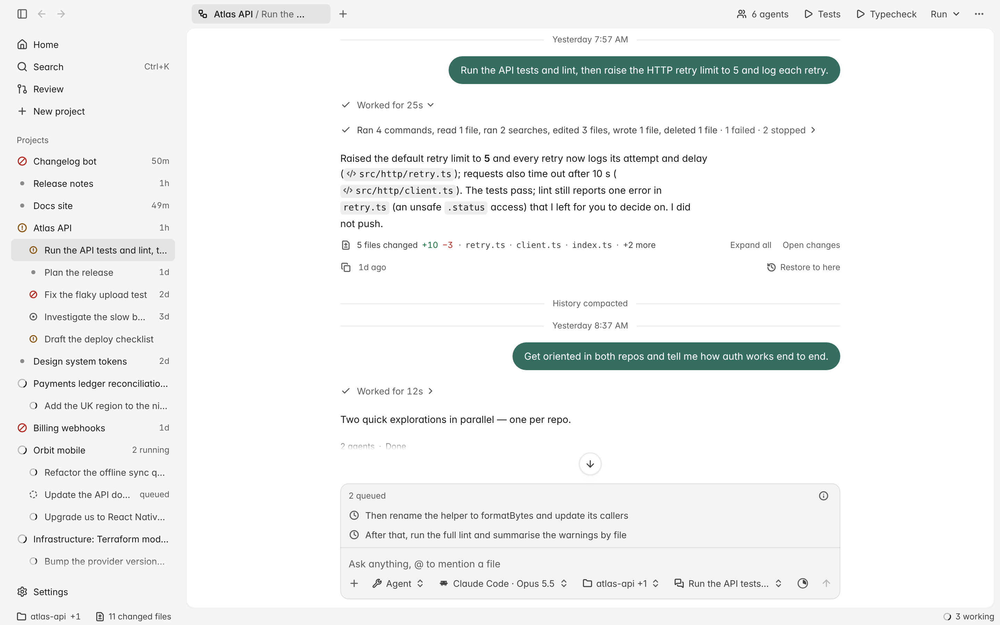

# Octo monorepo

<picture>
  <source media="(prefers-color-scheme: dark)" srcset="./docs/images/octo-dark.png">
  
</picture>

_The desktop app on demo data (`?demo=1`)._

Apps-directory monorepo with shared frontend packages.

| App / package | Path | Description |
| --- | --- | --- |
| **router** (Octo) | [`apps/router/`](./apps/router/) | Rust HTTP proxy for OpenAI / Anthropic / OpenRouter, plus an autoroute model ladder, a price rule, a routing decision for delegated tasks, budgets and a SQLite call history |
| **harness** | [`apps/harness/`](./apps/harness/) | Go project server (`harness serve`): one orchestrator per project (built-in Messages loop or an ACP agent such as Claude Code on a subscription), nested sub-agents, per-project SQLite, memory, changes / approvals / queue, file API, plugins, settings, `harness doctor` |
| **desktop** | [`apps/desktop/`](./apps/desktop/) | Tauri 2 shell for the shared UI; starts the harness and the optional router as sidecars |
| **ui** | [`packages/ui/`](./packages/ui/) | Shared React UI (`@octo/ui`) for the desktop app and the mobile web client |
| **agent-client** | [`packages/agent-client/`](./packages/agent-client/) | Harness bridge client (`@octo/agent-client`): HTTP + SSE, state reducer, message-port bridge |
| **web** | [`apps/web/`](./apps/web/) | Mobile web client (`@octo/web`): the same UI on a phone, served by the harness through Remote access |

## Documentation

| Guide | Contents |
| --- | --- |
| [docs/ARCHITECTURE.md](./docs/ARCHITECTURE.md) | System overview: parts, process diagram, data locations, flows, environment variables, status, specs index |
| [docs/superpowers/HANDOVER.md](./docs/superpowers/HANDOVER.md) | Current state, working rules, next steps |
| [AGENTS.md](./AGENTS.md) | Monorepo map + how agents should work here |
| [apps/router/README.md](./apps/router/README.md) | Octo user guide (curl, Claude Code, history) |
| [apps/router/docs/README.md](./apps/router/docs/README.md) | Product docs index |
| [apps/harness/docs/README.md](./apps/harness/docs/README.md) | Harness product docs index |
| [apps/desktop/docs/architecture.md](./apps/desktop/docs/architecture.md) | Desktop shell + UI boundaries |
| [apps/desktop/README.md](./apps/desktop/README.md) | Run, install, sidecars, quit and kill behaviour |
| [docs/superpowers/specs/](./docs/superpowers/specs/) | Design contracts with "As built" notes (listed in docs/ARCHITECTURE.md) |
| [apps/router/AGENTS.md](./apps/router/AGENTS.md) | Router operational notes for contributors / agents |

## Quick start (router)

```bash
git submodule update --init --recursive
cargo build -p octo
cd apps/router && cargo run
```

Default listen address: `127.0.0.1:8080`. Full setup, config, and examples: [`apps/router/README.md`](./apps/router/README.md).

## Run the whole app

```bash
pnpm install
pnpm dev:all                # harness (no API key needed) + UI at http://localhost:1420 in a browser
pnpm install:app            # build the harness and router sidecars and the Tauri app, then install it
```

### UI tab feature flags (`@octo/ui`)

`@octo/ui` gates dock tool tabs behind UI-only feature flags (`DEFAULT_TAB_FLAGS` in `packages/ui/src/lib/tabFlags.ts`):

- **Disabled by default (`false`):** `sessions` (the `Sessions` dock tool tab and top-bar `Sessions` button/picker), `agents`, `notes`, `details`, `usage`, `memory`.
- **Enabled by default (`true`):** `files`, `browser`, `terminal`, `processes`, `changes`, `review`, `side`.

Left-sidebar project sessions (`SessionTree`), `/new`, session switching, `session:<id>` conversation tabs, sub-agent transcript tabs (`agent:<id>`), `/remember`, and Settings (`Usage and budget`, `Memory`) remain active. These flags are purely client-side in `@octo/ui` and do **not** alter `apps/harness` endpoints, background memory extraction, usage recording, or `@octo/agent-client`. Override in dev/tests via `?tabs=all`, `?tabs=none`, or `?tabs=sessions,usage` (or `OctoApp`'s `tabs` prop).

## Development

Rust workspace root is this directory (`Cargo.toml` members = `apps/router`). Prefer:

```bash
cargo test -p octo
cargo clippy -p octo --all-targets -- -D warnings
```

Run the binary from `apps/router` (or set `OCTO_CONFIG`) so the split `config/` TOML files load from the process cwd.
