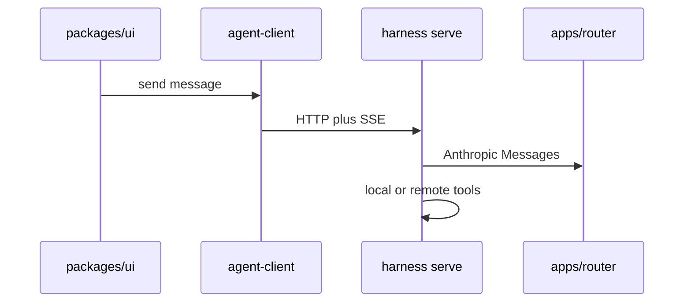

# Desktop app architecture

Tauri 2 **shell** for shared UI. Product screens live in [`packages/ui`](../../../packages/ui); bridge wiring in [`packages/agent-client`](../../../packages/agent-client).

## Boundaries

| Layer | Path | Responsibility |
| --- | --- | --- |
| UI | `packages/ui` | React screens — **no** Tauri APIs |
| Client | `packages/agent-client` | Bridge URL + future HTTP/SSE client |
| Shell | `apps/desktop` | Webview host, OS integration |
| Agent | `apps/harness/` (Phase 2 `serve`) | Tool loop, SQLite sessions |

## Data flow (Phase 2)



## Phase 1

Desktop loads `OctoApp` with `resolveBridgeUrl()` (default `http://127.0.0.1:8790`). Start bridge manually once Phase 2 lands.

## Security

When local tools are enabled via harness on desktop, **`bash`** has full user privileges — same as [`apps/harness/README.md`](../../harness/README.md). The UI must not bypass harness to run shell commands.

## Build

```bash
pnpm install
pnpm --filter @octo/desktop build
cargo check --manifest-path apps/desktop/src-tauri/Cargo.toml
pnpm --filter @octo/desktop tauri dev   # needs OS Tauri prerequisites
```
