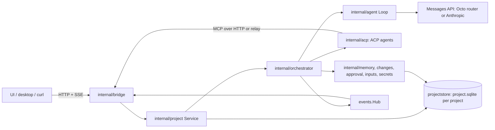
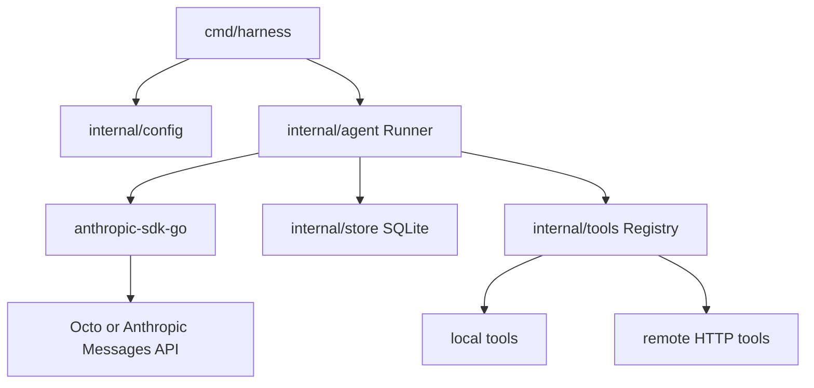
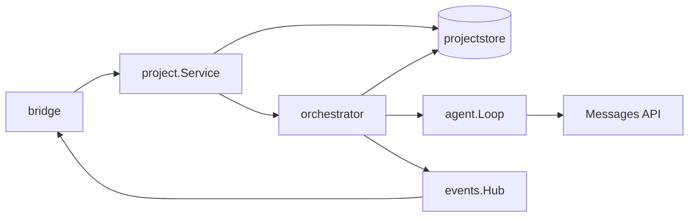

# Harness architecture

Go module: `github.com/ndolinschi/Octo/apps/harness`. A thin **Anthropic Messages tool loop** with workspace file/shell tools, optional HTTP-discovered tools, a legacy one-shot CLI session store, and a project-based HTTP/SSE server (`harness serve`) where a long-lived orchestrator delegates to nested sub-agents. It is a client of any Anthropic-compatible Messages endpoint — usually [Octo router](../../router/) on loopback.

## Runtime shape

Two shapes share the Messages loop. **`harness serve`** (the product) is a project server: the bridge (HTTP + SSE) in front of a service layer, an orchestrator that runs one turn per main session (several sessions of a project at once, within the running caps; `sessions.md`), and the stores:



The **legacy one-shot CLI** (`harness run`, `sessions`, `show`) uses the loop directly with the `harness.sqlite` store:



## Layout

Every package of the module (`go list ./...`, 67 on 2026-11-22). Imports, callers, sizes and test counts per package are in
the module map of [`docs/ARCHITECTURE.md`](../../../docs/ARCHITECTURE.md#module-map); limits and background work in
[`docs/SYSTEM.md`](../../../docs/SYSTEM.md).

| Path | Role |
| --- | --- |
| `cmd/harness` | The binary: `serve` (wires every package below), `doctor`, `mcp-relay`, `run` / `sessions` / `show` (legacy one-shot CLI), `version` |
| `internal/acp` | Agent Client Protocol client: JSON-RPC over a child's stdio, session/new, load, prompt, auth, model selection |
| `internal/acptrace` | Opt-in wire trace of ACP sessions under `{data-dir}/traces/` (redacted, 5 MB x 20 files) |
| `internal/activity` | The one-line "what the agent is doing now" label (Reading x, Running `cmd`) |
| `internal/agent` | The built-in Messages-API tool loop (`agent.Loop`): streaming, concurrent tools, caching breakpoints, compaction, tool-result clearing; `Runner` for the legacy CLI |
| `internal/anthropicclient` | The Anthropic SDK client with base URL, key source and a response observer (rate-limit headers) |
| `internal/apitoken` | The bridge's bearer token: from `HARNESS_API_TOKEN` or generated into `{data-dir}/api-token` |
| `internal/approval` | Pending approval requests and turn grants; one waiting request blocks only its agent |
| `internal/attachments` | Images attached to a message: sniffed type, size, hash name |
| `internal/bridge` | HTTP + SSE server: every `/v1` route, `/health`, `/mcp/...`, CORS, token check, loopback rules |
| `internal/browserproxy` | Loopback reverse proxy for the Browser tab: header stripping, rewriting, inspector injection |
| `internal/budget` | A project's spend: the router's last report, else usage rows plus price estimates |
| `internal/buildinfo` | The version and commit stamped at build time (`harness --version`, `/health`) |
| `internal/cache` | On-disk cache of remote tool manifests |
| `internal/changes` | Change tracker: explicit writes plus before/after snapshots of the folders, pre-images, revert |
| `internal/childenv` | Allow-list environment for every child process (bash, agents, language servers, probes) |
| `internal/codehost` | Code-host adapter for PR review (GitHub through the user's `gh`) |
| `internal/commands` | A project's named commands and ad-hoc runs (Processes tab): start, stream, stop, restart |
| `internal/completion` | Pure part of inline completion: validation, fill-in-the-middle prompt, post-processing |
| `internal/config` | Environment, flags and `harness.env` into `Config`; model tiers; context windows |
| `internal/datalock` | One harness per data directory (OS lock on `harness.lock`) |
| `internal/diag` | The diagnostics report (`harness doctor`, `GET /v1/diagnostics`), scrubbed log ring of 200 lines |
| `internal/diff` | Line counts added/removed between two texts (Myers, bounded) |
| `internal/events` | Per-project event hub with a monotonic `seq` |
| `internal/fakeacp` | Scripted ACP agent for tests and demos (`examples/fakeacp`) |
| `internal/fakelsp` | Scripted language server for tests |
| `internal/fakerouter` | Stand-in Octo router for tests (health, result headers, call records, route, outcomes) |
| `internal/features` | Process-wide feature flags (`HARNESS_FEATURE_AUTO_MEMORY`, `HARNESS_DELEGATION_ESCALATE_ON_FAILURE`) |
| `internal/files` | Confined list/read/write of files under a folder root; refuses writes into `.git` |
| `internal/gitx` | Hardened `git` runner (argv only, no hooks, no fsmonitor): refs, worktrees, branches, diffs |
| `internal/globx` | Doublestar glob matching (approval rules) |
| `internal/inputs` | Forms agents open with `request_input`, incl. JSON-schema forms |
| `internal/instructions` | Reads AGENTS.md / CLAUDE.md of the project folders for the built-in loop |
| `internal/limits` | Latest rate-limit headers per provider and model (memory only) |
| `internal/lsp` | Language-server processes and the stdio relay (frames, never interprets LSP) |
| `internal/mcp` | Small MCP server (Streamable HTTP) that gives an ACP orchestrator the harness's tools |
| `internal/mcprelay` | `harness mcp-relay`: stdio-to-HTTP bridge for agents that only speak stdio MCP |
| `internal/memory` | Orchestrator memory: task records, memory files, search shaping, digest merge, redaction |
| `internal/mockllm` | Scripted Anthropic-compatible Messages server (`examples/mockllm`) |
| `internal/notemd` | Markdown form of a note (front matter + body) and the description index |
| `internal/orchestrator` | Turns per main session, sub-agents, `spawn_agent` incl. `tier: auto`, outcomes and escalation, ACP host and orchestrator, approvals glue, queue, compaction, memory window, side question, modes, recovery |
| `internal/permission` | The one place that answers an ACP agent's permission request |
| `internal/prices` | Optional `prices.toml` of the harness (never the router's) |
| `internal/proctree` | Stops a child with everything it started; `children.json` ledger for leftovers |
| `internal/projcfg` | Shapes of per-project settings kept outside the project row (commands, review config) |
| `internal/project` | Service layer between bridge and orchestrator/store: validation, defaults, files, notes, sessions, branches, workspaces, usage, imports |
| `internal/projectstore` | SQLite: `registry.sqlite` and one `project.sqlite` per project, migrations (schema 15), backups |
| `internal/providers` | "What can run a model now": built-in loop, router, every ACP agent, with states and models; Ollama and loopback probes |
| `internal/remoteaccess` | Remote access: `cloudflared` quick tunnel, second listener, pairing, device tokens, allow-list, long-poll |
| `internal/review` | Pull-request review (RV1): sources, worktrees, viewed marks, findings, comments, submit |
| `internal/review/reviewtest` | Fixtures for review tests (throw-away repo, fake `gh`) |
| `internal/router` | Harness side of the router: detection, hint headers, result headers, call records, spend, route call, outcome reports |
| `internal/secrets` | Per-project secret store (`secrets.json`, 0600) and its redactor |
| `internal/sessionimport` | Imports other tools' sessions (`~/.claude/projects`, `~/.codex/sessions`, ...) |
| `internal/settings` | Backend of the settings screen: the fixed list, `harness.env` writes, apply-now hooks |
| `internal/store` | Legacy CLI session store (`harness.sqlite`) |
| `internal/terminal` | PTY shells per project (Terminal tab) |
| `internal/tools` | Tool registry, result caps, `ToolUseID` |
| `internal/tools/local` | `bash`, `read_file`, `write_file`, `edit`, `list_dir`, `search_files` over labelled, confined roots |
| `internal/tools/remote` | Remote HTTP tool discovery and invocation (`--remote`) |
| `internal/tools/webfetch` | `web_fetch`: one GET, no private addresses unless allowed |
| `internal/usererr` | The error catalogue: message, hint, command, action, details for everything said to a person |
| `examples/fakeacp` | `main` around `internal/fakeacp` |
| `examples/mockllm` | `main` around `internal/mockllm` |
| `examples/remotetool` | Minimal remote tool server (manual demo of `--remote`) |
| `internal/plugins` | Plugin manifests (language servers, ACP agents, tool servers), login and version probes |
| `plugins-examples/subscription-agents` | Embeds the built-in `subscription-agents` manifest (11 ACP agents) |

`plugins-examples/` also holds example manifests that are not loaded unless copied into a plugins directory
(`acp-agents`, `fake-acp`, `go-tools`, `typescript-tools`).

## Conventions

- Cursor rules: `.cursor/rules/octo-go.mdc`, `go-pr-checklist.mdc`, `verify-go.mdc`.
- Soft cap **~250 lines** per `.go` file; split by responsibility.
- All I/O takes `context.Context`; shared state must be race-free.
- Planned project roots for Anthropic-compatible **skills/hooks**: `.agency/` and `.code/` (same shapes as Claude Code: `skills/*/SKILL.md`, hooks in `settings.json`). Loaders stay out of the agent core.

## Project server

The HTTP/SSE bridge contract is described on this page and in [`../../packages/agent-client/AGENTS.md`](../../../packages/agent-client/AGENTS.md).



- One **turn** per main session at a time; several main sessions of a project run at once (schema 15, `sessions.md`), within `session_settings.max_running` per project (default 3) and `HARNESS_MAX_RUNNING_SESSIONS` on the machine (default 6); a message beyond them waits in its session's queue (`waiting_for: "slot"`). Each session has its own root agent, queue, steer box, ACP process and MCP token; per-session state in the orchestrator is keyed by `project/session`. `POST /messages` (the default session) and `POST /sessions/{sid}/messages` persist the user message and run the turn in the background; progress arrives over SSE, each event of a session's work with its `session_id`.
- The orchestrator thread is reloaded from `project.sqlite` every turn. If the previous turn left a `tool_use` without results (cancel/crash), a synthetic `is_error` result is stored before the new user message.
- `spawn_agent` creates the child row (`spawn_tool_use_id` from `tools.ToolUseID(ctx)`), runs the child loop synchronously, and returns its final text. A failed or cancelled child yields an `is_error` tool result; the parent continues. Agents at `depth == max_depth` do not get `spawn_agent`.
- Several tool calls in one assistant message run concurrently (`errgroup`); results keep call order. Parallel `spawn_agent` calls therefore run in parallel, so sibling rows appear in nondeterministic creation order.
- Cancel (`POST /cancel`) or shutdown cancels the turn context; the whole tree stops, running agents become `cancelled`, the orchestrator returns to `idle`, and `turn.finished` is emitted with `cancelled`.
- Orchestrator row: `idle` between turns, `running` during one. A failed turn still ends `idle`; the failure is in its `error` field and in `turn.finished`.
- Startup recovery: agents left `running` become `failed` ("interrupted"); the orchestrator becomes `idle`.
- Stored message content is the SDK `content` array; the API returns normalized `text` / `tool_use` / `tool_result` blocks (empty text skipped, tool_result content flattened to a string).

### Plugins and ACP agents

See [`plugins-examples/README.md`](../plugins-examples/README.md). Examples and the manifest reference: [`plugins-examples/README.md`](../plugins-examples/README.md).

Manifests are read once at startup from `{data-dir}/plugins/*/plugin.json` and every `--plugins-dir` / `HARNESS_PLUGINS_DIR` entry (a plugin directory, or a directory of them), then the embedded `subscription-agents` manifest (`plugins-examples/subscription-agents/embed.go`, `go:embed` of `plugin.json`; `Plugin.Builtin`, `"builtin": true`) unless `--no-builtin-plugins`: a directory plugin of the same name replaces it and an agent id already taken is skipped silently. `plugins.Load` validates names, required fields and ids (first plugin wins; later duplicates are listed in that plugin's `errors`), resolves commands (absolute as is, path separator = relative to the plugin dir, else `PATH`) and sets `available`. A broken manifest becomes an entry with `errors` and no capabilities. `toolServers` are registered on the shared remote registry (sub-agents only); a failure is logged and recorded in `errors`. `GET /v1/plugins` returns `{"plugins": [...]}` (commands, args and env are never exposed); there is no write endpoint. `languageServers` are parsed and exposed (`Registry.LanguageServers`, `LanguageServer(id)`); they are started by the language-server relay below.

`spawn_agent` gains an optional `agent` (enum of available ACP agent ids; omitted from the schema when there are none). The sub-agent row is created as usual with `model = "acp:<id>"`, then `acp.Start` runs the command in the project's first folder (`initialize` with protocol version 1, fs capabilities on, terminal off), `session/new` with `mcpServers: []` (an ACP **sub-agent** gets none of the harness's tools; only an ACP-run *orchestrator* gets the MCP server, see [acp-orchestrator.md](./acp-orchestrator.md)) and one `session/prompt` carrying the task. The orchestrator system prompt names the available agents.

Subscription agents (Copilot, Grok, Codex; [`plugins-examples/subscription-agents`](../plugins-examples/subscription-agents/plugin.json)) added manifest fields `models`, `defaultModel`, `modelArg`, `auth {probe, hint}` and `${NAME}` env references (expanded by `Launch.ResolvedEnv` at spawn; an entry with an unset or empty variable is dropped). `spawn_agent` also accepts `model` for ACP agents: validated against the manifest list (else a free token matching `plugins.ModelPattern`), recorded as `acp:<id>/<model>` on the agent and its usage rows (`acp:<id>` when no model applies; the manifest default counts). `acp.Client.RunWith` takes `RunOptions`: when `session/new` is refused and `initialize` advertised `authMethods`, it calls `authenticate` with the first method of type `agent` (no interaction; `terminal`, `env_var` and unknown types are skipped) and retries once, else fails with `acp.ErrAuthRequired` plus the manifest hint. A requested model is selected through a model config option (`session/set_config_option`), else `session/set_model`, or `modelArg` at start-up; one the orchestrator asked for that cannot be selected fails the sub-agent, a manifest default is best effort. Unknown notifications, session updates and capabilities are ignored. `GET /v1/plugins` agents carry `logged_in`, `models`, `default_model`, `hint`: `Registry.StartProbes` enables the login probes, which run in goroutines when `Plugins()` is called (at most once a minute per agent, 5 s timeout, never awaited by the request).

| ACP | Harness |
| --- | --- |
| `agent_message_chunk` (text) | `message.delta`; accumulated, flushed as a persisted assistant text message before each tool call and at the end |
| `agent_thought_chunk` (text) | `message.thinking_delta {agent_id, text}`, secrets scrubbed; never stored, indexed or part of the transcript |
| `plan` | the whole plan is stored on the agent row (`plan`, schema 4; cleared when the next turn starts) and published as `agent.plan {agent_id, entries:[{content,status,priority}]}` |
| `available_commands_update`, `current_mode_update`, unknown variants | ignored (they still count as a sign of life for the silence watcher) |
| `tool_call` | persisted assistant `tool_use` (`id` = toolCallId, `name` = kind or `tool`, `input` = `{title, raw_input?, locations?}`); `tool.started` |
| `tool_call_update` (any) | `tool.updated {agent_id, tool_use_id, status?, title?, locations?, summary?}` with the fields that changed (summary: first 300 characters of the content); the activity label follows a new title |
| `tool_call_update` completed/failed (or a `tool_call` already terminal) | persisted user `tool_result` (text content and diffs flattened to text, `is_error` when failed); `tool.finished`. Tool calls still open at the end get an error result |
| `usage_update` | ACP reports tokens in context (`used`), not input/output: growth of `used` is added to `input_tokens`; output tokens stay 0 |
| `session/request_permission` | `selected` with the first `allow_once` (else first `allow_always`); logged with the tool title; `cancelled` once cancellation started |
| `fs/read_text_file`, `fs/write_text_file` | absolute path must lie in a project folder (symlinks resolved via `internal/files`), else a JSON-RPC error; `line`/`limit` honoured; writes are atomic, create missing parent directories and publish `file.changed` (`source: "agent"`) |
| other requests | JSON-RPC `-32601` |
| stopReason | `end_turn` completed (final text = last assistant text segment after the last tool call, else all text joined); `cancelled` cancelled; others failed with the reason |

Messages are stored as SDK-shaped content arrays exactly like the built-in loop's, so `GET .../agents/{aid}/messages` and normalization need no special case. Turn cancel or server shutdown cancels the run context: `session/cancel` is sent, the agent gets about 3 s to answer, then its process group is killed; the process is always reaped when the run ends. A crash, protocol error or failed `initialize` fails that sub-agent (stderr tail included in the error) and returns an error result to the parent, which continues.

**Trust:** ACP agents run with the user's privileges. Their permission requests are auto-approved in a project with `access: "full"` and become approval cards in a `supervised` one ([v7.md](./v7.md)). File requests through the client are confined to the project folders, but the agent process itself is not sandboxed. Plugins can only be installed by writing files locally.

### Project storage

```text
{data-dir}/
  harness.sqlite               # legacy CLI sessions
  registry.sqlite              # projects(id, name, created_at)
  projects/{project_id}/project.sqlite
```

`project.sqlite` has 39 tables at schema 15 (`projectstore.SchemaVersion`); the list with the purpose of each, the
migrations and the `.pre-*` backups are in [`docs/SYSTEM.md`](../../../docs/SYSTEM.md#data-model). The block above is the
original layout; `{data-dir}` also holds `harness.env`, `harness.lock`, `api-token`, `children.json`, `traces/`, `remote/`
and per project `shadow/` and `secrets.json`. Each database is opened with WAL, `busy_timeout`, and a single pooled connection, so parallel sub-agents serialize their writes inside the process. Deleting a project removes its directory.

### File API

`folder` is a folder label, `path` is relative to it (`""` = root, forward slashes). Paths are confined exactly like the agents' file tools: traversal, absolute paths and symlink escape give `400 invalid_request`; an unknown project or folder gives `404 not_found`.

| Method | Path | Result |
| --- | --- | --- |
| GET | `/v1/projects/{pid}/files?folder=&path=` | `{ "entries": [{name, path, type: "file"\|"dir", size, chain?}] }` — one level, directories first then by name, `.git` omitted; missing path or not a directory is `404`. `chain` (optional, directories only; 2026-11-19, compact folders) names the directories below the entry while each is the only entry of its parent (`.git` aside) and a real directory, at most 32: `src` → `["main","java","com"]` when `src/main/java/com/` hold nothing else, so a client can draw a compact row with one listing per visible row. A symlinked directory has none and is never descended; an empty `chain` is omitted |
| GET | `/v1/projects/{pid}/files/content?folder=&path=` | `{folder, path, size, mtime, content}`; `mtime` is RFC 3339 with nanoseconds, UTC. `413 file_too_large` over 2 MiB, `415 binary_file` for invalid UTF-8 or NUL bytes, `400` for a directory. `&encoding=base64` returns any file (same roots, path checks and 2 MiB limit, no UTF-8 check) as `{folder, path, size, mtime, content, encoding: "base64"}` with `content` base64-encoded; the UI uses it to preview images; another `encoding` is `400` |
| PUT | `/v1/projects/{pid}/files/content` | body `{folder, path, content, expected_mtime?}` → `{folder, path, size, mtime}`. The parent directory must exist (`404`). `409 file_changed` when `expected_mtime` is set and differs from the current mtime (a missing file counts as changed). Written via temp file + rename in the same directory; an existing file keeps its mode, new files get `0644`. Body cap 3 MiB (`413 file_too_large`). A path with a `.git` segment (any case; also after following symlinks, so a link to `.git` and the `.git` file of a worktree or submodule count) is `400 invalid_request` "Octo does not change files inside .git.": the same refusal (`local.ErrGitPath`, `local.ResolveWritable`) applies to the agents' `write_file` and `edit`, ACP `fs/write_text_file`, reverting a change and rewinding; reading `.git` stays allowed |
| GET | `/v1/projects/{pid}/files/search?q=&mode=&workspace=&limit=` | `{ "matches": [{folder, path, line?, column?, preview?}] }` — `mode=name` (default) searches project file paths across all folders (ranked exact/prefix/substring/subsequence); `mode=content` searches UTF-8 text files (≤ 512 KiB) line-by-line (case-insensitive). Skips `.git`, `node_modules`, `target`, `dist`, `build`, `.next`, `vendor`, `.venv`, `__pycache__`. `limit` defaults to 50 (capped at 200). Invalid `mode` is `400 invalid_request` |
| POST | `/v1/projects/{pid}/files/mkdir` | body `{folder, path, workspace_id?}` → `201 {folder, path}`. Creates directory (and missing parents) confined to the folder root; refuses `.git`, traversal, symlink escape (`400`), existing file/dir (`409 already_exists`), and `@review` (`409 review_workspace_read_only`). Publishes `file.changed` |
| POST | `/v1/projects/{pid}/files/rename` | body `{folder, from, to, workspace_id?}` → `200 {folder, path}`. Renames/moves a file or directory within the folder root; refuses `.git`, traversal, symlink escape (`400`), missing source (`404`), existing target (`409 already_exists`), and `@review` (`409 review_workspace_read_only`). Publishes `file.changed` |
| DELETE | `/v1/projects/{pid}/files/entry?folder=&path=&workspace=` | `204`. Deletes a file or directory recursively within the folder root; refuses root deletion, `.git`, traversal, symlink escape (`400`), missing path (`404`), and `@review` (`409 review_workspace_read_only`). Publishes `file.changed` |

`file.changed` (`{type, seq, folder, path, source: "user"|"agent"}`) is published on the SSE stream after a successful `PUT`, `mkdir`, `rename`, or `DELETE` (`user`) and after an agent's `write_file` call finishes without error (`agent`; the orchestrator decorates the registered tool, so the agent loop knows nothing about files).

### Tools by agent kind

| Tool | Orchestrator | Sub-agent |
| --- | --- | --- |
| `spawn_agent` | yes | yes while `depth < max_depth` |
| `list_dir`, `read_file` | yes | yes |
| `write_file`, `bash` | no | yes |
| `save_note`, `delete_note` | yes | no |
| remote tools (`--remote`) | no | yes |

File and shell tools take an optional `folder` label (defaults to the first folder; the schema only advertises it with 2+ folders). Each root is confined independently (symlink escape rejected). A project with no folders gets no file/shell tools. Model tiers default to `claude-sonnet-5-5` / `claude-haiku-5-5` / `claude-sonnet-5-5` / `claude-opus-5-5` (orchestrator / fast / balanced / deep; the orchestrator was opus before 2026-11-10, and projects created earlier keep their stored `models_json`); override with `HARNESS_MODEL_ORCHESTRATOR|FAST|BALANCED|DEEP` or per project.

### Context breakdown

`GET /v1/projects/{pid}/context[?agent=]` (`orchestrator.Context`, `context.go`) rebuilds what the agent's next request would carry from a snapshot, never taking the turn slot: the system prompt (the orchestrator's split into the static part and the notes block), the serialized tool definitions, and the effective history (`loadHistory`: the latest compaction's summary, then the later messages), counted in characters by kind (text and tool calls as `messages`, tool result text as `tool_results`, the summary message as `summary`). `used_tokens` comes from `DB.LastReportedContext`: the newest API usage row (input + cache read + cache write) of that agent that is not a compaction request, not a side row, not empty, and was recorded after the agent's latest compaction (`compactions.usage_id` marks the newest row at compaction time; rows of databases from before the column fall back to comparing timestamps). With no such row the total is the estimate (`estimated: true`). Parts are the character estimates scaled to the total by largest remainder, so they sum to it exactly. Windows: `config.ContextWindows` (`HARNESS_CONTEXT_WINDOWS`, built-in table intentionally empty), looked up by served model, then requested model, then the ACP agent's reported `context_size`.

### Side question

`POST /v1/projects/{pid}/side` (`orchestrator.Side`, `side.go`) runs one `agent.Loop` outside the turn machinery: it claims a per-project side slot (`o.sides`, never `o.turns`), snapshots the orchestrator's effective history with `loadHistory`, drops a trailing assistant message whose tool calls are unanswered (a turn may be mid-flight), appends the earlier side exchanges from `side_messages` and the new question (merged into a trailing user message so roles alternate), and starts a goroutine under the orchestrator's wait group. The loop has its own registry (`list_dir`, `read_file`, `search_files` over the project folders and `read_notes`; `SideToolNames`; `search_files` is a new read-only tool in `tools/local/search.go`, confined like the others, skipping `.git`, `node_modules`, binaries and symlinks, and deliberately not in `local.AllTools`, so the orchestrator and sub-agent tool sets are unchanged), a system prompt that forbids changes, `MaxTurns = SideMaxRounds + 1` (6 tool rounds, then the answer), the fast model (`models.side` overrides) and router hints role `sub` / depth 1 / tier hint `fast`. Its sink (`side_sink.go`) publishes `side.delta`, stores nothing but the final answer (the orchestrator does the persisting for turns; a side question appends no `messages` row) and records usage through `RecordUsage` with `Role: "side"` (a `usage.role` column; such rows skip the agent's token totals). `side_messages(id, side_id, role, content, created_at)`: a question row is written when the question is accepted and the answer row when it finishes; a failed or cancelled question deletes its question row. `DELETE` cancels the running question (its answer is discarded: the slot entry is removed under the orchestrator mutex, which the finishing goroutine checks before writing) and clears the table. Migration: `side_messages` is `CREATE TABLE IF NOT EXISTS`; `usage.role` and `compactions.usage_id` are added when missing.

## Agent loop (legacy CLI session)

1. Create session row; persist user message.
2. Call Messages API (streaming when `Runner.Stream` is true — CLI `--stream` / `HARNESS_STREAM`, default true).
3. When streaming, write text deltas to **stderr**; accumulate full assistant message for persistence and final stdout.
4. If the model emitted `tool_use` blocks, run handlers, persist tool results, append to context, repeat.
5. Stop on end-turn text or `MaxTurns` (config, env, or `--max-turns`).

What goes back into model context is capped (`internal/tools/cap.go`, constants and `tools.Limits`; overrides `HARNESS_MAX_TOOL_RESULT_BYTES`, `HARNESS_MAX_REPORT_BYTES`, `HARNESS_READ_FILE_LINES`):

- **Tool results: 48 KiB.** The agent loop caps every result (`Limits.CapResult`) before it becomes a `tool_result`, so the stored and the resent message are the capped one. A cut result ends with `[truncated: showed the first N of M bytes; K bytes cut. ...]` and a hint on how to get the rest.
- **`read_file`** takes optional `offset` (1-based first line) and `limit` (lines, default 2000). When the window or the byte cap cuts the file it appends `[read_file: showed lines A-B of TOTAL total. Call read_file again with offset=B+1 to continue.]`.
- **Sub-agent reports: 32 KiB** as returned to the parent by `spawn_agent` (`Limits.CapReport`); the full report stays in the database and the UI.
- Not affected: the UI file API (`internal/files`, `/v1/projects/{id}/files`, 2 MiB) and ACP `fs/read_text_file` (served to the external agent, not the model; it supports `line`/`limit` and stays confined by `locate` + `files.Read`).

### Prompt caching

Every Messages request from the agent loop carries up to three `cache_control: {"type":"ephemeral"}` breakpoints (limit 4): the last tool definition, the last system block, and the last block of the last message. The first two are set once per loop; the third moves every turn, so it is applied at send time to a copy of the final message and is never persisted (`internal/agent/cache.go`). Tools are sorted by name and earlier messages are never rewritten, so each request's prefix is its predecessor's plus appended messages. The orchestrator prompt puts the project notes last, so `save_note` changes only the tail of the system block. Switch: `HARNESS_PROMPT_CACHING=false` or `serve --prompt-caching=false` (for a gateway that rejects the field). Cache tokens are recorded from the response's `cache_read_input_tokens` / `cache_creation_input_tokens` into the usage rows. mockllm models the cache (see the README).

## Local tools

| Tool | Behavior |
| --- | --- |
| `read_file` / `write_file` / `list_dir` | Paths must stay under `--workspace` (symlink escape rejected). |
| `bash` | `bash -c` with cwd = workspace, 30s timeout. **Full host shell privileges** — not a container or syscall sandbox. Commands can read/write anywhere the OS user can. A failed command's result (`is_error: true`) always ends with a line saying how it ended: `exit status N`, or `signal: killed` and the like (with "(timed out after 30s)" on a timeout); the output before it is cut so that line survives the result cap. The UI reads "Failed (exit N)" from it. |

File tools validate paths at resolve time; `bash` does not re-validate paths used inside the command.

## Remote tools

Repeatable `--remote http://host:port` (or env-driven lists in future). Registration:

1. `GET {base}/tools` → JSON manifest (live GET preferred; cache used only on GET failure).
2. Register each tool; name collisions with an already-registered tool are skipped (local wins).
3. Invoke via `POST {base}/tools/{url.PathEscaped(name)}` with 30s HTTP client timeout.

Manifest bytes may be written under `{data-dir}/cache/` after a successful live GET.

## Session store

SQLite file: `{data-dir}/harness.sqlite` (default `./data/harness`).

| Table | Columns |
| --- | --- |
| `sessions` | `id`, `model`, `created_at` |
| `messages` | `session_id`, `role`, `content_json`, `created_at` |

Messages store SDK-shaped JSON from `json.Marshal(anthropic.MessageParam)`. **`harness sessions`** and **`harness show <id>`** read this store; Octo `data/history.sqlite` is separate.

## Talking to Octo

| Mode | `--base-url` | Notes |
| --- | --- | --- |
| Direct Messages | `http://127.0.0.1:8080` | Uses `[llm.messages]` routing in Octo config |
| Autoroute | `http://127.0.0.1:8080/autoroute` | Octo applies ladder / sticky / budget before upstream |

Set `ANTHROPIC_API_KEY` to the key the upstream expects (OpenRouter bearer or Anthropic key, depending on Octo config). When Octo has `server.client_auth_key`, set `HARNESS_OCTO_KEY` or `--octo-key` so the SDK sends `x-octo-key`.

### Working with the Octo router

Code: `internal/router` (detection, hint headers, result headers, call records, spend), `internal/agent/route.go` and `compact.go` (the request path), `internal/budget` (spend), `internal/orchestrator/route.go` (hints, budget gate). Tests use `internal/fakerouter`, a contract-level fake; `scripts/e2e-router.sh` runs the same flows against a real router and a mock upstream.

**Detection.** At start-up `GET {origin of --base-url}/health` (2 s timeout, no `x-octo-key`). `"service":"octo"` turns the integration on and `GET /v1/config` reports `router: true` and `router_capabilities`. When the probe fails the integration stays off and is re-probed in the background at most once a minute (the check runs when `Enabled()` is next asked, never on the request path), so a router started after the harness is found within a minute. Any other service, an error status or an unreachable host leaves the harness exactly as it was without the router: no `x-octo-*` request header is sent (except `x-octo-key` when you configured one) and nothing below applies. Use the router's autoroute path as base URL (`--base-url http://127.0.0.1:8080/autoroute`): the hints and result headers are only on `/autoroute/v1/messages`.

**Hints sent on every Messages request** (older routers ignore unknown headers):

| Header | Value |
| --- | --- |
| `x-octo-budget-key` | the project id, so all agents of a project (orchestrator and every sub-agent) share one budget |
| `x-octo-budget-usd` | the project's `budget_usd`, only when one is set (the router ignores it without the budget key) |
| `x-octo-agent-role` / `x-octo-agent-depth` | `orchestrator` or `sub`; `0`, `1`, ... |
| `x-octo-tier-hint` | the tier the harness would have used: a sub-agent's spawn tier; for the orchestrator the tier whose model it runs on (balanced when it is none of them) |
| `x-octo-tier-policy` | the project's `models.tier_policy`: `auto` (default), `ceiling` (never above the hint), `fixed` (the hint's tier). Validated: anything else is a 400 on create/PATCH |
| `x-octo-task` | sub-agents only: the first 200 characters of the task title, percent-encoded |

**Ledger.** Every usage row gains `served_model`, `tier`, `route_trigger` (stored as the router sent it, no fixed list) and `router_request_id`. After the response body has ended the harness reads `GET /autoroute/v1/calls/{x-octo-request-id}` once, and once more after 200 ms if it was still 404. With the record, `cost_usd` is the router's figure and `cost_estimated` is true when the record's `cost_source` is `estimated`. Without it (record never ready, router old, request failed before the router answered) `cost_usd` stays empty and the usage report estimates it from `prices.toml` by the served model, marked estimated; with no price the cost is unknown (`null`), never 0. A record of `cost_usd: 0` with source `estimated` means the router knew no price and is treated the same way. Failed, rejected and cancelled requests that carry a request id get a row too (tokens from the record, else what the stream had delivered). `/v1/usage?group=model` groups by the served model, falling back to the requested one; `agent_id`, `day` and `project` groups are unchanged. Migration: `ALTER TABLE usage ADD COLUMN` for the five new columns, `project.budget_usd`, and a new `compactions` table, all when missing, so Phase A databases open unchanged.

**Budget.** `PATCH /v1/projects/{id}` takes `budget_usd` (a number > 0, `null` removes it); project JSON returns `budget_usd` and `spent_usd` (the larger of the router's last report for the project, which is the header spend plus the call's cost, and the sum of the usage rows; `null` while nothing has a cost). A 402 from the router settles the agent as failed with `This project's budget is used up ($X of $Y).` (X, Y from the 402's `x-octo-spent-usd` / `x-octo-budget-usd`), the error travels up through every parent, so the turn ends with that message and no further request is made. `spawn_agent` refuses to start a sub-agent once the last known spend is at or over the budget and returns the same message as a tool error. Without a router (or one that does not announce `budget_key`) the harness enforces the budget itself: before every request it sums the project's usage rows (reported costs plus `prices.toml` estimates); unknown prices mean unknown spend and no enforcement.
**Output cap (P2-11).** The gate runs between requests, so one long request could spend well past the budget (owner's
re-test: $0.0011 of a $0.0005 budget). A request's cost is known only when it ends (the usage comes with the end of the
stream), so the built-in loop bounds it before it is sent: with a budget and a `prices.toml` price for the model, a request
asks for `max_tokens` = (budget − spent − estimated input cost) ÷ output price, never below 256 tokens and never above the
default 8192 (`orchestrator/route.go` `outputCap`, `agent.Loop.OutputCap`). An answer that stops at that cap
(`stop_reason: max_tokens`) ends the turn with `BudgetCut` ("…ran out during this request…; the answer was stopped
mid-request.", code `budget_reached`); its text is kept as a `stopped` message (a tool call cut in the middle is dropped).
The overshoot is then at most 256 output tokens plus the request's input. Without a price (or with a router whose model
name has none) nothing is capped and the router's 402 stays the backstop. ACP agents are not capped: the agent CLI
controls its own requests and spend; the harness sees its cost only in `usage_update` and stops at the next turn's gate
(or at a harness tool call over MCP).

**Compaction.** The router answers a compaction with `x-octo-trigger: compact` and the upstream's Messages JSON as a body, never a stream even when one was requested; it succeeded when the status is 2xx and `stop_reason` is `compaction`. The loop reads the summary from the `compaction` content block's `content` string, else the concatenated `text` blocks (`compactionSummary` in `internal/agent/compact.go`, the one function to change if the format changes). A failed compaction ends the turn with an error and leaves the history alone. On success the response is not stored as a message; the summary goes to the `compactions` table (`upto_message_id` = every message stored so far) and the loop continues with a single user message that carries the summary. The raw messages stay in `messages` for the UI. The next turn of the orchestrator rebuilds its history from the latest compaction plus the messages after it (`loadHistory`). The compaction call has its own usage row with trigger `compact`. The sink then publishes `agent.compacted` (`{agent_id, upto_message_id, summary_tokens, at}`, `summary_tokens` estimated from the summary's length) and the transcript endpoint (`GET .../agents/{aid}/messages`) returns the same markers as `compactions` beside `messages`, read from the `compactions` table.

**Automatic choice (I2).** `internal/router/route.go` (`Router.Route`, typed `RouteError`), `internal/orchestrator/auto.go` (candidates from the config, plugins and probes; fallbacks; the `route` usage row) and `spawn.go` (the `auto` tier). With `route_api` announced, `spawn_agent`'s `tier` defaults to `auto`, the harness posts the task and candidates to `/autoroute/v1/route` (timeout `HARNESS_ROUTE_TIMEOUT`, default 2500 ms) and records `route_choice`, `route_reason`, `route_band` and `route_request_id` on the agent row (new nullable `agents` columns, added when missing). Any failure falls back to the default tier with the reason recorded; a 402 is the budget failure. The classifier's cost is a usage row with role `route`. Section "Automatic choice of who does a task (I2)" in the README has the full behaviour.

**Delegation outcomes and escalation (learned-router data path).** Code: `internal/router/outcome.go` (`ReportOutcome`, `SendOutcome`: at most 3 tries, 3 s each, doubling pause from 500 ms, only a connection failure / 5xx / 404 is retried; `SendOutcome` runs in a goroutine bound to the router's lifetime and never blocks or fails the caller), `internal/orchestrator/delegation.go` and `spawn.go` (`runSpawned`, `spawnTarget`). Only when the router announces `route_outcome`, and only for sub-agents the router chose (a `route_request_id`), the harness reports to `POST /autoroute/v1/route/{id}/outcome`:

| Event | When | What it carries |
| --- | --- | --- |
| `finished` | the sub-agent ended | `status` (`completed`, `failed`, `stopped` for the person's stop or a cancelled turn, `timed_out` for too many steps or a deadline, `agent_error`), `agent_signal` (`done`, `could_not` when the report starts with "Could not do it", `none` for no report), `error_kind` (the error catalogue code, `budget`), `usage` (assistant turns, tool calls, failed tool results, tokens and cost summed from the agent's own usage rows; `flat_rate` for a subscription agent), `duration_ms`, `session_id` (the agent id the built-in loop sends as the router session, so the router joins its own test summary; absent for ACP agents, whose traffic does not pass the router). `report_id` `<agent id>:finished` |
| `redelegated` | a later `spawn_agent` under the same parent looks like the same work (same title, or briefs with a word-set Jaccard overlap of at least 0.6) | `by` (the new decision's id), `after_failure`. Matching uses an in-memory log of the last 32 delegations per parent (a restart forgets it) |
| `escalated` | the harness retried it (below) | `by`, `reason` |
| `rewound` | a rewind hides the sub-agent (`RoutedCutIn`, before `RewindIn`) | `report_id` `rewound:<message id>` |
| `reverted` | `POST …/changes/{id}/revert` of a change the sub-agent made (`project.Service.reportRevert`) | `report_id` `reverted:<change id>` |

The route request now also carries `session_id` (the main session) and `task.parent_tier` (the delegating agent's tier hint). The router derives the `solved` label; the harness stores nothing new. The sub-agent prompt asks a built-in sub-agent that cannot do its task to start its report with "Could not do it:"; an ACP sub-agent gets only the brief, so its could-not signal is caught only if it uses that phrase itself.

**Escalation on failure** (policy `delegation.escalate_on_failure`, setting `HARNESS_DELEGATION_ESCALATE_ON_FAILURE`: on = `once`, off = `off`, **default off**, applies at once). When a sub-agent the router chose ends with an agent error, a timeout / too many steps, a non-budget failure, its own "Could not do it", or completes while the router's label for it says `tests_failed` (the harness then waits up to 5 s for the outcome's answer instead of sending it in the background), the harness asks the router again with `attempt: 2`, `escalated_from`, `exclude: [<failed choice>]` and `min_tier: <next tier above the failed one>`, and runs a **fresh** sub-agent with the same brief on the answer. Never for a stopped run or a budget failure, never above `deep` (nothing stronger), never when the budget is reached, never when the router gives no decision (any fallback), and never twice: the retry is not escalated again. The retry's row says so in the text the activity row already shows: `route_reason` = `Retried on <the tier tier | acp:agent> after <reason>. <router's reason>`; the orchestrator's tool result starts with `[The first attempt (<choice>) ended with <reason>; the task was retried once on <…>.]`. Both rows stay in the tree; the first keeps its own failure. Default off because it spends money the person did not ask for (as the router's own budget and the bundled router are opt-in). Tests: `internal/orchestrator/delegation_test.go` (fake router and scripted model: payloads, escalation once, off by default, no second retry, nothing above deep, the tests_failed label, re-delegation, rewind, revert, an ACP sub-agent, a router that answers 503), `internal/router/outcome_test.go`; end to end with the real router: `scripts/e2e-router.sh` cases 7 and 8.

**Without a router** nothing above is sent or recorded except the harness-side budget (`budget_usd`), the `tier_policy` setting (stored, unused) and an empty `served_model`.

## CLI surface

| Command | Purpose |
| --- | --- |
| `harness serve` | Project HTTP + SSE server on `--addr` (default `127.0.0.1:8790`); needs no key (the built-in loop is then unavailable, see README "Running without a key"); reads `{data-dir}/harness.env` |
| `harness run --prompt "…"` | New session, tool loop; session id on stderr, final text on stdout |
| `harness sessions` | JSON list of sessions |
| `harness show <session-id>` | JSON message rows for one session |
| `harness version` / `--version` | Prints `harness 0.2.0 (<commit>)` and exits 0 (`internal/buildinfo`: the default version, `-ldflags -X …buildinfo.Version=… -X …buildinfo.Commit=…` as `scripts/build-sidecar.sh` stamps it, else the commit `go build` recorded). `GET /health` returns `version`, `commit` and, while a router is detected, `router_version` |

Common flags: `--workspace` (`run`), `--base-url`, `--model` (`run`), `--data-dir`, `--remote` (repeatable), `--max-turns`, `--octo-key`. `serve` also takes `--addr`.

### Language servers

Requests go by POST, server messages come by SSE; no WebSocket.

| Method | Path | Result |
| --- | --- | --- |
| GET | `/v1/projects/{pid}/lsp` | `{"servers":[{id,label,languages,available}]}` |
| POST | `/v1/projects/{pid}/lsp/{server}/sessions` | `201 {session_id, root_uri, workspace_folders:[{uri,name}]}`; 404 unknown/unavailable server, 400 project without folders, 429 `too_many_sessions` |
| POST | `/v1/projects/{pid}/lsp/sessions/{sid}/messages` | one JSON object in, `202`; 400 not a JSON object, 404 unknown session (also another project's), 413 `message_too_large` |
| GET | `/v1/projects/{pid}/lsp/sessions/{sid}/events` | SSE: `event: message` (`data` = one compact JSON-RPC message), `: ping` every 15 s, finally `event: exit` `{"code":n}` and the stream ends; 409 `already_subscribed` for a second concurrent stream |
| DELETE | `/v1/projects/{pid}/lsp/sessions/{sid}` | `204`, kills the server |

`lsp.Manager.Start` runs the plugin's command/args/env (plus the inherited environment minus provider keys, endpoints and harness settings; see README, "Running on subscriptions") with the project's first folder as cwd. `root_uri` is that folder as a percent-encoded `file://` URI; `workspace_folders` lists every folder (`name` = folder label). The harness frames stdio (`Content-Length`, a `Content-Type` header is tolerated) and checks JSON validity; it does not interpret LSP. Client writes are serialised by a mutex with a 10 s write deadline.

Lifecycle: a session ends on `DELETE`, when the server process exits (the subscriber gets `exit` with the exit code; `-1` when killed), when no stream has been attached for 30 s after creation or after the stream disconnected (the stream may be re-attached within that window; buffered messages are kept), on a framing error or oversize message from the server, when the subscriber is too slow, and on harness shutdown. Ending kills the process group (unix) and unregisters the session. An `exit` that the harness itself caused carries an extra `reason` string in its data.

Limits: 8 live sessions per project (finished processes do not count), 4 MiB per message in both directions. Backpressure: server messages wait in a buffered channel of 256 messages (`lsp.DefaultBuffer`); the relay never blocks on the subscriber, and when the buffer is full the session is dropped (`reason: "event subscriber too slow..."`) rather than growing without bound. Server stderr goes to `slog` at debug (2000 chars per line, 1 MiB per session).

### Usage, cost and limits


- **Storage.** `projectstore` opens every project database through `migrate`, which is idempotent: `CREATE TABLE IF NOT EXISTS` for the new `usage` table and an `ALTER TABLE agents ADD COLUMN` for `context_used` / `context_size` only when `pragma_table_info` lacks them. `DB.RecordUsage` writes the usage row and adds input/output tokens to the agent totals in one transaction (cache tokens live only in `usage`; the totals are unchanged). Rows: one per model response (`source = "api"`, model = the requested model, cache tokens from `cache_read_input_tokens` / `cache_creation_input_tokens`) or per ACP `usage_update` (`source = "acp"`, token delta approximate as before, `cost_usd` = increase of the USD cost since the previous update; other currencies are ignored; the same transaction stores `context_used` / `context_size`).
- **Aggregation.** `project.Service.Usage` asks each project database for sums grouped by key, model, source and "has reported cost" (`DB.UsageRows`), then merges across projects and applies `prices.Table` to API rows without a reported cost. Handlers only pass the raw query parameters.
- **Prices.** `internal/prices` parses the `prices.toml` subset itself (no TOML dependency); missing or malformed means an empty table.
- **Limits.** `anthropicclient.New(..., WithResponseObserver(fn))` installs an SDK middleware that reports host, requested model and response headers for every response, including 429s. `limits.Store.Observe` parses them and keeps the latest value per provider, model and kind behind a mutex; nothing is persisted. `cmd/harness` is the only place that connects the client, the store and `GET /v1/limits` (`bridge.WithLimits`).


## Live-test fixes (part 0)

- **Flat-rate agents' cost is not spend.** An ACP agent whose manifest says `flatRate: true` reports a USD figure per `usage_update`; it is stored as `cost_usd` with `cost_estimated: true` and the usage field `flat_rate: true`, and left out of `spent_usd`, budget checks and `cost_usd` in `GET /v1/usage`, which reports it as `subscription_equivalent_usd` per bucket (null when none). Other agents keep recording their figure as spend. The agent's counters are cumulative over its session, so the harness records the increase since the previous update; for an ACP orchestrator that state lives with the session and survives turns (before, each turn restarted from zero and recorded the whole session cost again).
- **One budget, one number.** With a router that announces `budget_key`, the router's last reported spend is authoritative: the harness's own figure is that spend or the costs the router reported in call records, never a price-table estimate or a flat-rate figure. The orchestrator's own requests are gated by the same check as delegation (the router's 402 stays as the backstop), and the budget header is read fresh for every request.
- **Refused delegation.** A `spawn_agent` refused because the budget is reached creates its sub-agent row, settled `failed` with the reason (`agent.created` then `agent.updated`), so the delegation never stays "starting".
- **ACP orchestrator calls to harness tools** (`mcp__octo-harness__spawn_agent`, `octo-harness: spawn_agent`, `octo-harness__...`, or a title naming the tool with a raw input that fits its schema) are stored as the tool's own name and arguments; the sub-agent's `spawn_tool_use_id` is matched by arguments (title, task, tier ...) first, timing second.
- **`turn.finished`** is published after the turn's slot is released.
- **Bridge API token.** Every `/v1/**` route needs `Authorization: Bearer <token>` (`internal/bridge/auth.go`, `internal/apitoken`); `/health`, a CORS preflight and the MCP routes are outside it; the two SSE routes also take `?token=`. Token: `HARNESS_API_TOKEN`, else generated per start into `{data-dir}/api-token` (0600); `--no-api-token` / `HARNESS_NO_API_TOKEN=1` switch the check off (the `bridge.New` library default is also "no token", so only `serve` enforces it). Kept from agents: not in the child environment, not in doctor or diagnostics, redacted in ACP traces and the log tail, data dir closed to the file tools. Not stopped: a shell command as the same OS user (see the README).
- **`--exit-on-stdin-close`** (`HARNESS_EXIT_ON_STDIN_CLOSE=1`): graceful shutdown (the SIGTERM path, agents and language servers included) when stdin reaches EOF; off by default.
- **Manifest** `requires` (commands that must be on PATH) and `unavailable_reason` in `GET /v1/plugins`; built-in `strengths` for claude-code, codex (easy, medium, hard) and copilot, cursor (easy, medium).

## Live run 2 (harness)

Router integration behaviour matches [`apps/router/docs/autoroute.md`](../../../apps/router/docs/autoroute.md) and the harness `internal/router` package.

- **One spend number.** With a router that tracks budgets, a project's spend is the highest `x-octo-spent-usd` seen for its budget key (`Router.NoteSpent` keeps the maximum, so two calls that finish out of order cannot lower it); it is never a sum of usage rows, which miss what the router charges for classifying. The header excludes the response it comes with, so after a call the harness uses the call record's `spent_after_usd` (the router sets it for every call charged to a budget key, the key's spend once the call was charged, classifier cost included), else, with an older router, header plus the call's own cost, which can lag by that call's classifier cost until the next call's header. The fake router mirrors the real one (`spent_after_usd` always; `NoSpentAfter` reproduces an older router; `ClassifierUSD` and `DelayFor` make calls overlap and finish out of order); three overlapping calls with classifier cost end with the harness and the router at the same micro-USD (`TestRouterSpendAfterConcurrentCallsFinishingOutOfOrder`). Before the router has reported anything for a key, the reported costs of the rows count.
- **Usage contract.** Every bucket of `GET /v1/usage` has `flat_rate` (the bucket holds flat-rate usage and nothing else), `cost_usd` (money spent: **0, never null, for flat-rate usage**; null only when an API request has no known cost), `subscription_equivalent_usd` (what the flat-rate usage would have cost per token; null when none), and `tokens_estimated`. The real shapes are fixtures, written by the harness's contract test (`TestUsageContract`, `OCTO_UPDATE_FIXTURES=1` regenerates): `packages/agent-client/src/fixtures/usage.api.json`, `usage.flat.json`, `usage.mixed.json`.
- **Flat-rate by environment.** Manifest `billingEnv` lists variables that make a flat-rate agent bill per token when set in the environment it is started with. Grok is `flatRate: true` with `billingEnv: ["XAI_API_KEY"]`. `GET /v1/plugins` shows the effective `flat_rate` (computed from the harness's environment); the usage rows of a spawned agent use the resolved spawn environment (a key passed in `spawn_agent`'s `env` counts).
- **Probes.** `auth.notLoggedInPattern`: a regular expression matched against the output of a probe that exited non-zero; a match means logged out. Exit 0 always wins (decision 2026-11-12: the login probe is advisory, see `providers.md`).
- **Errors for people.** An ACP auth failure (`ErrAuthRequired`, an RPC `-32000 "Authentication required"` and similar texts) becomes `<agent label> is not logged in`; the manifest's login hint travels in its own field: `hint` on `turn.finished`, `error_hint` on the agent row (schema 5), never inside `error`. The "agent returned nothing" and unexpected stop reasons do the same. A sub-agent's failure text in the parent's `spawn_agent` result is the message only.
- **ACP usage.** Output tokens are recorded: the `usage` of the `session/prompt` response when the agent sends it (`outputTokens` plus `thoughtTokens`), else an estimate from the text streamed (runes / 4), with `tokens_estimated` set on the row and the bucket. They are added to the turn's last usage row (or a row of their own when the turn had none), so a turn is still one group of rows.
- **Cancelled turns.** The text an agent had written is stored as an assistant message with `stopped: true` (the built-in loop's streamed text and an ACP agent's flushed text alike); `message.created` carries the flag and `turn.finished` says `cancelled`. A tool call that is announced without input and given it by a `tool_call_update` keeps the input: the stored `tool_use` row is rewritten and `message.updated {message}` is published (`spawn_agent` rows of an ACP orchestrator were stored as `""`).
- **Trace.** The ACP wire trace also redacts e-mail addresses.
- **Doctor, memory and search:** see the README ("Diagnostics") and `memory.md` ("Task records over a turn"). Schema version 5 added `agents.error_hint`, `messages.stopped`, `usage.tokens_estimated` and the `search_s` index (rebuilt from the stored documents when an older database opens).

## Added 2026-11-14: durability of a running turn, the event stream, one service per data folder

- **Checkpoints.** While an agent streams, its redacted partial text is written to `partials` (one row per agent) at most
  every 500 ms, and a running turn stamps `turn_alive` every 5 s. The write runs on its own goroutine, never in the path that publishes a delta: a slow disk does not hold the stream back. Storing the message clears the row; a row older than
  the agent's last message is ignored.
- **Recovery on start** (`orchestrator/recover.go`, before the rows are settled): open tool calls of running agents get
  the interruption result, a valid checkpoint becomes the assistant message (flagged `stopped`, which now means "cut
  short" for cancelled, failed and recovered turns), the orchestrator row gets `turn_interrupted`, and the exchange is
  recorded `failed` with `interrupted: true` and a duration up to the last sign of life. A failed stream keeps its
  partial text too. The tables and the `exchanges.interrupted` column are additive; the schema number did not change.
- **Event stream.** `event: heartbeat` (`data: {}`, no id) every 15 s instead of a comment; `retry: 1000` at the start.
  Events are not replayed (`Last-Event-ID` is ignored): clients re-read after a reconnect. CORS exposes `Date`.
- **Data-folder lock** (`internal/datalock`): `harness serve` takes an OS lock on `<data-dir>/harness.lock` before the
  store is opened (flock on Unix; a no-share open on Windows, compiled but not run; none elsewhere) and refuses a second
  service with `data_dir_in_use`. A killed holder leaves no stale lock.
- **Mock model:** the `[essay]` marker gives a long answer with no tools.


## Added 2026-11-14: remote access

`internal/remoteaccess` ([remote-access.md](./remote-access.md), spec `2026-11-14-remote-access-mobile-design.md`). Off
after every start. `bridge.NewAPI` builds the bridge's routes with no token, CORS, MCP or mounts as the inner handler of
the tunnel listener, which authenticates device tokens itself and lets requests through by an allow-list that denies by
default; `bridge.WithMount` puts the `/v1/remote` control routes on the main bridge behind the local token. The local
token never works on the tunnel listener, and no loopback check counts there (every request comes from `cloudflared` on
`127.0.0.1`). `harness doctor` and `GET /v1/diagnostics` report `cloudflared`. Event `remote.changed`.

## Added 2026-11-19: child processes end with their terminal and with the harness

`internal/proctree`. Every terminal shell (PTY, `setsid` + controlling tty) and every Processes run (`bash -c`, now `setsid`
instead of `setpgid`) is a session leader. A shell's background jobs (`sleep 777 &`, `python3 -m http.server &`) get process
groups of their own under job control but keep the shell's session id, also after the shell exits and they are re-parented.
Closing a terminal (`DELETE …/terminals/{tid}`, the idle timeout, the shell's own exit), stopping a run and shutting the
harness down (SIGTERM, SIGINT, stdin closed) signal every process of the session plus every descendant of the leader (one that
called `setsid` itself): SIGHUP, SIGTERM and SIGCONT, then SIGKILL after 2 s (`proctree.KillSession`; runs keep their own
3 s grace between SIGTERM and SIGKILL). The list is read from `/proc` on Linux and from `ps` + `getsid` on macOS.

A SIGKILLed harness runs no code, so its children are recorded in `{data-dir}/children.json` (pid, start time, kind) while
they run. At the next start, before the store opens, every recorded pid whose start time still matches is stopped the same
way (log `WARN stopped a process left running by a previous harness`); a pid now owned by another process (start time
differs) is never touched. Leftovers are stopped, not re-adopted: a terminal's PTY and a run's output pipes died with the old
process, so nothing could show them; the run's row is marked interrupted by `commands.Recover` as before.
`PR_SET_PDEATHSIG` is not used: it fires when the forking OS thread exits, which Go does not pin, and it would reach only the
leader, not its jobs. macOS has no equivalent at all, so there the start-up reap is the only net. Windows is unchanged (the
leader alone is killed; nothing is recorded).

The desktop shell stops the harness's process group (SIGTERM, then SIGKILL after 3 s). Terminal shells and runs are in their
own sessions, outside that group, so they are stopped by the harness's shutdown on SIGTERM, or, when the 3 s SIGKILL comes
first, by the next start's reap. Tests: `internal/proctree` (session after the leader exited, descendants that called
`setsid`, the ledger reaping only matching pids), `internal/terminal/leftovers_test.go` (close and shutdown with `&` and
`nohup` jobs in an interactive bash), `internal/commands/session_unix_test.go`.

## Added 2026-11-19: start-up messages

- A non-loopback `--addr` (`0.0.0.0`, a LAN address) starts as before, with every `/v1` route still behind the API token,
  and logs `WARN listening on a non-loopback address: other computers on the network can reach the harness; /v1 routes
  still require the API token`.
- A data folder that cannot be written (read-only disk, wrong owner) stops the start with the catalogue case
  `data_dir_unwritable`: "Octo cannot write to its data folder. Give your user write access to the folder in details, or
  start Octo with another data folder. (<dir>: <error>)" instead of only `lock …: permission denied`.
- `.pre-m6` / `.pre-v15` migration backups beside `project.sqlite` are kept; nothing removes them (docs/ARCHITECTURE.md,
  data locations).
