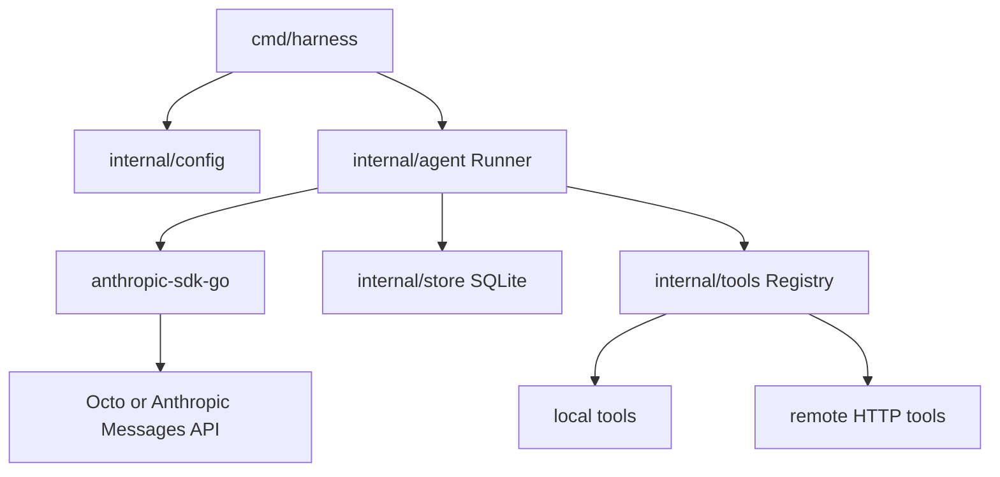
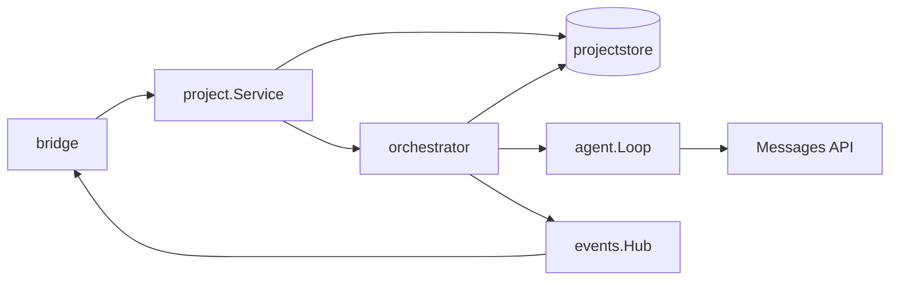

# Harness architecture

Go module: `github.com/ndolinschi/Octo/apps/harness`. A thin **Anthropic Messages tool loop** with workspace file/shell tools, optional HTTP-discovered tools, a legacy one-shot CLI session store, and a project-based HTTP/SSE server (`harness serve`) where a long-lived orchestrator delegates to nested sub-agents. It is a client of any Anthropic-compatible Messages endpoint — usually [Octo router](../router/) on loopback.

## Runtime shape



## Layout

| Path | Role |
| --- | --- |
| `cmd/harness` | CLI: `serve`, `run`, `sessions`, `show` (wiring only; `serve.go` is the one wiring site for the server) |
| `internal/config` | Env defaults (`ANTHROPIC_*`, `HARNESS_*`), model tiers |
| `internal/anthropicclient` | SDK client + optional `ANTHROPIC_BASE_URL` |
| `internal/agent` | `Loop`: system prompt, history, streaming, concurrent tools, usage, `Sink`; `Runner` = legacy CLI session |
| `internal/store` | Legacy `harness.sqlite`: sessions + message JSON blobs |
| `internal/projectstore` | `registry.sqlite` + per-project `project.sqlite` (projects, folders, agents, messages, notes); no SDK/agent imports |
| `internal/events` | Per-project pub/sub hub with in-memory `seq` |
| `internal/orchestrator` | Turn lifecycle, `spawn_agent`, note tools, system prompts, tool sets per agent kind, cancel/shutdown |
| `internal/files` | Confined list / read / atomic write of files under a folder root (reuses `tools/local` path confinement) |
| `internal/project` | Service layer: validation, defaults, notes, files, error kinds the bridge maps to HTTP |
| `internal/bridge` | `net/http` handlers (Go 1.22 `ServeMux` patterns), SSE, CORS, JSON errors |
| `internal/plugins` | Loads `plugin.json` manifests (language servers, ACP agents, tool servers) into an immutable `Registry`; resolves commands and `available`; never executes anything |
| `internal/acp` | Agent Client Protocol client: process lifecycle, ndjson JSON-RPC connection, typed protocol structs, `Client.Run` with a `Handler` the orchestrator implements; no project/orchestrator imports |
| `internal/lsp` | Language-server relay, HTTP-agnostic: `Manager` of `Session`s (process + LSP `Content-Length` framing, bounded event buffer, idle reaping, process-group kill). Frames and validates JSON only; never interprets LSP |
| `internal/fakelsp` | Scripted language server for tests (re-exec of the test binary) |
| `internal/fakeacp` | Scripted ACP agent for tests and demos (`examples/fakeacp` is its `main`); env switches advertise auth methods, models and refuse unknown models |
| `internal/mockllm` | Scripted Anthropic-compatible Messages server (used by tests and `examples/mockllm`) |
| `internal/tools` | Registry → Anthropic tool defs; `ToolUseID(ctx)` for handlers |
| `internal/tools/local` | `bash`, `read_file`, `write_file`, `list_dir` over one or more labelled roots |
| `internal/tools/remote` | `GET {base}/tools` discovery, `POST {base}/tools/{name}` invoke |
| `internal/cache` | On-disk cache for remote manifests (fallback when GET fails) |
| `examples/remotetool` | Minimal remote tool server |
| `examples/mockllm` | Thin `main` around `internal/mockllm` |
| `examples/fakeacp` | Thin `main` around `internal/fakeacp` |
| `plugins-examples` | Example manifests (not loaded automatically) |

## Conventions

- Cursor rules: `.cursor/rules/octo-go.mdc`, `go-pr-checklist.mdc`, `verify-go.mdc`.
- Soft cap **~250 lines** per `.go` file; split by responsibility.
- All I/O takes `context.Context`; shared state must be race-free.
- Planned project roots for Anthropic-compatible **skills/hooks**: `.agency/` and `.code/` (same shapes as Claude Code: `skills/*/SKILL.md`, hooks in `settings.json`). Loaders stay out of the agent core.

## Project server

Spec and HTTP/SSE contract: [`docs/superpowers/specs/2026-11-10-project-harness-design.md`](../../../docs/superpowers/specs/2026-11-10-project-harness-design.md).



- One **turn** per project at a time (`409 turn_in_progress`). `POST /messages` persists the user message and runs the turn in the background; progress arrives over SSE.
- The orchestrator thread is reloaded from `project.sqlite` every turn. If the previous turn left a `tool_use` without results (cancel/crash), a synthetic `is_error` result is stored before the new user message.
- `spawn_agent` creates the child row (`spawn_tool_use_id` from `tools.ToolUseID(ctx)`), runs the child loop synchronously, and returns its final text. A failed or cancelled child yields an `is_error` tool result; the parent continues. Agents at `depth == max_depth` do not get `spawn_agent`.
- Several tool calls in one assistant message run concurrently (`errgroup`); results keep call order. Parallel `spawn_agent` calls therefore run in parallel, so sibling rows appear in nondeterministic creation order.
- Cancel (`POST /cancel`) or shutdown cancels the turn context; the whole tree stops, running agents become `cancelled`, the orchestrator returns to `idle`, and `turn.finished` is emitted with `cancelled`.
- Orchestrator row: `idle` between turns, `running` during one. A failed turn still ends `idle`; the failure is in its `error` field and in `turn.finished`.
- Startup recovery: agents left `running` become `failed` ("interrupted"); the orchestrator becomes `idle`.
- Stored message content is the SDK `content` array; the API returns normalized `text` / `tool_use` / `tool_result` blocks (empty text skipped, tool_result content flattened to a string).

### Plugins and ACP agents

Specs: [`2026-11-10-workspace-plugins-acp-design.md`](../../../docs/superpowers/specs/2026-11-10-workspace-plugins-acp-design.md) §1-2. Examples and the manifest reference: [`plugins-examples/README.md`](../plugins-examples/README.md).

Manifests are read once at startup from `{data-dir}/plugins/*/plugin.json` and every `--plugins-dir` / `HARNESS_PLUGINS_DIR` entry (a plugin directory, or a directory of them). `plugins.Load` validates names, required fields and ids (first plugin wins; later duplicates are listed in that plugin's `errors`), resolves commands (absolute as is, path separator = relative to the plugin dir, else `PATH`) and sets `available`. A broken manifest becomes an entry with `errors` and no capabilities. `toolServers` are registered on the shared remote registry (sub-agents only); a failure is logged and recorded in `errors`. `GET /v1/plugins` returns `{"plugins": [...]}` (commands, args and env are never exposed); there is no write endpoint. `languageServers` are parsed and exposed (`Registry.LanguageServers`, `LanguageServer(id)`); they are started by the language-server relay below.

`spawn_agent` gains an optional `agent` (enum of available ACP agent ids; omitted from the schema when there are none). The sub-agent row is created as usual with `model = "acp:<id>"`, then `acp.Start` runs the command in the project's first folder (`initialize` with protocol version 1, fs capabilities on, terminal off), `session/new` (`mcpServers: []`) and one `session/prompt` carrying the task. The orchestrator system prompt names the available agents.

Subscription agents (Copilot, Grok, Codex; [`plugins-examples/subscription-agents`](../plugins-examples/subscription-agents/plugin.json)) added manifest fields `models`, `defaultModel`, `modelArg`, `auth {probe, hint}` and `${NAME}` env references (expanded by `Launch.ResolvedEnv` at spawn; an entry with an unset or empty variable is dropped). `spawn_agent` also accepts `model` for ACP agents: validated against the manifest list (else a free token matching `plugins.ModelPattern`), recorded as `acp:<id>/<model>` on the agent and its usage rows (`acp:<id>` when no model applies; the manifest default counts). `acp.Client.RunWith` takes `RunOptions`: when `session/new` is refused and `initialize` advertised `authMethods`, it calls `authenticate` with the first method of type `agent` (no interaction; `terminal`, `env_var` and unknown types are skipped) and retries once, else fails with `acp.ErrAuthRequired` plus the manifest hint. A requested model is selected through a model config option (`session/set_config_option`), else `session/set_model`, or `modelArg` at start-up; one the orchestrator asked for that cannot be selected fails the sub-agent, a manifest default is best effort. Unknown notifications, session updates and capabilities are ignored. `GET /v1/plugins` agents carry `logged_in`, `models`, `default_model`, `hint`: `Registry.StartProbes` enables the login probes, which run in goroutines when `Plugins()` is called (at most once a minute per agent, 5 s timeout, never awaited by the request).

| ACP | Harness |
| --- | --- |
| `agent_message_chunk` (text) | `message.delta`; accumulated, flushed as a persisted assistant text message before each tool call and at the end |
| `agent_thought_chunk`, plans, unknown variants | ignored |
| `tool_call` | persisted assistant `tool_use` (`id` = toolCallId, `name` = kind or `tool`, `input` = `{title, raw_input?, locations?}`); `tool.started` |
| `tool_call_update` completed/failed (or a `tool_call` already terminal) | persisted user `tool_result` (text content and diffs flattened to text, `is_error` when failed); `tool.finished`. Tool calls still open at the end get an error result |
| `usage_update` | ACP reports tokens in context (`used`), not input/output: growth of `used` is added to `input_tokens`; output tokens stay 0 |
| `session/request_permission` | `selected` with the first `allow_once` (else first `allow_always`); logged with the tool title; `cancelled` once cancellation started |
| `fs/read_text_file`, `fs/write_text_file` | absolute path must lie in a project folder (symlinks resolved via `internal/files`), else a JSON-RPC error; `line`/`limit` honoured; writes are atomic, create missing parent directories and publish `file.changed` (`source: "agent"`) |
| other requests | JSON-RPC `-32601` |
| stopReason | `end_turn` completed (final text = last assistant text segment after the last tool call, else all text joined); `cancelled` cancelled; others failed with the reason |

Messages are stored as SDK-shaped content arrays exactly like the built-in loop's, so `GET .../agents/{aid}/messages` and normalization need no special case. Turn cancel or server shutdown cancels the run context: `session/cancel` is sent, the agent gets about 3 s to answer, then its process group is killed; the process is always reaped when the run ends. A crash, protocol error or failed `initialize` fails that sub-agent (stderr tail included in the error) and returns an error result to the parent, which continues.

**Trust:** ACP agents run with the user's privileges and are auto-approved for tool permissions. File requests through the client are confined to the project folders, but the agent process itself is not sandboxed. Plugins can only be installed by writing files locally.

### Project storage

```text
{data-dir}/
  harness.sqlite               # legacy CLI sessions
  registry.sqlite              # projects(id, name, created_at)
  projects/{project_id}/project.sqlite
```

Tables in `project.sqlite`: `project` (one row), `folders`, `agents`, `messages`, `notes` (columns per the spec). Each database is opened with WAL, `busy_timeout`, and a single pooled connection, so parallel sub-agents serialize their writes inside the process. Deleting a project removes its directory.

### File API

Design: [`docs/superpowers/specs/2026-11-10-code-pane-design.md`](../../../docs/superpowers/specs/2026-11-10-code-pane-design.md). `folder` is a folder label, `path` is relative to it (`""` = root, forward slashes). Paths are confined exactly like the agents' file tools: traversal, absolute paths and symlink escape give `400 invalid_request`; an unknown project or folder gives `404 not_found`.

| Method | Path | Result |
| --- | --- | --- |
| GET | `/v1/projects/{pid}/files?folder=&path=` | `{ "entries": [{name, path, type: "file"\|"dir", size}] }` — one level, directories first then by name, `.git` omitted; missing path or not a directory is `404` |
| GET | `/v1/projects/{pid}/files/content?folder=&path=` | `{folder, path, size, mtime, content}`; `mtime` is RFC 3339 with nanoseconds, UTC. `413 file_too_large` over 2 MiB, `415 binary_file` for invalid UTF-8 or NUL bytes, `400` for a directory |
| PUT | `/v1/projects/{pid}/files/content` | body `{folder, path, content, expected_mtime?}` → `{folder, path, size, mtime}`. The parent directory must exist (`404`). `409 file_changed` when `expected_mtime` is set and differs from the current mtime (a missing file counts as changed). Written via temp file + rename in the same directory; an existing file keeps its mode, new files get `0644`. Body cap 3 MiB (`413 file_too_large`) |

`file.changed` (`{type, seq, folder, path, source: "user"|"agent"}`) is published on the SSE stream after a successful `PUT` (`user`) and after an agent's `write_file` call finishes without error (`agent`; the orchestrator decorates the registered tool, so the agent loop knows nothing about files).

### Tools by agent kind

| Tool | Orchestrator | Sub-agent |
| --- | --- | --- |
| `spawn_agent` | yes | yes while `depth < max_depth` |
| `list_dir`, `read_file` | yes | yes |
| `write_file`, `bash` | no | yes |
| `save_note`, `delete_note` | yes | no |
| remote tools (`--remote`) | no | yes |

File and shell tools take an optional `folder` label (defaults to the first folder; the schema only advertises it with 2+ folders). Each root is confined independently (symlink escape rejected). A project with no folders gets no file/shell tools. Model tiers default to `claude-sonnet-5-5` / `claude-haiku-5-5` / `claude-sonnet-5-5` / `claude-opus-5-5` (orchestrator / fast / balanced / deep; the orchestrator was opus before 2026-11-10, and projects created earlier keep their stored `models_json`); override with `HARNESS_MODEL_ORCHESTRATOR|FAST|BALANCED|DEEP` or per project.

## Agent loop (legacy CLI session)

1. Create session row; persist user message.
2. Call Messages API (streaming when `Runner.Stream` is true — CLI `--stream` / `HARNESS_STREAM`, default true).
3. When streaming, write text deltas to **stderr**; accumulate full assistant message for persistence and final stdout.
4. If the model emitted `tool_use` blocks, run handlers, persist tool results, append to context, repeat.
5. Stop on end-turn text or `MaxTurns` (config, env, or `--max-turns`).

What goes back into model context is capped (`internal/tools/cap.go`, constants and `tools.Limits`; overrides `HARNESS_MAX_TOOL_RESULT_BYTES`, `HARNESS_MAX_REPORT_BYTES`, `HARNESS_READ_FILE_LINES`):

- **Tool results: 48 KiB.** The agent loop caps every result (`Limits.CapResult`) before it becomes a `tool_result`, so the stored and the resent message are the capped one. A cut result ends with `[truncated: showed the first N of M bytes; K bytes cut. ...]` and a hint on how to get the rest.
- **`read_file`** takes optional `offset` (1-based first line) and `limit` (lines, default 2000). When the window or the byte cap cuts the file it appends `[read_file: showed lines A-B of TOTAL total. Call read_file again with offset=B+1 to continue.]`.
- **Sub-agent reports: 32 KiB** as returned to the parent by `spawn_agent` (`Limits.CapReport`); the full report stays in the database and the UI.
- Not affected: the UI file API (`internal/files`, `/v1/projects/{id}/files`, 2 MiB) and ACP `fs/read_text_file` (served to the external agent, not the model; it supports `line`/`limit` and stays confined by `locate` + `files.Read`).

### Prompt caching

Every Messages request from the agent loop carries up to three `cache_control: {"type":"ephemeral"}` breakpoints (limit 4): the last tool definition, the last system block, and the last block of the last message. The first two are set once per loop; the third moves every turn, so it is applied at send time to a copy of the final message and is never persisted (`internal/agent/cache.go`). Tools are sorted by name and earlier messages are never rewritten, so each request's prefix is its predecessor's plus appended messages. The orchestrator prompt puts the project notes last, so `save_note` changes only the tail of the system block. Switch: `HARNESS_PROMPT_CACHING=false` or `serve --prompt-caching=false` (for a gateway that rejects the field). Cache tokens are recorded from the response's `cache_read_input_tokens` / `cache_creation_input_tokens` into the usage rows. mockllm models the cache (see the README).

## Local tools

| Tool | Behavior |
| --- | --- |
| `read_file` / `write_file` / `list_dir` | Paths must stay under `--workspace` (symlink escape rejected). |
| `bash` | `bash -c` with cwd = workspace, 30s timeout. **Full host shell privileges** — not a container or syscall sandbox. Commands can read/write anywhere the OS user can. |

File tools validate paths at resolve time; `bash` does not re-validate paths used inside the command.

## Remote tools

Repeatable `--remote http://host:port` (or env-driven lists in future). Registration:

1. `GET {base}/tools` → JSON manifest (live GET preferred; cache used only on GET failure).
2. Register each tool; name collisions with an already-registered tool are skipped (local wins).
3. Invoke via `POST {base}/tools/{url.PathEscaped(name)}` with 30s HTTP client timeout.

Manifest bytes may be written under `{data-dir}/cache/` after a successful live GET.

## Session store

SQLite file: `{data-dir}/harness.sqlite` (default `./data/harness`).

| Table | Columns |
| --- | --- |
| `sessions` | `id`, `model`, `created_at` |
| `messages` | `session_id`, `role`, `content_json`, `created_at` |

Messages store SDK-shaped JSON from `json.Marshal(anthropic.MessageParam)`. **`harness sessions`** and **`harness show <id>`** read this store; Octo `data/history.sqlite` is separate.

## Talking to Octo

| Mode | `--base-url` | Notes |
| --- | --- | --- |
| Direct Messages | `http://127.0.0.1:8080` | Uses `[llm.messages]` routing in Octo config |
| Autoroute | `http://127.0.0.1:8080/autoroute` | Octo applies ladder / sticky / budget before upstream |

Set `ANTHROPIC_API_KEY` to the key the upstream expects (OpenRouter bearer or Anthropic key, depending on Octo config). When Octo has `server.client_auth_key`, set `HARNESS_OCTO_KEY` or `--octo-key` so the SDK sends `x-octo-key`.

## CLI surface

| Command | Purpose |
| --- | --- |
| `harness serve` | Project HTTP + SSE server on `--addr` (default `127.0.0.1:8790`); requires `ANTHROPIC_API_KEY` |
| `harness run --prompt "…"` | New session, tool loop; session id on stderr, final text on stdout |
| `harness sessions` | JSON list of sessions |
| `harness show <session-id>` | JSON message rows for one session |

Common flags: `--workspace` (`run`), `--base-url`, `--model` (`run`), `--data-dir`, `--remote` (repeatable), `--max-turns`, `--octo-key`. `serve` also takes `--addr`.

### Language servers

Spec: [`2026-11-10-workspace-plugins-acp-design.md`](../../../docs/superpowers/specs/2026-11-10-workspace-plugins-acp-design.md) §3. Requests go by POST, server messages come by SSE; no WebSocket.

| Method | Path | Result |
| --- | --- | --- |
| GET | `/v1/projects/{pid}/lsp` | `{"servers":[{id,label,languages,available}]}` |
| POST | `/v1/projects/{pid}/lsp/{server}/sessions` | `201 {session_id, root_uri, workspace_folders:[{uri,name}]}`; 404 unknown/unavailable server, 400 project without folders, 429 `too_many_sessions` |
| POST | `/v1/projects/{pid}/lsp/sessions/{sid}/messages` | one JSON object in, `202`; 400 not a JSON object, 404 unknown session (also another project's), 413 `message_too_large` |
| GET | `/v1/projects/{pid}/lsp/sessions/{sid}/events` | SSE: `event: message` (`data` = one compact JSON-RPC message), `: ping` every 15 s, finally `event: exit` `{"code":n}` and the stream ends; 409 `already_subscribed` for a second concurrent stream |
| DELETE | `/v1/projects/{pid}/lsp/sessions/{sid}` | `204`, kills the server |

`lsp.Manager.Start` runs the plugin's command/args/env (plus the inherited environment) with the project's first folder as cwd. `root_uri` is that folder as a percent-encoded `file://` URI; `workspace_folders` lists every folder (`name` = folder label). The harness frames stdio (`Content-Length`, a `Content-Type` header is tolerated) and checks JSON validity; it does not interpret LSP. Client writes are serialised by a mutex with a 10 s write deadline.

Lifecycle: a session ends on `DELETE`, when the server process exits (the subscriber gets `exit` with the exit code; `-1` when killed), when no stream has been attached for 30 s after creation or after the stream disconnected (the stream may be re-attached within that window; buffered messages are kept), on a framing error or oversize message from the server, when the subscriber is too slow, and on harness shutdown. Ending kills the process group (unix) and unregisters the session. An `exit` that the harness itself caused carries an extra `reason` string in its data.

Limits: 8 live sessions per project (finished processes do not count), 4 MiB per message in both directions. Backpressure: server messages wait in a buffered channel of 256 messages (`lsp.DefaultBuffer`); the relay never blocks on the subscriber, and when the buffer is full the session is dropped (`reason: "event subscriber too slow..."`) rather than growing without bound. Server stderr goes to `slog` at debug (2000 chars per line, 1 MiB per session).

### Usage, cost and limits

Spec: [`2026-11-10-usage-design.md`](../../../docs/superpowers/specs/2026-11-10-usage-design.md) (Phase A contract).

- **Storage.** `projectstore` opens every project database through `migrate`, which is idempotent: `CREATE TABLE IF NOT EXISTS` for the new `usage` table and an `ALTER TABLE agents ADD COLUMN` for `context_used` / `context_size` only when `pragma_table_info` lacks them. `DB.RecordUsage` writes the usage row and adds input/output tokens to the agent totals in one transaction (cache tokens live only in `usage`; the totals are unchanged). Rows: one per model response (`source = "api"`, model = the requested model, cache tokens from `cache_read_input_tokens` / `cache_creation_input_tokens`) or per ACP `usage_update` (`source = "acp"`, token delta approximate as before, `cost_usd` = increase of the USD cost since the previous update; other currencies are ignored; the same transaction stores `context_used` / `context_size`).
- **Aggregation.** `project.Service.Usage` asks each project database for sums grouped by key, model, source and "has reported cost" (`DB.UsageRows`), then merges across projects and applies `prices.Table` to API rows without a reported cost. Handlers only pass the raw query parameters.
- **Prices.** `internal/prices` parses the `prices.toml` subset itself (no TOML dependency); missing or malformed means an empty table.
- **Limits.** `anthropicclient.New(..., WithResponseObserver(fn))` installs an SDK middleware that reports host, requested model and response headers for every response, including 429s. `limits.Store.Observe` parses them and keeps the latest value per provider, model and kind behind a mutex; nothing is persisted. `cmd/harness` is the only place that connects the client, the store and `GET /v1/limits` (`bridge.WithLimits`).
