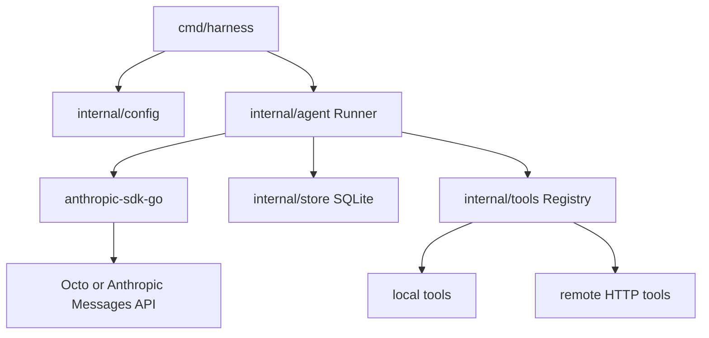
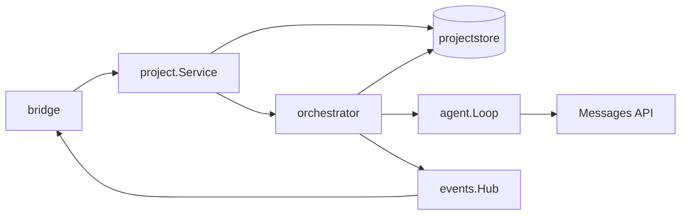

# Harness architecture

Go module: `github.com/ndolinschi/Octo/apps/harness`. A thin **Anthropic Messages tool loop** with workspace file/shell tools, optional HTTP-discovered tools, a legacy one-shot CLI session store, and a project-based HTTP/SSE server (`harness serve`) where a long-lived orchestrator delegates to nested sub-agents. It is a client of any Anthropic-compatible Messages endpoint — usually [Octo router](../router/) on loopback.

## Runtime shape



## Layout

| Path | Role |
| --- | --- |
| `cmd/harness` | CLI: `serve`, `run`, `sessions`, `show` (wiring only; `serve.go` is the one wiring site for the server) |
| `internal/config` | Env defaults (`ANTHROPIC_*`, `HARNESS_*`), model tiers |
| `internal/anthropicclient` | SDK client + optional `ANTHROPIC_BASE_URL` |
| `internal/agent` | `Loop`: system prompt, history, streaming, concurrent tools, usage, `Sink`; `Runner` = legacy CLI session |
| `internal/store` | Legacy `harness.sqlite`: sessions + message JSON blobs |
| `internal/projectstore` | `registry.sqlite` + per-project `project.sqlite` (projects, folders, agents, messages, notes); no SDK/agent imports |
| `internal/events` | Per-project pub/sub hub with in-memory `seq` |
| `internal/orchestrator` | Turn lifecycle, `spawn_agent`, note tools, system prompts, tool sets per agent kind, cancel/shutdown |
| `internal/files` | Confined list / read / atomic write of files under a folder root (reuses `tools/local` path confinement) |
| `internal/project` | Service layer: validation, defaults, notes, files, error kinds the bridge maps to HTTP |
| `internal/bridge` | `net/http` handlers (Go 1.22 `ServeMux` patterns), SSE, CORS, JSON errors |
| `internal/mockllm` | Scripted Anthropic-compatible Messages server (used by tests and `examples/mockllm`) |
| `internal/tools` | Registry → Anthropic tool defs; `ToolUseID(ctx)` for handlers |
| `internal/tools/local` | `bash`, `read_file`, `write_file`, `list_dir` over one or more labelled roots |
| `internal/tools/remote` | `GET {base}/tools` discovery, `POST {base}/tools/{name}` invoke |
| `internal/cache` | On-disk cache for remote manifests (fallback when GET fails) |
| `examples/remotetool` | Minimal remote tool server |
| `examples/mockllm` | Thin `main` around `internal/mockllm` |

## Conventions

- Cursor rules: `.cursor/rules/octo-go.mdc`, `go-pr-checklist.mdc`, `verify-go.mdc`.
- Soft cap **~250 lines** per `.go` file; split by responsibility.
- All I/O takes `context.Context`; shared state must be race-free.
- Planned project roots for Anthropic-compatible **skills/hooks**: `.agency/` and `.code/` (same shapes as Claude Code: `skills/*/SKILL.md`, hooks in `settings.json`). Loaders stay out of the agent core.

## Project server

Spec and HTTP/SSE contract: [`docs/superpowers/specs/2026-11-10-project-harness-design.md`](../../../docs/superpowers/specs/2026-11-10-project-harness-design.md).



- One **turn** per project at a time (`409 turn_in_progress`). `POST /messages` persists the user message and runs the turn in the background; progress arrives over SSE.
- The orchestrator thread is reloaded from `project.sqlite` every turn. If the previous turn left a `tool_use` without results (cancel/crash), a synthetic `is_error` result is stored before the new user message.
- `spawn_agent` creates the child row (`spawn_tool_use_id` from `tools.ToolUseID(ctx)`), runs the child loop synchronously, and returns its final text. A failed or cancelled child yields an `is_error` tool result; the parent continues. Agents at `depth == max_depth` do not get `spawn_agent`.
- Several tool calls in one assistant message run concurrently (`errgroup`); results keep call order. Parallel `spawn_agent` calls therefore run in parallel, so sibling rows appear in nondeterministic creation order.
- Cancel (`POST /cancel`) or shutdown cancels the turn context; the whole tree stops, running agents become `cancelled`, the orchestrator returns to `idle`, and `turn.finished` is emitted with `cancelled`.
- Orchestrator row: `idle` between turns, `running` during one. A failed turn still ends `idle`; the failure is in its `error` field and in `turn.finished`.
- Startup recovery: agents left `running` become `failed` ("interrupted"); the orchestrator becomes `idle`.
- Stored message content is the SDK `content` array; the API returns normalized `text` / `tool_use` / `tool_result` blocks (empty text skipped, tool_result content flattened to a string).

### Project storage

```text
{data-dir}/
  harness.sqlite               # legacy CLI sessions
  registry.sqlite              # projects(id, name, created_at)
  projects/{project_id}/project.sqlite
```

Tables in `project.sqlite`: `project` (one row), `folders`, `agents`, `messages`, `notes` (columns per the spec). Each database is opened with WAL, `busy_timeout`, and a single pooled connection, so parallel sub-agents serialize their writes inside the process. Deleting a project removes its directory.

### File API

Design: [`docs/superpowers/specs/2026-11-10-code-pane-design.md`](../../../docs/superpowers/specs/2026-11-10-code-pane-design.md). `folder` is a folder label, `path` is relative to it (`""` = root, forward slashes). Paths are confined exactly like the agents' file tools: traversal, absolute paths and symlink escape give `400 invalid_request`; an unknown project or folder gives `404 not_found`.

| Method | Path | Result |
| --- | --- | --- |
| GET | `/v1/projects/{pid}/files?folder=&path=` | `{ "entries": [{name, path, type: "file"\|"dir", size}] }` — one level, directories first then by name, `.git` omitted; missing path or not a directory is `404` |
| GET | `/v1/projects/{pid}/files/content?folder=&path=` | `{folder, path, size, mtime, content}`; `mtime` is RFC 3339 with nanoseconds, UTC. `413 file_too_large` over 2 MiB, `415 binary_file` for invalid UTF-8 or NUL bytes, `400` for a directory |
| PUT | `/v1/projects/{pid}/files/content` | body `{folder, path, content, expected_mtime?}` → `{folder, path, size, mtime}`. The parent directory must exist (`404`). `409 file_changed` when `expected_mtime` is set and differs from the current mtime (a missing file counts as changed). Written via temp file + rename in the same directory; an existing file keeps its mode, new files get `0644`. Body cap 3 MiB (`413 file_too_large`) |

`file.changed` (`{type, seq, folder, path, source: "user"|"agent"}`) is published on the SSE stream after a successful `PUT` (`user`) and after an agent's `write_file` call finishes without error (`agent`; the orchestrator decorates the registered tool, so the agent loop knows nothing about files).

### Tools by agent kind

| Tool | Orchestrator | Sub-agent |
| --- | --- | --- |
| `spawn_agent` | yes | yes while `depth < max_depth` |
| `list_dir`, `read_file` | yes | yes |
| `write_file`, `bash` | no | yes |
| `save_note`, `delete_note` | yes | no |
| remote tools (`--remote`) | no | yes |

File and shell tools take an optional `folder` label (defaults to the first folder; the schema only advertises it with 2+ folders). Each root is confined independently (symlink escape rejected). A project with no folders gets no file/shell tools. Model tiers default to `claude-opus-5-5` / `claude-haiku-5-5` / `claude-sonnet-5-5` / `claude-opus-5-5` (orchestrator / fast / balanced / deep); override with `HARNESS_MODEL_ORCHESTRATOR|FAST|BALANCED|DEEP` or per project.

## Agent loop (legacy CLI session)

1. Create session row; persist user message.
2. Call Messages API (streaming when `Runner.Stream` is true — CLI `--stream` / `HARNESS_STREAM`, default true).
3. When streaming, write text deltas to **stderr**; accumulate full assistant message for persistence and final stdout.
4. If the model emitted `tool_use` blocks, run handlers, persist tool results, append to context, repeat.
5. Stop on end-turn text or `MaxTurns` (config, env, or `--max-turns`).

Tool outputs are capped at **1 MiB** per result (`tools.CapString` / `CapBytes`); oversized output ends with `\n...truncated`.

## Local tools

| Tool | Behavior |
| --- | --- |
| `read_file` / `write_file` / `list_dir` | Paths must stay under `--workspace` (symlink escape rejected). |
| `bash` | `bash -c` with cwd = workspace, 30s timeout. **Full host shell privileges** — not a container or syscall sandbox. Commands can read/write anywhere the OS user can. |

File tools validate paths at resolve time; `bash` does not re-validate paths used inside the command.

## Remote tools

Repeatable `--remote http://host:port` (or env-driven lists in future). Registration:

1. `GET {base}/tools` → JSON manifest (live GET preferred; cache used only on GET failure).
2. Register each tool; name collisions with an already-registered tool are skipped (local wins).
3. Invoke via `POST {base}/tools/{url.PathEscaped(name)}` with 30s HTTP client timeout.

Manifest bytes may be written under `{data-dir}/cache/` after a successful live GET.

## Session store

SQLite file: `{data-dir}/harness.sqlite` (default `./data/harness`).

| Table | Columns |
| --- | --- |
| `sessions` | `id`, `model`, `created_at` |
| `messages` | `session_id`, `role`, `content_json`, `created_at` |

Messages store SDK-shaped JSON from `json.Marshal(anthropic.MessageParam)`. **`harness sessions`** and **`harness show <id>`** read this store; Octo `data/history.sqlite` is separate.

## Talking to Octo

| Mode | `--base-url` | Notes |
| --- | --- | --- |
| Direct Messages | `http://127.0.0.1:8080` | Uses `[llm.messages]` routing in Octo config |
| Autoroute | `http://127.0.0.1:8080/autoroute` | Octo applies ladder / sticky / budget before upstream |

Set `ANTHROPIC_API_KEY` to the key the upstream expects (OpenRouter bearer or Anthropic key, depending on Octo config). When Octo has `server.client_auth_key`, set `HARNESS_OCTO_KEY` or `--octo-key` so the SDK sends `x-octo-key`.

## CLI surface

| Command | Purpose |
| --- | --- |
| `harness serve` | Project HTTP + SSE server on `--addr` (default `127.0.0.1:8790`); requires `ANTHROPIC_API_KEY` |
| `harness run --prompt "…"` | New session, tool loop; session id on stderr, final text on stdout |
| `harness sessions` | JSON list of sessions |
| `harness show <session-id>` | JSON message rows for one session |

Common flags: `--workspace` (`run`), `--base-url`, `--model` (`run`), `--data-dir`, `--remote` (repeatable), `--max-turns`, `--octo-key`. `serve` also takes `--addr`.
