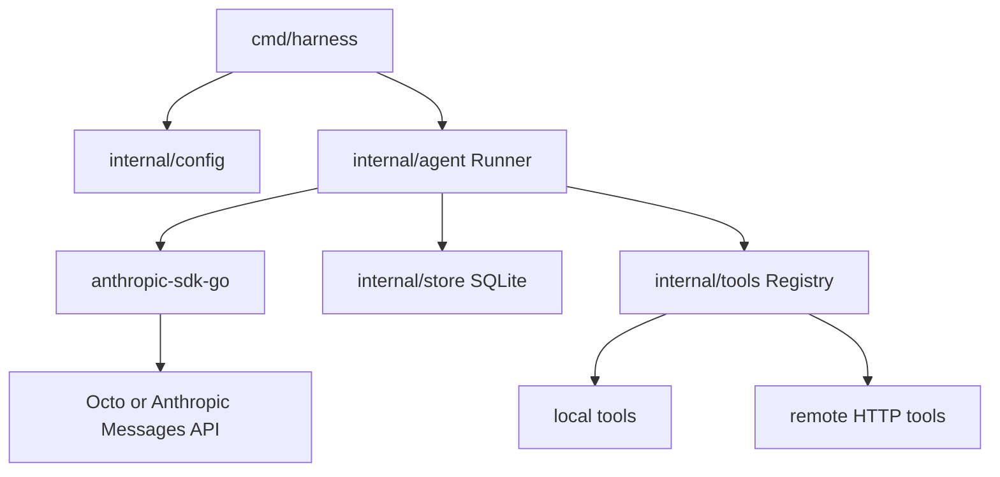

# Harness architecture

Go module: `github.com/ndolinschi/Octo/apps/harness`. A thin **Anthropic Messages tool loop** with workspace file/shell tools, optional HTTP-discovered tools, and a dedicated SQLite session store. It is a client of any Anthropic-compatible Messages endpoint — usually [Octo router](../router/) on loopback.

## Runtime shape

## Layout

| Path | Role |
| --- | --- |
| `cmd/harness` | CLI: `run`, `sessions`, `show` (wiring only) |
| `internal/config` | Env defaults (`ANTHROPIC_*`, `HARNESS_*`) |
| `internal/anthropicclient` | SDK client + optional `ANTHROPIC_BASE_URL` |
| `internal/agent` | Turn loop, streaming assistant text, tool dispatch |
| `internal/store` | `harness.sqlite`: sessions + message JSON blobs |
| `internal/tools` | Registry → Anthropic tool defs |
| `internal/tools/local` | `bash`, `read_file`, `write_file`, `list_dir` |
| `internal/tools/remote` | `GET {base}/tools` discovery, `POST {base}/tools/{name}` invoke |
| `internal/cache` | On-disk cache for remote manifests (fallback when GET fails) |
| `examples/remotetool` | Minimal remote tool server |

## Conventions

- Cursor rules: `.cursor/rules/octo-go.mdc`, `go-pr-checklist.mdc`, `verify-go.mdc`.
- Soft cap **~250 lines** per `.go` file; split by responsibility.
- All I/O takes `context.Context`; shared state must be race-free.
- Planned project roots for Anthropic-compatible **skills/hooks**: `.agency/` and `.code/` (same shapes as Claude Code: `skills/*/SKILL.md`, hooks in `settings.json`). Loaders stay out of the agent core.

## Agent loop

1. Create session row; persist user message.
2. Call Messages API (streaming when `Runner.Stream` is true — CLI `--stream` / `HARNESS_STREAM`, default true).
3. When streaming, write text deltas to **stderr**; accumulate full assistant message for persistence and final stdout.
4. If the model emitted `tool_use` blocks, run handlers, persist tool results, append to context, repeat.
5. Stop on end-turn text or `MaxTurns` (config, env, or `--max-turns`).

Tool outputs are capped at **1 MiB** per result (`tools.CapString` / `CapBytes`); oversized output ends with `\n...truncated`.

## Local tools

| Tool | Behavior |
| --- | --- |
| `read_file` / `write_file` / `list_dir` | Paths must stay under `--workspace` (symlink escape rejected). |
| `bash` | `bash -c` with cwd = workspace, 30s timeout. **Full host shell privileges** — not a container or syscall sandbox. Commands can read/write anywhere the OS user can. |

File tools validate paths at resolve time; `bash` does not re-validate paths used inside the command.

## Remote tools

Repeatable `--remote http://host:port` (or env-driven lists in future). Registration:

1. `GET {base}/tools` → JSON manifest (live GET preferred; cache used only on GET failure).
2. Register each tool; name collisions with an already-registered tool are skipped (local wins).
3. Invoke via `POST {base}/tools/{url.PathEscaped(name)}` with 30s HTTP client timeout.

Manifest bytes may be written under `{data-dir}/cache/` after a successful live GET.

## Session store

SQLite file: `{data-dir}/harness.sqlite` (default `./data/harness`).

| Table | Columns |
| --- | --- |
| `sessions` | `id`, `model`, `created_at` |
| `messages` | `session_id`, `role`, `content_json`, `created_at` |

Messages store SDK-shaped JSON from `json.Marshal(anthropic.MessageParam)`. **`harness sessions`** and **`harness show <id>`** read this store; Octo `data/history.sqlite` is separate.

## Talking to Octo

| Mode | `--base-url` | Notes |
| --- | --- | --- |
| Direct Messages | `http://127.0.0.1:8080` | Uses `[llm.messages]` routing in Octo config |
| Autoroute | `http://127.0.0.1:8080/autoroute` | Octo applies ladder / sticky / budget before upstream |

Set `ANTHROPIC_API_KEY` to the key the upstream expects (OpenRouter bearer or Anthropic key, depending on Octo config). When Octo has `server.client_auth_key`, set `HARNESS_OCTO_KEY` or `--octo-key` so the SDK sends `x-octo-key`.

## CLI surface

| Command | Purpose |
| --- | --- |
| `harness run --prompt "…"` | New session, tool loop; session id on stderr, final text on stdout |
| `harness sessions` | JSON list of sessions |
| `harness show <session-id>` | JSON message rows for one session |

Common flags: `--workspace`, `--base-url`, `--model`, `--data-dir`, `--remote` (repeatable), `--max-turns`, `--octo-key`.
