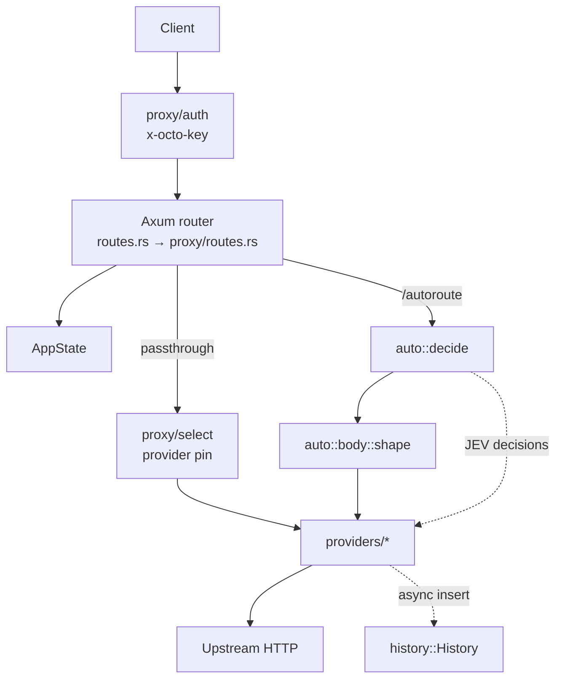
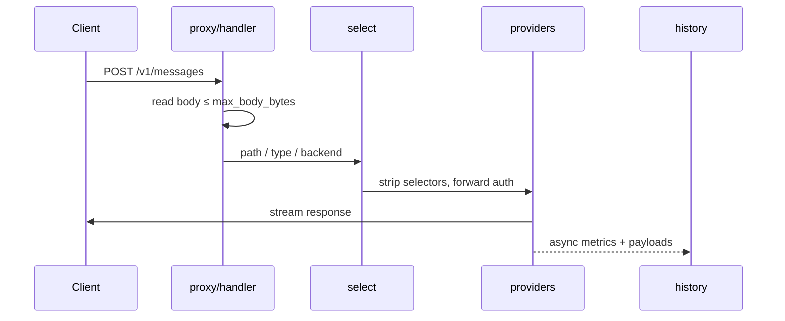
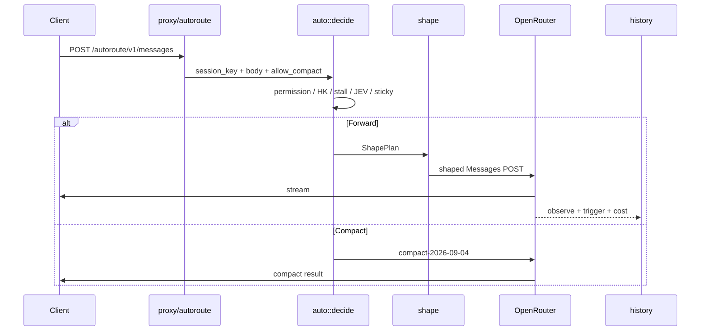

# Architecture

Octo is a **single application crate** (`octo`, edition 2021). Process entry: `src/main.rs` → `proxy::run()`, or
`export::run` for `octo export-delegations`. Module map checked against the source on 2026-11-22 (91 files, 16,405 lines in
`src/`; 29 test files in `tests/`). Where the router sits in the whole system: [`docs/ARCHITECTURE.md`](../../../docs/ARCHITECTURE.md#module-map).

## Runtime shape



`AppState` holds: merged `Config`, shared `reqwest::Client`, `llm::Wired`, `decision::Providers`, optional `History`, and `auto::Auto` (tiers + per-session sticky state).

## Layers

| Layer | Path | Owns |
| --- | --- | --- |
| HTTP / proxy | `src/proxy/` | Routes, auth, body limits, handlers, autoroute entry, errors |
| Autoroute core | `src/auto/` | Decide, JEV, sticky, stall, catalog, `shape()`, routing meta |
| Providers | `src/providers/` | Upstream wire formats, attribution, stream tee |
| History | `src/history/` | SQLite, HMAC tokens, cost, payloads, outcomes |
| Config | `src/config.rs` + `config/` | Fragment TOML → `Config` |

**Boundary rule:** Axum types stay in `proxy/`; routing policy stays in `auto/`; vendor JSON stays in `providers/`. See `.cursor/rules/octo-rust.mdc`.

## Module map

```text
src/
├── main.rs                 tracing + proxy::run (or export-delegations)
├── cli.rs                  --version, --help
├── export.rs               octo export-delegations: delegation records as JSON lines for export
├── lib.rs                  crate modules
├── config.rs               TOML merge
├── state.rs                AppState
├── routes.rs               top-level TraceLayer router
├── proxy/
│   ├── mod.rs              bind, history connect, serve, drain
│   ├── routes.rs           path table
│   ├── handler.rs          passthrough handlers
│   ├── auth.rs             client key middleware
│   ├── stdin_watch.rs      OCTO_EXIT_ON_STDIN_CLOSE
│   ├── select.rs           OpenAI/OpenRouter/Claude pin
│   ├── error.rs            ProxyError → JSON
│   └── autoroute/          messages/chat/status/compact/retry, route (delegation), outcome, calls
├── auto/
│   ├── decide/             sticky, classify, gate, route
│   ├── delegate/           POST /autoroute/v1/route: types, band, choice policy, classifier seam (jev, heuristic,
│   │                       learned), outcome.rs (the derived `solved` label)
│   ├── jev/                Decisions questions + parse
│   ├── hints.rs            harness hint headers
│   ├── ledger.rs           per-budget-key spend
│   ├── calls.rs            call records for the calls endpoint
│   ├── body.rs             shape, housekeeping, session_key
│   ├── catalog.rs          tiers, windows, strip defaults
│   ├── stall.rs            error/tool stalls
│   ├── ladder.rs           ladder warnings at start-up
│   ├── routing.rs          RouteMeta / triggers
│   └── text_tool_call.rs   detector + escalate hook
├── providers/
│   ├── llm/                openai, openrouter chat, claude
│   ├── decision/           openrouter decisions
│   ├── openrouter/         attribution + helpers
│   └── utils.rs            POST + stream tee
├── prices/                 prices.toml + the OpenRouter catalogue refresh
└── history/                connect, call insert, payload, cost, session outcomes, call records and spend,
                            delegations.rs (delegation records and outcome reports)
```

## Two request paths

### Passthrough



### Autoroute



## Design invariants

1. **Streaming first** — history and routing must not block bytes after response headers (autoroute reshapes *before* the upstream call).
2. **Money is integer micros** — never store `f64` dollars in SQLite.
3. **Config owns policy** — URLs, limits, ladder, strip lists live under `config/`.
4. **Fail open on history** — DB failure disables persistence; proxy keeps serving.
5. **Fail closed on remote bind** — non-loopback requires `allow_remote` + `client_auth_key`.
6. **Tests outside `src/`** — integration tests only under `tests/`.

## Related

- [proxy.md](./proxy.md) — route table and auth
- [autoroute.md](./autoroute.md) — decide pipeline detail
- [status.md](./status.md) — known gaps vs this design
