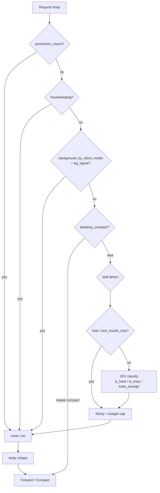
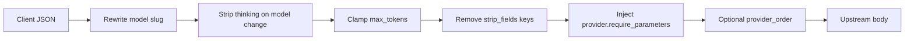
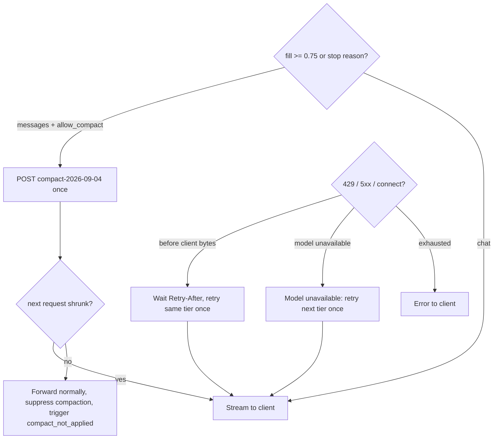

# Autoroute

Autoroute is the session-aware model ladder for Claude Code → OpenRouter. It lives behind dedicated paths so passthrough behavior stays unchanged.

## Endpoints

| Method | Path | Notes |
| --- | --- | --- |
| `POST` | `/autoroute/v1/messages` | Primary Claude Code path; compaction + retry + text-tool-call hook |
| `POST` | `/autoroute/v1/chat/completions` | Same decide/shape; **no** Messages compact API; no text-tool-call hook |
| `GET` | `/autoroute/status` | JSON for statusline (`?session=` optional) |

Ladder slugs and policy: `config/autoroute.toml` (default: `deepseek/deepseek-v4.1-flash` → `minimax/minimax-m3.1-flash` → `deepseek/deepseek-v4.1-flash-1017`; no `provider_order` pin; `allow_fallbacks = true`).

## Decide pipeline

Order inside `auto::decide` (simplified):

### Triggers (examples)

| Trigger / reason | Meaning |
| --- | --- |
| `permission_check` | Keep sticky model; skip JEV |
| `housekeeping` / `housekeeping_trimmed` | Force low; optional message trim |
| `background_model` | Same as housekeeping when opt-in flag on |
| `stall:error_streak` / `stall:tool_*` | Escalate one band for `escalate_turns` |
| `text_tool_call` | Next-turn escalate after detector fires |
| `none` | Empty question passthrough (still shaped) |
| JEV band names | Complexity from Decisions scores |

## Body shaping (`shape`)

Applied on every Forward (including “passthrough” unset tier):

Shipped strip list (Anthropic-only; proven against destinstral `supported_parameters`):

- `output_config`
- `safeguards`
- `context_management`

`require_parameters` modes: `always` | `tools_only` | `never` (invalid values fail config load). Empty `strip_fields` disables stripping — do not leave `require_parameters=always` with an empty list unless you accept OpenRouter 404s.

Protected keys (`tools`, `tool_choice`, `system`, `messages`, `max_tokens`, `stop_sequences`, `metadata`) are never stripped even if listed.

## Sticky, stall, budget

| Mechanism | Behavior |
| --- | --- |
| Sticky band | Session remembers low/mid/high; down-tier needs `down_confirm` consecutive lower classifications |
| Stall | Looks at last `stall_window` non-HK assistant turns; escalates and holds `escalate_turns` |
| Session budget | **Default `session_budget_usd = 0` means OFF: no cap, no refusal.** When `> 0` and spend reaches it: `session_budget_action = "downgrade"` (default) routes to the **cheapest** tier by `prices.toml` (blended estimate for the request's input and `max_tokens`; legacy "mid" cap if the ladder is not fully priced); `"reject"` returns HTTP 402 `billing_error` (Anthropic error shape) with the budget and spend, before any upstream or classifier call |
| Budget key | Header `x-octo-budget-key` makes spend (and the budget) shared across every session sending the same key; stripped before upstream; needs `metadata.user_id` session id |
| Classifier failure | New session and the JEV call fails: use `classifier_failure_tier` (default `mid`), remember it like any decision (trigger `classifier_failure`), retry classification on the next user turn. A missing API key still passes through unclassified |
| Classifier input | Last user text sent to JEV is capped at 2000 characters (head + tail with an omission marker) |
| `max_tokens` | Missing client value becomes `default_max_tokens` (default 8192), capped by the model maximum; explicit values are respected, also capped by the model maximum |
| high_allow | Client preferred model on High only if allowlisted (empty = always use configured high slug) |

Caveats: [status.md](./status.md).

## Compaction and retry (messages)

- Messages autoroute: OpenRouter compaction, **at most one compaction call per threshold crossing**. If the next request from that session has not shrunk (the client did not apply the summary), Octo logs a warning, forwards the request normally with trigger `compact_not_applied` in history, and does not compact that session again until its request falls below the fill threshold and rises again (or after `compact_cooldown_requests` further requests when set). Toolless requests carry no session state, so they are not tracked.
- Retry (messages route, before any client bytes): 429, 5xx, and connect/timeout errors get **one** retry. The wait honours `Retry-After` (seconds or an IMF-fixdate HTTP date), bounded by `retry_after_max_secs` (default 10). The retry goes to the **same tier**; it goes to the next tier up only when the error body says the model/provider is unavailable (`No available model provider`, `No endpoints found`, `model_not_available`, `model is (not available|unavailable)` on a 429/5xx) and the budget allows that tier. Other 4xx are never retried. There is never a second retry.
- Chat autoroute: `allow_compact=false` for overflow decide; if a Compact turn still appears, `chat_compact` strips compaction and forwards as normal chat. No retry on chat.

## Session identity

`session_key` is derived only from the request body: `metadata.user_id` (JSON string) → `session_id`, then optional `#sub:{hash}` for Claude Code Agents. The hash is SHA-256 of the **first** user message text (stable across tool_result turns). `calls.parent_session_id` stores the parent UUID. New subagent sessions default to the **low** tier on first turn.

## Observe signals (history only unless flags on)

| Signal | Source | Routing effect by default |
| --- | --- | --- |
| `client_model` | Preferred model in body | None |
| `client_has_thinking` | Thinking blocks present | None |
| `client_tool_names` | Tool name CSV | None |
| `bg_signal` | Model matches `background_model_patterns` | None unless `background_by_client_model` |
| `hk_text_signal` | Housekeeping text patterns | Housekeeping path when text matches |

## Server tools

`web_search` / `web_fetch` / `code_execution`:

| `server_tool_mode` | Behavior |
| --- | --- |
| `passthrough` (default) | Forward unchanged |
| `online_suffix` | Rewrite model with `:online` |
| `reject` | 400 before upstream |

## Statusline

`GET /autoroute/status?session=…` returns spend / model JSON for `scripts/statusline.sh`.
