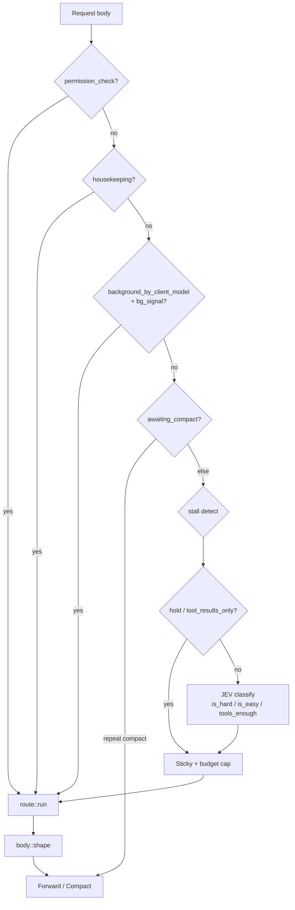
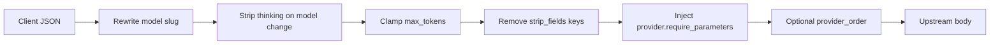
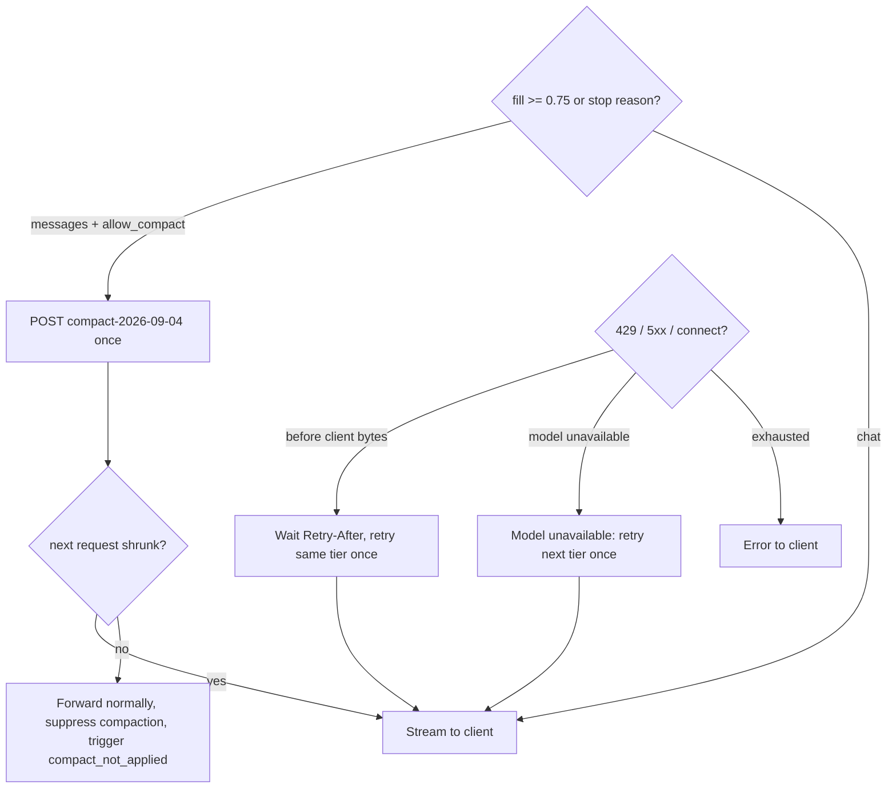

# Autoroute

Autoroute is the session-aware model ladder for Claude Code → OpenRouter. It lives behind dedicated paths so passthrough behavior stays unchanged.

## Endpoints

| Method | Path | Notes |
| --- | --- | --- |
| `POST` | `/autoroute/v1/messages` | Primary Claude Code path; compaction + retry + text-tool-call hook |
| `POST` | `/autoroute/v1/chat/completions` | Same decide/shape; **no** Messages compact API; no text-tool-call hook |
| `GET` | `/autoroute/status` | JSON for statusline (`?session=` optional) |
| `GET` | `/autoroute/v1/calls/{request-id}` | Final tokens and cost of one finished call (see [Harness integration](#harness-integration)) |

Ladder slugs and policy: `config/autoroute.toml` (default: `deepseek/deepseek-v4.1-flash` → `minimax/minimax-m3.1-flash` → `deepseek/deepseek-v4.1-flash-1017`; no `provider_order` pin; `allow_fallbacks = true`).

## Decide pipeline

Order inside `auto::decide` (simplified):



### Triggers (examples)

| Trigger / reason | Meaning |
| --- | --- |
| `permission_check` | Keep sticky model; skip JEV |
| `housekeeping` / `housekeeping_trimmed` | Force low; optional message trim |
| `background_model` | Same as housekeeping when opt-in flag on |
| `stall:error_streak` / `stall:tool_*` | Escalate one band for `escalate_turns` |
| `text_tool_call` | Next-turn escalate after detector fires |
| `none` | Empty question passthrough (still shaped) |
| JEV band names | Complexity from Decisions scores |

## Body shaping (`shape`)

Applied on every Forward (including “passthrough” unset tier):



Shipped strip list (Anthropic-only; proven against destinstral `supported_parameters`):

- `output_config`
- `safeguards`
- `context_management`

`require_parameters` modes: `always` | `tools_only` | `never` (invalid values fail config load). Empty `strip_fields` disables stripping — do not leave `require_parameters=always` with an empty list unless you accept OpenRouter 404s.

Protected keys (`tools`, `tool_choice`, `system`, `messages`, `max_tokens`, `stop_sequences`, `metadata`) are never stripped even if listed.

## Sticky, stall, budget

| Mechanism | Behavior |
| --- | --- |
| Sticky band | Session remembers low/mid/high; down-tier needs `down_confirm` consecutive lower classifications |
| Stall | Looks at last `stall_window` non-HK assistant turns; escalates and holds `escalate_turns` |
| Session budget | **Default `session_budget_usd = 0` means OFF: no cap, no refusal.** When `> 0` and spend reaches it: `session_budget_action = "downgrade"` (default) routes to the **cheapest** tier by `prices.toml` (blended estimate for the request's input and `max_tokens`; legacy "mid" cap if the ladder is not fully priced); `"reject"` returns HTTP 402 `billing_error` (Anthropic error shape) with the budget and spend, before any upstream or classifier call |
| Budget key | Header `x-octo-budget-key` makes spend (and the budget) shared across every session sending the same key; stripped before upstream; see [Harness integration](#harness-integration) for `x-octo-budget-usd` |
| Classifier failure | New session and the JEV call fails: use `classifier_failure_tier` (default `mid`), remember it like any decision (trigger `classifier_failure`), retry classification on the next user turn. A missing API key still passes through unclassified |
| Classifier input | Last user text sent to JEV is capped at 2000 characters (head + tail with an omission marker) |
| `max_tokens` | Missing client value becomes `default_max_tokens` (default 8192), capped by the model maximum; explicit values are respected, also capped by the model maximum |
| high_allow | Client preferred model on High only if allowlisted (empty = always use configured high slug) |

Caveats: [status.md](./status.md).

## Compaction and retry (messages)



- Messages autoroute: OpenRouter compaction, **at most one compaction call per threshold crossing**. If the next request from that session has not shrunk (the client did not apply the summary), Octo logs a warning, forwards the request normally with trigger `compact_not_applied` in history, and does not compact that session again until its request falls below the fill threshold and rises again (or after `compact_cooldown_requests` further requests when set). Toolless requests carry no session state, so they are not tracked.
- Retry (messages route, before any client bytes): 429, 5xx, and connect/timeout errors get **one** retry. The wait honours `Retry-After` (seconds or an IMF-fixdate HTTP date), bounded by `retry_after_max_secs` (default 10). The retry goes to the **same tier**; it goes to the next tier up only when the error body says the model/provider is unavailable (`No available model provider`, `No endpoints found`, `model_not_available`, `model is (not available|unavailable)` on a 429/5xx) and the budget allows that tier. Other 4xx are never retried. There is never a second retry.
- Chat autoroute: `allow_compact=false` for overflow decide; if a Compact turn still appears, `chat_compact` strips compaction and forwards as normal chat. No retry on chat.

## Session identity

`session_key` is derived only from the request body: `metadata.user_id` (JSON string) → `session_id`, then optional `#sub:{hash}` for Claude Code Agents. The hash is SHA-256 of the **first** user message text (stable across tool_result turns). `calls.parent_session_id` stores the parent UUID. New subagent sessions default to the **low** tier on first turn.

## Observe signals (history only unless flags on)

| Signal | Source | Routing effect by default |
| --- | --- | --- |
| `client_model` | Preferred model in body | None |
| `client_has_thinking` | Thinking blocks present | None |
| `client_tool_names` | Tool name CSV | None |
| `bg_signal` | Model matches `background_model_patterns` | None unless `background_by_client_model` |
| `hk_text_signal` | Housekeeping text patterns | Housekeeping path when text matches |

## Server tools

`web_search` / `web_fetch` / `code_execution`:

| `server_tool_mode` | Behavior |
| --- | --- |
| `passthrough` (default) | Forward unchanged |
| `online_suffix` | Rewrite model with `:online` |
| `reject` | 400 before upstream |

## Statusline

`GET /autoroute/status?session=…` returns spend / model JSON for `scripts/statusline.sh`.

## Harness integration

Integration I1 of [`docs/superpowers/specs/2026-11-11-router-harness-integration.md`](../../../docs/superpowers/specs/2026-11-11-router-harness-integration.md). The harness detects the router with `GET /health`, tells it what a request is for (hint headers), and reads back what the router did (result headers, the calls endpoint). Everything here applies to `/autoroute/v1/messages`; the hint headers are also read on `/autoroute/v1/chat/completions`.

### Detection

`GET /health` (no auth, even with `client_auth_key`) returns HTTP 200 and JSON:

```json
{"status":"ok","service":"octo","version":"0.1.0","capabilities":["autoroute","route_hints","result_headers","budget_key"]}
```

`route_api` (the I2 routing-decision endpoint) is not advertised yet.

### Request headers (harness to router)

All are optional and stripped before the upstream request (upstream headers are an allowlist anyway). An invalid value is ignored and logged at `debug`; a bad hint never produces a 4xx.

| Header | Value | Effect |
| --- | --- | --- |
| `x-octo-budget-key` | printable ASCII, at most 128 chars (the project id) | Spend is tracked per key across every session that sends it, with or without `metadata.user_id` |
| `x-octo-budget-usd` | positive decimal, e.g. `0.50` | Budget for that key; ignored without a budget key. Latest value sent for a key wins |
| `x-octo-agent-role` | `orchestrator` or `sub` | `sub` (or any depth above 0) makes a new session start at `min(hint, classifier)` |
| `x-octo-agent-depth` | integer, `0`, `1`, ... | See above |
| `x-octo-tier-hint` | `fast`, `balanced`, `deep` (map to `low`, `mid`, `high`) | Starting tier of a new session (see below) |
| `x-octo-tier-policy` | `auto` (default), `ceiling`, `fixed` | How binding the hint is |
| `x-octo-task` | URL-encoded text, truncated to 200 characters | Prefixed to the classifier input as `Task: ...`; only used when the classifier runs |

**Tier hint semantics.** A "new session" is one with no remembered tier (first request, or after a compaction reset).

| Policy | New session | Later turns |
| --- | --- | --- |
| `auto` | Orchestrator or role absent: starts at the hint, no classifier call, trigger `hint`. Sub-agent: classifier runs, starts at `min(hint, classifier)` (trigger `classify` when the classifier is lower, `hint` otherwise; if the classifier fails or no API key is present, the hint) | Normal sticky, hysteresis, stall and budget rules; the hint is not re-applied |
| `ceiling` | Same start as `auto` | Same rules as `auto`, then the result is clamped to at most the hint tier on every turn. This includes stall escalation, `upgrade` to a larger-context ladder model, the unavailable-model retry escalation and a remembered higher session. A clamp reports trigger `hint` |
| `fixed` | The hint's ladder tier, trigger `hint`, no classifier call | Every turn is served at the hint's tier; stall escalation and classification are ignored; no fill upgrade above it |

Budget rules apply inside these bounds: a budget cap may still pick a cheaper tier than the hint (trigger `budget_cap`). Permission checks, housekeeping and background-model requests keep their own handling (housekeeping is always `low`, so it never exceeds a hint). Fixed and ceiling hints do not stop a context overflow from compacting.

### Budget

The effective budget for a budget key is the smaller of `x-octo-budget-usd` and `autoroute.session_budget_usd` (0 means the configured one is off, so the header alone applies). Spend accumulates per budget key from every call (reported cost first, then the price estimate) including compaction calls and classifier calls made with a session id.

Action when spend reaches the budget:

- the budget came from the header (header is smaller than or equal to the configured budget, or the configured one is off): always **reject**, because the harness's project budget is a hard cap;
- the configured budget is the smaller one: `session_budget_action` applies (`downgrade` or `reject`).

Reject returns HTTP 402 before any upstream or classifier call, Anthropic-shaped:

```json
{"type":"error","error":{"type":"billing_error","message":"autoroute budget key `proj-9` budget exceeded: spent $2.000000 of $0.010000 (...)"}}
```

with result headers `x-octo-trigger: budget`, `x-octo-budget-usd`, `x-octo-spent-usd` and `x-octo-request-id`.

### Result headers (router to harness)

Set on the response head, so they are available before a streamed body starts. Sent on every Messages response that reaches the router's forward path, including compaction and 402 (which has no model or tier). Errors raised before a response exists (for example upstream connect failure, which becomes a plain 502 JSON error) carry none.

| Header | Value |
| --- | --- |
| `x-octo-model` | The model actually sent upstream (ladder slug after any retry escalation) |
| `x-octo-tier` | `low`, `mid`, `high` (`custom` for a client-preferred high model) |
| `x-octo-trigger` | Why: `none` (plain sticky turn), `classify`, `reclassify`, `tool_update`, `hint`, `budget_cap`, `budget` (402), `stall:*`, `stall_release`, `hysteresis_hold`, `housekeeping`, `housekeeping_trimmed`, `permission_check`, `upgrade`, `retry`, `classifier_failure`, `compact_not_applied`, `compact`, ... (same values as the history `trigger` column) |
| `x-octo-request-id` | Id of this call, key for the calls endpoint (`octo_<hex>`). With a retry, the id is the final attempt's |
| `x-octo-budget-usd`, `x-octo-spent-usd` | Effective budget and spend so far (USD, six decimals) for the budget key, or for the session when only the configured budget applies. Absent when no budget applies. Spend excludes the response being sent |

### `GET /autoroute/v1/calls/{request-id}`

```json
{"model":"deepseek/deepseek-v4.1-flash","tier":"low","trigger":"hint","input_tokens":1000,"output_tokens":500,"cache_read_tokens":0,"cache_write_tokens":0,"cost_usd":0.002,"cost_source":"estimated"}
```

- 404 `{"error":"unknown or unfinished request",...}` until the response body has ended (the row is written when the stream finishes, before the client sees the end of the body), and for ids that were evicted or never existed.
- `cost_source` is `reported` when the cost came from the upstream (OpenRouter `usage.cost` or BYOK upstream cost) and `estimated` otherwise (`prices.toml`; when nothing is priced `cost_usd` is `0` and the source is `estimated`).
- Failed responses (non-2xx) and cancelled ones (client dropped the stream) get a row too, with the tokens known so far (estimated for dropped streams) and no cost when unknown.
- Storage: a bounded in-memory store of the most recent 4096 calls. Rows are lost on restart. The SQLite history keeps its own `calls` rows (without the request id).
- Cost per call also feeds the budget ledger above; the harness does not have to sum anything itself.

### Compaction

When the context passes the fill threshold (or the previous reply stopped with `model_context_window_exceeded`), autoroute does not forward the turn. It POSTs the request to OpenRouter Messages with `"compaction": {"type": "summarize"}`, `"stream": false`, the model's own ladder slug and the header `anthropic-beta: compact-2026-09-04`, and returns **the upstream's response unchanged** (status and JSON body; only the `content-type` is normalised to `application/json`). If the first model fails (non-2xx, unparsable, or `model_context_window_exceeded`) and a larger-context ladder model exists, the call is repeated once with that model.

How the harness detects and applies it:

1. Detect: response header `x-octo-trigger: compact` (the request was a compaction, not an answer). The body is an Anthropic Messages object, never a stream, whatever `stream` the client asked for.
2. Check success: HTTP 2xx and `stop_reason` equal to `"compaction"`. Anything else (non-2xx, `stop_reason: "model_context_window_exceeded"`) is a failed compaction: surface the error, do not replace history.
3. Read the summary from the `content` array: the block with `"type": "compaction"` and its `content` string (when none is present, concatenate the `text` blocks).
4. Apply: store the summary as the agent's compacted history and send a shorter history from the next request on (the raw messages may stay in the harness database). The compaction call's own `usage` and cost are in the calls endpoint (`trigger: compact`).
5. If the next request is not shorter than the compacted one, the router logs `compaction was not applied`, forwards normally with trigger `compact_not_applied` and will not compact that session again until its request falls below the fill threshold and rises again (or after `compact_cooldown_requests` requests).

Compaction only exists on `/autoroute/v1/messages`. On `/autoroute/v1/chat/completions` an overflow is forwarded as a normal chat call.
