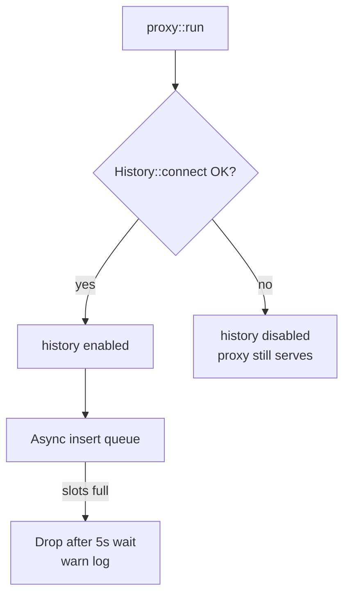
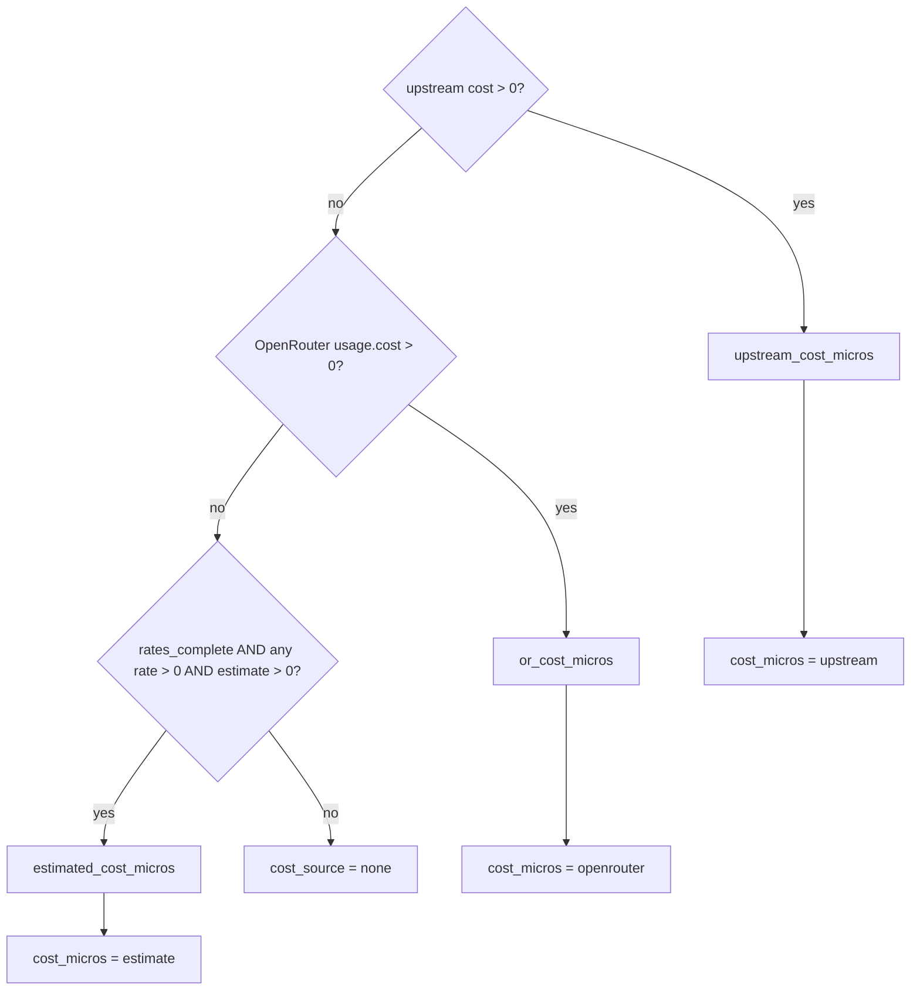

# History and cost

Octo records a **side copy** of proxied calls in SQLite. Live streaming is unchanged: inserts run asynchronously and must not block the client.

## Connect behavior



- Path: `config/history.toml` → `database_path` (default `data/history.sqlite`).
- Migrations under `migrations/`; compile-time `query!` uses committed `.sqlx/` (`SQLX_OFFLINE`).
- Concurrency: 32 insert slots; wait up to 5s; then **drop** the row (no spill-to-disk).
- Shutdown: graceful drain of in-flight inserts.

## Identity

Caller secrets (`Authorization` / `x-api-key`) are stored as **HMAC-SHA256** hashes. Token key from `OCTO_HISTORY_TOKEN_KEY`, `history.token_key`, or an auto-generated `.key` beside the DB (restrictive Unix permissions).

Raw tokens are never written to the database or tracing.

## Tables (conceptual)

### `calls`

Core metrics: kind, provider, model, status, latency, bytes, tokens, `cost_micros`.

Routing: `session_id`, `parent_session_id` (set for `#sub:{hash}` keys), `tier_before` / `tier_after`, `trigger`, `rerouting` / `rerouting_reason`.

Cost detail: `or_cost_micros`, `upstream_cost_micros`, `estimated_cost_micros`, `cost_source`, `is_byok`, `upstream_provider`, cache tokens, `generation_id` (prefers OpenRouter `x-generation-id` `gen-*`), `trimmed_from_tokens`.

Observe: `client_model`, `client_has_thinking`, `client_tool_names`, `bg_signal`, `hk_text_signal`.

Payloads: `request_payload` / `response_payload` (JSON envelopes). **`store_payloads` is `true` by default**: request and response text is kept in the history database. To turn it off set `store_payloads = false` under `[history]` in `config/history.toml` (`$OCTO_CONFIG/history.toml`); text payload columns are then omitted; metrics and observe columns remain.

The `calls` row of an autoroute call also has `request_id` (the `x-octo-request-id` value). Autoroute call records and per-budget-key spend are persisted in the `autoroute_calls` and `budget_spend` tables with their own retention (`calls_max_age_days`, `calls_max_rows`, `budget_spend_max_age_days`, `prune_interval_secs`); see [autoroute.md](./autoroute.md#harness-integration).

### `decisions`

JEV / Decisions rows: scores (`is_hard`, `is_easy`, `tools_enough`), complexity, choice rule, payloads, cost columns. No orchestration score columns yet.

### `session_outcomes`

Upserted from last-user `tool_result` blocks that look like cargo / pytest / unittest summaries, keyed by observe `session_id` (including `#sub:{hash}` when present).

## Delegation records

Why: the learned-router thesis (`docs/superpowers/specs/2026-11-13-learned-router-design.md`) moves the routing decision to the delegation boundary, where a fresh context starts and nothing cached is lost. Training and evaluating a model for that decision needs, for every delegation, what was asked, what was chosen, what it cost and whether it worked. These two tables are that record; the router stores, the harness reports over HTTP ([autoroute.md](./autoroute.md#delegation-record-and-outcome)).

### `delegations` (one row per `POST /autoroute/v1/route` decision)

Written off the request path through the same bounded insert queue as the call records (so a burst can drop a row, counted in `dropped_inserts`). **Not pruned** by the call-record retention: it is the training set. Migration `20261120120000_delegations.sql`.

| Column | Meaning |
| --- | --- |
| `request_id` | The decision's `octo_…` id (= `request_id` of the response, key of the calls endpoint) |
| `created_at` | Unix milliseconds |
| `budget_key`, `session_id` | The project key; the caller's session when it sent one |
| `attempt`, `escalated_from` | `1`, or `2` with the request id of the failed first attempt (escalation) |
| `title`, `brief` | The task text, **only when `store_payloads = true`** (else NULL) |
| `title_chars`, `brief_chars`, `brief_tokens` | Lengths; tokens are estimated as characters / 4, rounded up |
| `brief_hash` | HMAC-SHA256 of the brief with this installation's history token key (a salted hash: equal briefs match, the text cannot be recovered or matched across installations) |
| `text_features` | JSON of facts derived from the text at decision time: `multiple_files`, `tests`, `stack_trace`, `hard_keyword`, `asks_inspection`, `read_only_tools`, `text_chars` (kept whatever `store_payloads` says) |
| `tools`, `tool_count`, `depth`, `parent_tier` | As sent in `task` |
| `candidates`, `exclude`, `min_tier` | The candidates considered (after `exclude` / `min_tier`), as JSON; the retry fields |
| `choice`, `choice_kind`, `choice_tier`, `model`, `served_tier` | The chosen id, `api` / `agent`, its API tier, the ladder slug served, `low`/`mid`/`high`/`agent` |
| `band`, `reason` | The decision's band and reason text (fixed phrases plus candidate ids and labels) |
| `classifier`, `classifier_requested`, `classifier_version`, `classifier_status`, `fallback_reason` | Who decided (`jev`, `heuristic`), what was configured (`jev`, `heuristic`, `learned`), version (`jev-v1`, `heuristic-v1`), `used` / `fallback` / `skipped`, why the configured one did not decide |
| `p_low`, `p_mid`, `p_high` | Per-tier success probabilities of a learned model; NULL until one runs |
| `estimated_cost_micros`, `classifier_cost_micros` | The nominal estimate of the chosen candidate (NULL when unpriced), the classifier call's cost |
| `solved`, `solved_rule`, `solved_confidence`, `outcome_at` | The derived label as of the last outcome report (a cache: the export recomputes it) |

Privacy: with `store_payloads = false` no task text is stored, only the lengths, the salted hash, the derived features, the tool names and the reason; the export's `--redact` drops the text even when it is stored.

### `delegation_outcomes` (append-only reports)

One row per report: `request_id`, `report_id` (unique per delegation: the same report twice is stored once), `received_at` (Unix ms; orders the reports), `event` (`finished`, `redelegated`, `escalated`, `rewound`, `reverted`) and `body` (the report as sent, JSON). Later signals (a rewind, a revert) are appended when they happen; nothing is overwritten.

### The `solved` label

Computed in one place, `derive` in `src/auto/delegate/outcome.rs`, from the reports in arrival order and the test summary of the sub-agent's router session (`session_outcomes` of the `session_id` the latest `finished` report names). First rule that matches wins:

| # | Rule | `solved` | Confidence |
| --- | --- | --- | --- |
| 1 | `no_outcome`: no `finished` report yet | unknown | none |
| 2 | `stopped`: the person stopped the sub-agent | unknown | none |
| 3 | `did_not_finish`: status `failed`, `timed_out` or `agent_error` | no | high |
| 4 | `could_not`: the sub-agent's report said it could not do the task (`agent_signal: could_not`) | no | high |
| 5 | `escalated`: the harness retried the brief on a stronger candidate | no | high |
| 6 | `redelegated`: the orchestrator delegated a similar task again under the same parent | no | medium after a failure, low after a completion |
| 7 | `undone`: the person rewound the turn that used the result, or reverted a file it changed | no | low |
| 8 | `tests_failed`: the last test run in the sub-agent failed (the harness's own `tests` report wins; else the router's `session_outcomes`) | no | medium |
| 9 | `empty_report`: completed without a final report | unknown | none |
| 10 | `tests_passed`: completed and the last test run passed | yes | high |
| 11 | `completed`: completed, none of the above, no test run | yes | low |

Only the latest `finished` report counts for the status; every `escalated`, `redelegated`, `rewound`, `reverted` report counts whenever it arrived.

Known noise (none of it measured; all of it is why the label carries a rule and a confidence):

- **Yes by default (rule 11).** Most sub-agents run no tests; "completed and nobody objected" is the weakest positive. An orchestrator can accept a wrong report, and the harness has no explicit "accepted" signal. Expect false positives here.
- **Re-delegation is a heuristic match** (same parent, similar title or brief by the harness's word overlap): a follow-up task that resembles the first gives a false `no`; a reworded retry is missed.
- **Undone ≠ wrong.** A person rewinds or reverts for reasons unrelated to quality (changed mind, wrong request); a revert of one file out of many marks the whole delegation.
- **Tests measure the tree, not the task.** A failing test may predate the sub-agent or be unrelated; a passing run may not cover the change. The router parses only cargo / pytest / unittest summaries and only from traffic that passes through it (built-in sub-agents; ACP agents' tool output does not).
- **Could-not depends on the prompt.** The sub-agent prompt asks it to start its report with "Could not do it:"; a model that ignores that, or hedges, is labelled by its status instead.
- **Stopped and empty are unknown,** not failures: they say nothing about the candidate, and they are excluded from training by most uses.
- **Late signals change a label.** A rewind or revert arrives after the fact; an export taken before it shows the earlier label.

### Delegation export

`octo export-delegations --out FILE.jsonl [--db PATH] [--redact]` (from `apps/router`, or the installed binary) opens the history database **read-only** (default: `history.database_path` of the configuration in `$OCTO_CONFIG` or `./config`) and writes one JSON line per delegation, oldest first. The label is recomputed at export time with the rule above. `--redact` writes `null` for the title and brief and keeps every derived feature. This file is what the ML pipeline in `apps/router/ml` reads. Schema `octo.delegation.v1`:

```json
{
  "schema": "octo.delegation.v1",
  "request_id": "octo_18c2…", "created_at_ms": 1763600000000, "budget_key": "proj-9", "session_id": "sess-1",
  "attempt": 1, "escalated_from": null,
  "task": {
    "title": "Fix the parser", "brief": "…", "text_stored": true,
    "title_chars": 14, "brief_chars": 412, "brief_tokens_est": 103, "brief_hash": "<64 hex>",
    "text_features": {"multiple_files": false, "tests": true, "stack_trace": false, "hard_keyword": false,
                      "asks_inspection": false, "read_only_tools": false, "text_chars": 428},
    "tools": ["read_file", "edit_file", "bash"], "tool_count": 3, "depth": 1, "parent_tier": "balanced"
  },
  "candidates": [{"kind": "api", "id": "fast", "tier": "fast"}, {"kind": "api", "id": "balanced", "tier": "balanced"}],
  "exclude": [], "min_tier": null,
  "decision": {
    "choice": "fast", "choice_kind": "api", "choice_tier": "fast", "model": "deepseek/deepseek-v4.1-flash",
    "served_tier": "low", "band": "easy", "reason": "Easy task; …",
    "classifier": "jev", "classifier_requested": "jev", "classifier_version": "jev-v1",
    "classifier_status": "used", "fallback_reason": null, "probabilities": null
  },
  "cost": {"estimated_usd": 0.0031, "classifier_usd": 0.0002, "measured_usd": 0.0123,
           "measured_is_estimate": false, "measured_flat_rate": false, "router_calls_usd": 0.0121},
  "outcome": {
    "status": "completed", "agent_signal": "done", "error_kind": null, "duration_ms": 41200, "session_id": "agent-7f3",
    "usage": {"turns": 6, "tool_calls": 9, "failed_tool_calls": 1, "input_tokens": 51000, "output_tokens": 2100,
              "cache_read_tokens": 30000, "cache_write_tokens": 0, "cost_usd": 0.0123, "cost_estimated": false},
    "tests": {"source": "router", "status": "pass", "tool": "cargo", "passed": 12, "failed": 0, "errors": 0}
  },
  "events": [{"event": "finished", "received_at": 1763600041300, "by": null, "after_failure": null, "reason": null}],
  "label": {"solved": "yes", "rule": "tests_passed", "confidence": "high", "note": "Completed and its last test run passed."}
}
```

Field notes for consumers:

- Decision-time features (usable as model inputs): everything under `task`, `candidates`, `exclude`, `min_tier`, `attempt`, and `decision.classifier*` / `probabilities` (what the deciding classifier said). **Not** decision-time: `cost.measured_usd`, `cost.router_calls_usd`, `outcome`, `events`, `label` (they leak the outcome).
- `outcome` is `null` until a `finished` report arrives. `cost.measured_usd` is the harness's sum for the sub-agent (`measured_flat_rate: true` means a subscription agent whose cost is a per-token estimate, not money); `router_calls_usd` is the router's own sum of the `calls` rows of the sub-agent's session (API sub-agents only; `null` when none passed through the router).
- `tests.source` is `harness` or `router`; missing when nothing was parsed.
- `events` lists every report in arrival order; an escalation appears as `escalated` on attempt 1 (`by` = the retry's request id) and the retry is its own line with `attempt: 2`, `escalated_from`.
- Absent text: `task.title` / `task.brief` are `null` when not stored or with `--redact`; `text_stored` says which.
- The schema name changes when a field changes meaning or goes away; added fields keep the name.

Tests: `tests/delegations.rs` (record, privacy, outcome idempotency, label rules in order, export with and without `--redact`, read-only open).

## Cost precedence



Reported cost (BYOK upstream, then OpenRouter `usage.cost`) wins; the price-table estimate (the live table: `source = "manual"` rows, then the OpenRouter catalogue, then `prices.toml` fallback rows; [prices.md](./prices.md)) is used only when none is reported. The autoroute call record (`GET /autoroute/v1/calls/{id}`) names the row's origin in `price_source` (`manual`, `catalogue@YYYY-MM-DD`, `fallback`); the `calls` table has no such column. `cost_source` records which one was used, and `estimated_cost_micros` is stored either way so the two can be compared.

Token semantics for the estimate: Anthropic Messages usage (`input_tokens`, `cache_read_input_tokens`, `cache_creation_input_tokens`) reports `input_tokens` as the **uncached** count, so cache reads and writes are added on top. OpenAI/OpenRouter chat usage (`prompt_tokens`, `prompt_tokens_details.cached_tokens`) reports `prompt_tokens` as the **total** including cache reads, so cache reads are subtracted from the input rate and billed at `cache_read`. The stored `input_tokens` column holds whichever number the vendor reported.

A stream that ends early (client disconnect or upstream error after the headers) still records usage: input tokens from `message_start` (or estimated as request bytes / 4 when the vendor sent none), and output tokens estimated as streamed text bytes / 4 when the reported figure is missing or smaller than what was seen. Those rows are estimates.

At the first request of a session after a restart, session spend is restored from this database whenever history is enabled (not only when a budget is set). Restored spend is kept separate from the routing state, so it does not create a sticky session.

Money is stored as **integer micro-dollars** (`CostMicros`). Failed / no-usage rows stay honest zeros with `cost_source = "none"`.

Rows in `prices.toml` that are all `0.0` skip the estimate (`!any_nonzero()`). The shipped rates were re-copied from the OpenRouter catalogue on 2026-11-14 ([ladder-cost-check.md](./ladder-cost-check.md)); `cache_write` stays `0.0` where the catalogue publishes no price. With catalogue refresh on, they are only the fallback.

## Caveats

| Issue | Effect |
| --- | --- |
| Soft-fail open | Proxy up, no history |
| Burst drop | Missing rows under load; warn includes `session_id` |
| Stream fail after headers | SSE (Messages, chat) cut off or ended without its terminator: the client gets the provider's error event and the row is 502. Other bodies: client may see a truncated body; history keeps header status (warn logs session) |
| `generation_id` | Prefers OpenRouter `x-generation-id` `gen-*`; body `msg_*` is fallback |
| Compact accounting | Compact rows store `session_id` and add session spend when cost is present |

Inspect latest rows:

```bash
sqlite3 data/history.sqlite \
  "SELECT id, kind, provider, model, status, trigger FROM calls ORDER BY id DESC LIMIT 5;"
```

Reconcile vs a provider CSV: `python3 scripts/reconcile_costs.py data/history.sqlite --provider-csv invoice.csv`.
