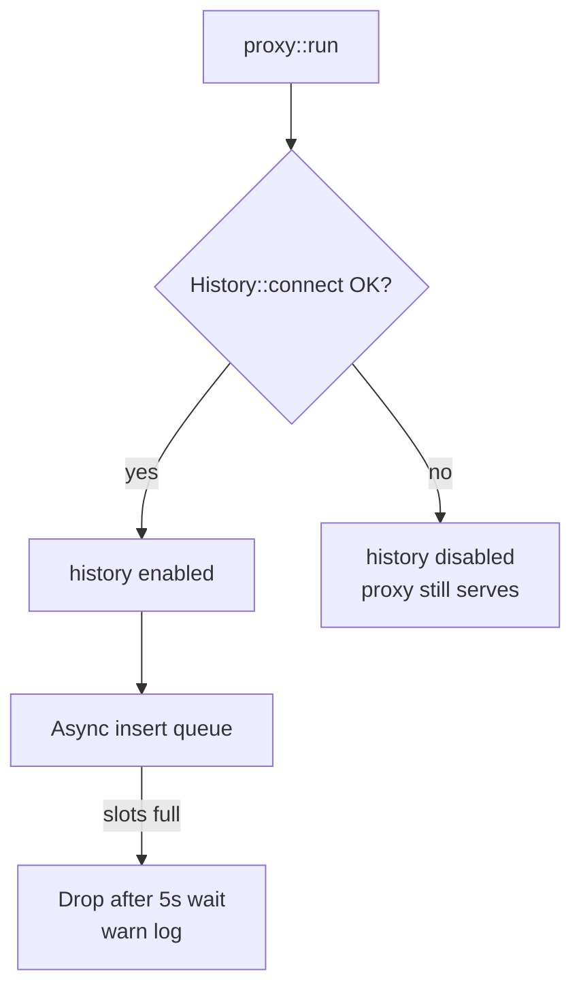
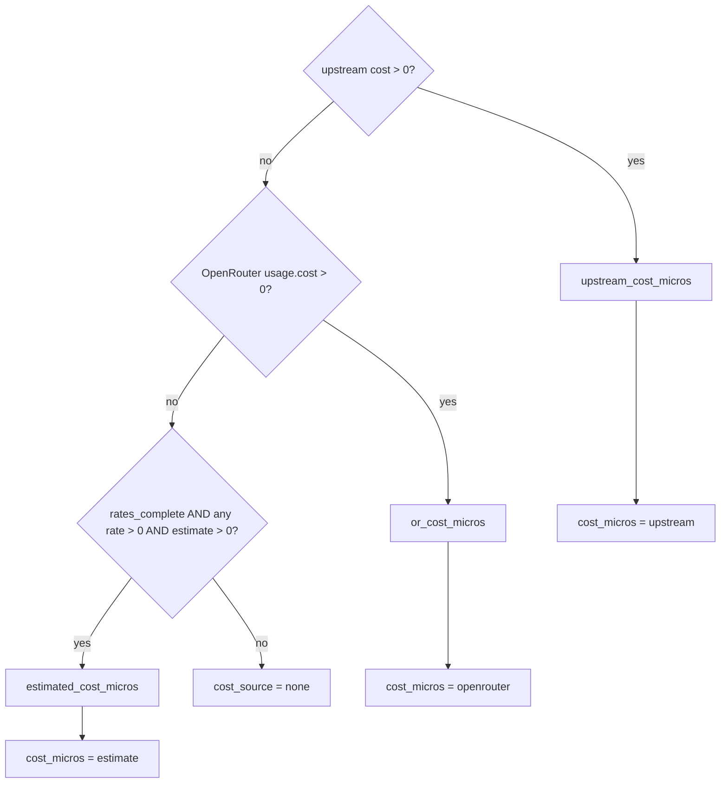

# History and cost

Octo records a **side copy** of proxied calls in SQLite. Live streaming is unchanged: inserts run asynchronously and must not block the client.

## Connect behavior



- Path: `config/history.toml` → `database_path` (default `data/history.sqlite`).
- Migrations under `migrations/`; compile-time `query!` uses committed `.sqlx/` (`SQLX_OFFLINE`).
- Concurrency: 32 insert slots; wait up to 5s; then **drop** the row (no spill-to-disk).
- Shutdown: graceful drain of in-flight inserts.

## Identity

Caller secrets (`Authorization` / `x-api-key`) are stored as **HMAC-SHA256** hashes. Token key from `OCTO_HISTORY_TOKEN_KEY`, `history.token_key`, or an auto-generated `.key` beside the DB (restrictive Unix permissions).

Raw tokens are never written to the database or tracing.

## Tables (conceptual)

### `calls`

Core metrics: kind, provider, model, status, latency, bytes, tokens, `cost_micros`.

Routing: `session_id`, `parent_session_id` (set for `#sub:{hash}` keys), `tier_before` / `tier_after`, `trigger`, `rerouting` / `rerouting_reason`.

Cost detail: `or_cost_micros`, `upstream_cost_micros`, `estimated_cost_micros`, `cost_source`, `is_byok`, `upstream_provider`, cache tokens, `generation_id` (prefers OpenRouter `x-generation-id` `gen-*`), `trimmed_from_tokens`.

Observe: `client_model`, `client_has_thinking`, `client_tool_names`, `bg_signal`, `hk_text_signal`.

Payloads: `request_payload` / `response_payload` (JSON envelopes). **`store_payloads` is `true` by default**: request and response text is kept in the history database. To turn it off set `store_payloads = false` under `[history]` in `config/history.toml` (`$OCTO_CONFIG/history.toml`); text payload columns are then omitted; metrics and observe columns remain.

The `calls` row of an autoroute call also has `request_id` (the `x-octo-request-id` value). Autoroute call records and per-budget-key spend are persisted in the `autoroute_calls` and `budget_spend` tables with their own retention (`calls_max_age_days`, `calls_max_rows`, `budget_spend_max_age_days`, `prune_interval_secs`); see [autoroute.md](./autoroute.md#harness-integration).

### `decisions`

JEV / Decisions rows: scores (`is_hard`, `is_easy`, `tools_enough`), complexity, choice rule, payloads, cost columns. No orchestration score columns yet.

### `session_outcomes`

Upserted from last-user `tool_result` blocks that look like cargo / pytest / unittest summaries, keyed by observe `session_id` (including `#sub:{hash}` when present).

## Cost precedence



Reported cost (BYOK upstream, then OpenRouter `usage.cost`) wins; the price-table estimate (the live table: `source = "manual"` rows, then the OpenRouter catalogue, then `prices.toml` fallback rows; [prices.md](./prices.md)) is used only when none is reported. The autoroute call record (`GET /autoroute/v1/calls/{id}`) names the row's origin in `price_source` (`manual`, `catalogue@YYYY-MM-DD`, `fallback`); the `calls` table has no such column. `cost_source` records which one was used, and `estimated_cost_micros` is stored either way so the two can be compared.

Token semantics for the estimate: Anthropic Messages usage (`input_tokens`, `cache_read_input_tokens`, `cache_creation_input_tokens`) reports `input_tokens` as the **uncached** count, so cache reads and writes are added on top. OpenAI/OpenRouter chat usage (`prompt_tokens`, `prompt_tokens_details.cached_tokens`) reports `prompt_tokens` as the **total** including cache reads, so cache reads are subtracted from the input rate and billed at `cache_read`. The stored `input_tokens` column holds whichever number the vendor reported.

A stream that ends early (client disconnect or upstream error after the headers) still records usage: input tokens from `message_start` (or estimated as request bytes / 4 when the vendor sent none), and output tokens estimated as streamed text bytes / 4 when the reported figure is missing or smaller than what was seen. Those rows are estimates.

At the first request of a session after a restart, session spend is restored from this database whenever history is enabled (not only when a budget is set). Restored spend is kept separate from the routing state, so it does not create a sticky session.

Money is stored as **integer micro-dollars** (`CostMicros`). Failed / no-usage rows stay honest zeros with `cost_source = "none"`.

Rows in `prices.toml` that are all `0.0` skip the estimate (`!any_nonzero()`). The shipped rates were re-copied from the OpenRouter catalogue on 2026-11-14 ([ladder-cost-check.md](./ladder-cost-check.md)); `cache_write` stays `0.0` where the catalogue publishes no price. With catalogue refresh on, they are only the fallback.

## Caveats

| Issue | Effect |
| --- | --- |
| Soft-fail open | Proxy up, no history |
| Burst drop | Missing rows under load; warn includes `session_id` |
| Stream fail after headers | Client may see a truncated body; history keeps header status (warn logs session) |
| `generation_id` | Prefers OpenRouter `x-generation-id` `gen-*`; body `msg_*` is fallback |
| Compact accounting | Compact rows store `session_id` and add session spend when cost is present |

Inspect latest rows:

```bash
sqlite3 data/history.sqlite \
  "SELECT id, kind, provider, model, status, trigger FROM calls ORDER BY id DESC LIMIT 5;"
```

Reconcile vs a provider CSV: `python3 scripts/reconcile_costs.py data/history.sqlite --provider-csv invoice.csv`.
