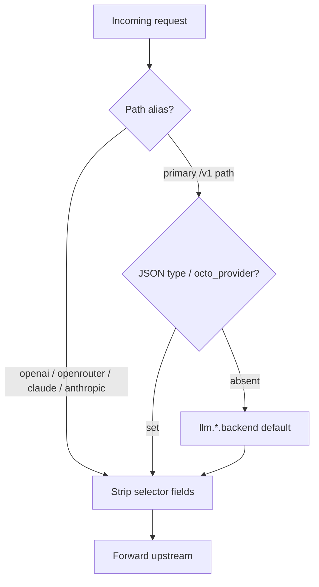
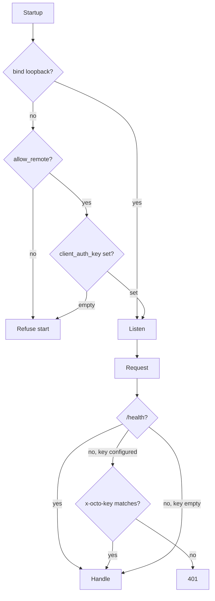

# Passthrough proxy

Passthrough routes forward the client body to upstream with streaming. Octo does **not** rewrite the model or run the autoroute ladder on these paths.

## Route table

| Method | Local path | Upstream role |
| --- | --- | --- |
| `GET` | `/health` | Liveness (no auth) |
| `POST` | `/v1/chat/completions` | Chat (backend from select) |
| `POST` | `/openai/completions`, `/openai/v1/chat/completions` | Direct OpenAI chat |
| `POST` | `/openrouter/completions`, `/openrouter/v1/chat/completions` | OpenRouter chat |
| `POST` | `/v1/messages` | Messages (backend from select) |
| `POST` | `/claude/messages`, `/claude/v1/messages`, `/anthropic/messages`, `/anthropic/v1/messages` | Direct Anthropic |
| `POST` | `/openrouter/messages`, `/openrouter/v1/messages` | OpenRouter Messages |
| `POST` | `/v1/decisions`, `/openrouter/decisions`, `/openrouter/v1/decisions` | OpenRouter Decisions |

Primary paths also come from config (`chat_completions_path`, `messages_path`, `decisions_path`). Autoroute paths are documented in [autoroute.md](./autoroute.md).

## Provider selection

- Chat backends: `openai` | `openrouter` (`config/llm.toml` → `[llm.chat]`).
- Messages backends: `claude` | `openrouter` (shipped default **`openrouter`**).
- Decisions: OpenRouter only in current wiring.

Invalid selector → **400** `invalid provider selector`.

## Streaming and headers

1. Read request body up to `limits.max_body_bytes` (413 if larger).
2. POST upstream with client credentials:
   - Chat / OpenRouter Messages / Decisions: `Authorization`
   - Direct Anthropic: `x-api-key` (+ `anthropic-version` from client or config)
3. OpenRouter attribution: client `Referer` / `X-OpenRouter-Title`, else config defaults.
4. Stream response bytes to the client immediately.
5. A rolling tail buffer captures trailing usage JSON for history (`providers/utils.rs`).
6. Response headers pass an allowlist (`Content-Type`, `Cache-Control`, `x-request-id`, `retry-after`, `openai-*`, `x-ratelimit-*`, `anthropic-ratelimit-*`).

Errors return JSON `{"error":"..."}` (400 / 413 / 502). Messages routes can remap to Anthropic-shaped error bodies for client compatibility.

## Auth and bind

Threat model: with `allow_remote = true`, anyone who can reach the bind address and knows `x-octo-key` can forward to configured upstream URLs. Keep keys secret; prefer loopback for local Claude Code.

## What passthrough does *not* do

- No model ladder / JEV / sticky / stall
- No `strip_fields` / `require_parameters` (Anthropic-only fields pass through — OpenRouter Mistral may 404)
- No `/autoroute/status`

Use `/autoroute/v1/messages` when talking to OpenRouter models that need hygiene.
