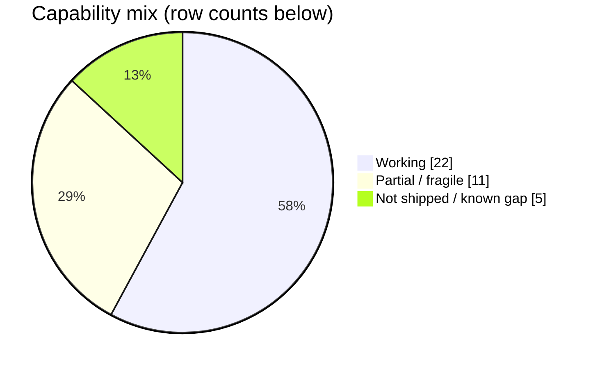
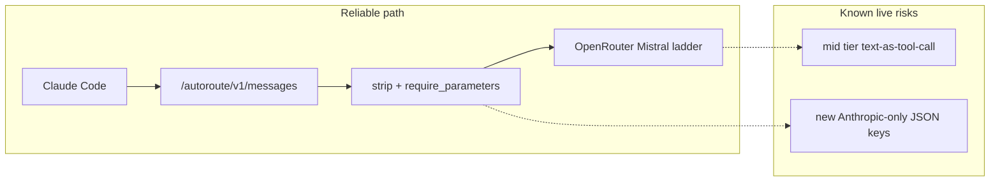

# Status — what works, what does not

Honest capability matrix for the codebase on `main` as of the architecture-docs merge (`27d89d0` lineage). Evidence comes from integration tests under `tests/`, live verification notes, and code inspection. Prefer this page over optimistic README wording when deciding what to rely on.

## Summary

| Bucket | Count | Meaning |
| --- | --- | --- |
| Working | 22 | Test-backed; safe for default Claude Code → OpenRouter use |
| Partial | 11 | Works with caveats, off-by-default flags, or accounting holes |
| Missing | 5 | Planned or documented; not in code |

---

## Working

| Area | What you can rely on | Evidence |
| --- | --- | --- |
| Health | `GET /health` → 200 with `service`/`capabilities` JSON | `route_integration`, `harness_integration` |
| Chat proxy | OpenAI + OpenRouter path/body/backend select, streaming | `chat_provider_select`, `proxy_post`, header tests |
| Messages proxy | Direct Anthropic + OpenRouter Messages | `route_integration`, llm defaults |
| Decisions proxy | OpenRouter Decisions forward + history | `history_store` |
| Client auth | Loopback default; remote needs key; `x-octo-key` | `proxy_post`, `auth.rs` |
| Autoroute ladder | low/mid/high from config; sticky + stall escalate/release | `tests/autoroute.rs` |
| JEV classify | `is_hard` / `is_easy` / `tools_enough`; scores in `decisions` | `autoroute` JEV tests; verification C1 |
| Housekeeping | Force low, no decisions row, optional trim | housekeeping fixtures |
| Permission check | Hold model, skip JEV | permission_check tests |
| Body hygiene | `strip_fields` + `require_parameters`; thinking strip; max_tokens clamp | shape fixtures `call_528` / `call_530` |
| Tools kept | Client `tools[]` not filtered by JEV | forwards_all_tools tests |
| Messages compact | OpenRouter compact API when overflow | `compact.rs` + decide route |
| Messages retry | One retry on 429 / 5xx / connect-timeout before client bytes: same tier after `Retry-After` (bounded), next tier only when the model is unavailable; no 4xx retry | `autoroute_retry` |
| Compaction bound | One compaction call per threshold crossing; unapplied compaction is logged (`compact_not_applied`) and suppressed until the context shrinks | `r1_*` in `cost_fixes` |
| Classifier failure | New session + JEV failure uses `classifier_failure_tier` (default `mid`), remembered, retried next user turn | `r2_*` in `cost_fixes` |
| `max_tokens` default | Missing value becomes `default_max_tokens` (8192), capped by model max | `r3_*` in `cost_fixes` |
| Classifier input cap | JEV receives at most 2000 chars of the last user text | `r4_*` in `cost_fixes` |
| Budget actions | `downgrade` to the cheapest tier by price, or `reject` with 402; optional shared `x-octo-budget-key` | `r6_*` in `cost_fixes` |
| Cost accounting | Reported cost beats the estimate; messages vs chat token semantics; dropped streams keep tokens; spend restored whenever history is on | `history_payload`, `r7_*` in `cost_fixes` |
| Ladder startup check | Warns when the ladder is not monotonic in price or a model is unpriced | `r8_*` in `cost_fixes` |
| History core | Async insert, HMAC tokens, cost micros, payloads | `history_*` tests |
| Observe columns | client_model / thinking / tools / bg / hk | `autoroute_observe` |
| Session outcomes | cargo / pytest / unittest tool_result parse | `session_outcomes` |
| Statusline | `/autoroute/status` + script | `status.rs`, `scripts/statusline.sh` |
| Harness integration | Hint headers, result headers (`x-octo-*`), `GET /autoroute/v1/calls/{id}`, header budget, compaction trigger; call records persisted | `harness_integration`, `call_persistence` |
| Routing decision for delegation | `POST /autoroute/v1/route` (capability `route_api`): one classifier call, ranking of API tiers and flat-rate agents | `route_api` |
| Price rule | `never_pay_more_for_less`: serve the cheapest tier at or above the decided one; `x-octo-decided-tier`, `x-octo-price-swap` | `price_rule` |
| Exit with the parent | `OCTO_EXIT_ON_STDIN_CLOSE=1` shuts down gracefully when stdin closes | `stdin_exit` |
| Per-subagent keys | `{uuid}#sub:{hash}` + `parent_session_id`; first turn defaults low | `subagent_first_turn_*`, `subagent_keys_*`, parent stall test |
| tool_results_only hold | Keeps sticky model; no JEV | `tool_results_only_hold_*` |
| Budget recap | Cap after fill-upgrade / before tier escalation on retry; compact adds session cost | `budget_blocks_fill_*`, `autoroute_does_not_escalate_*` |
| Catalog miss | Unknown window skips fill/compact (no fake 8192) | `catalog_miss_skips_compact_*` |
| `generation_id` | Prefers OpenRouter `x-generation-id` / `gen-*` | `generation_id_prefers_openrouter_header_*` |

---

## Partial / fragile

| Item | Default / behavior | Risk | Tracking |
| --- | --- | --- | --- |
| Soft-fail history | DB fail → proxy continues without DB | Silent loss of FinOps | `proxy/mod.rs` |
| Insert backpressure | 32 slots, 5s, then **drop** | Missing rows under burst (warn includes `session_id`) | verification F3 |
| Stream fail after headers | Client may see truncated body; history keeps header status | Warn logs session; recon by status alone can miss truncation | AGENTS.md |
| `session_budget_usd` | **0 (disabled)** | **No spend limit of any kind until set**: nothing is downgraded or refused, so cost is bounded only by the client. Set it (and pick `session_budget_action`) to enable | `autoroute.toml` |
| Ladder price order | **Inverted by the published prices** | At the catalogue prices `high` is the cheapest model and `low`/`mid` dearer; the ladder order is by capability and was not changed. `never_pay_more_for_less` (default on) serves the cheapest tier at or above the decided one, so low and mid requests are served by `high` for a typical shape; the start-up warning says so | [ladder-cost-check.md](./ladder-cost-check.md), `tests/price_rule.rs` |
| Budget key state | Spend per `x-octo-budget-key` is persisted (`budget_spend`) and restored on the key's first request after a restart; pruned after 90 idle days by default | A kill within milliseconds of a call finishing loses that call's record and spend increment | `ledger.rs`, `tests/call_persistence.rs` |
| Toolless compaction | Requests with no `tools[]` keep no session state | An oversized toolless request can still be compacted on every call | `route.rs` |
| Dropped-stream tokens | Estimated from streamed bytes / 4 | Approximate; the reported figure replaces it when the vendor sent one | `history/payload/common.rs` |
| Cache behaviour | Not verified against a live OpenRouter key | Real cache hit rates and billing untested | [ladder-cost-check.md](./ladder-cost-check.md) |
| `background_by_client_model` | **false** | `bg_signal` observe-only | defaults regression |
| `server_tool_mode` | **passthrough** | Server tools hit models that may not support them | `autoroute_server_tools` |
| Chat autoroute compact | No Messages compact API | Chat overflow ≠ messages compact | `allow_compact: !chat` |
| Text-as-tool-call | Detect + **next-turn** escalate | Mid-tier can emit Agent JSON as text this turn | [debug/text-tool-call](./debug/2026-11-06-text-tool-call.md) |
| `prices.toml` zeros | Rows left at `0.0` skip the estimate | Fall through to reported cost, else `none`; `minimax-m3.1-flash` keeps the peak rate (the catalogue halves it off-peak) | `prices.toml` |
| `provider_order` Mistral | Prefers Mistral endpoint | Hard-fail if Mistral down and fallbacks false | ratelim / text-tool docs |
| Filter-by-Parameters | Strip list tuned for known keys | New Anthropic-only fields → 404 again | [experiments/ratelim](./experiments/2026-11-06-ratelim.md) |

---

## Not shipped / does not work yet

| Gap | Intent | Status |
| --- | --- | --- |
| `needs_orchestration` JEV score | Shadow multi-part task detection | Plan P1 only |
| `orchestrate` config + Agent nudge | Encourage delegation on high | Plan P2 only |
| Eval harness H1–H5 | Quality vs always-high | Plan P4 only |
| Same-turn rewrite of text → `tool_use` | Fix mid-tier Agent text emissions | Explicitly not implemented |
| History spill-to-disk | Survive insert bursts | Not implemented (drop only) |

Full plan: [plans/2026-11-06-orchestration-plan.md](./plans/2026-11-06-orchestration-plan.md).

---

## Recommended production posture (today)

1. Bind loopback; set `client_auth_key` if exposing beyond localhost.
2. Point Claude Code at **`/autoroute`** (not raw `/v1/messages`) when using the Mistral ladder.
3. Keep shipped `strip_fields` + `require_parameters = "always"` unless you have a proven narrower set.
4. `session_budget_usd = 0` means **no cost limit at all**. Set a budget and `session_budget_action` (`downgrade` or `reject`) if you need a ceiling; use `x-octo-budget-key` to share one budget across agent sessions.
5. Leave `background_by_client_model = false` until you want Haiku-pattern routing.
6. Concurrent Claude Code Agents use distinct `{uuid}#sub:{hash}` sticky keys (first-prompt hash).
7. Treat mid-tier text-as-tool-call as a known failure mode; escalate helps the *next* turn only.
8. Do not depend on orchestration nudge — not in the binary.

---

## How this page is maintained

Update when:

- A PARTIAL becomes test-closed and default-safe → move to **Working**
- A plan item lands on `main` → move out of **Not shipped**
- A live incident finds a new Anthropic-only key or provider quirk → add under **Partial**

Dated evidence folders under `docs/verification`, `docs/experiments`, and `docs/debug` remain the audit trail; this matrix is the executive view.
