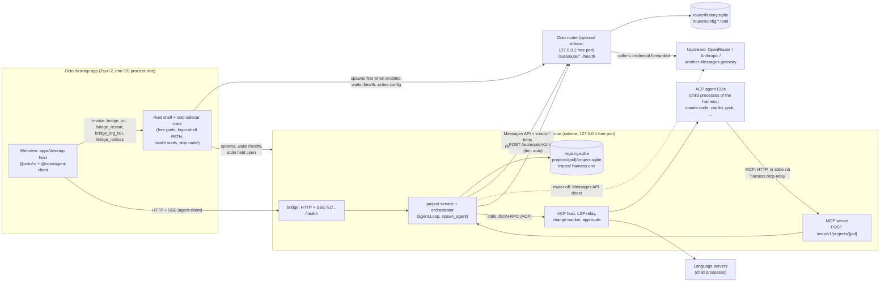

# Octo architecture

The single system overview. It describes the code as it is in the working tree, checked by reading the code on
2026-11-11, not copied from older documents. Where a spec and the code disagree, the code is described and the
disagreement is listed in [Known contradictions](#known-contradictions). Where something could not be checked it is
marked **unknown**. The reader who needs depth follows the links: each part has its own docs.

Contents: [Parts](#the-five-parts) · [Process diagram](#the-running-desktop-app) · [Data](#data-locations) ·
[Flows](#main-flows) · [Where to look](#where-to-look) · [Environment](#environment-variables-and-settings) ·
[Status](#status) · [Specs index](#specs-index) · [Gates](#gates-and-scripts) · [Contradictions](#known-contradictions)

## The five parts

| Part | Path | Stack | What it is |
| --- | --- | --- | --- |
| **router** (crate `octo`) | `apps/router/` | Rust (Axum 0.8, Tokio, SQLite via sqlx) | HTTP proxy for OpenAI-style chat, Anthropic Messages and OpenRouter, plus `/autoroute/*`: a session-aware model ladder, a price rule, a routing decision for delegated tasks, per-key budgets and a SQLite call history. Holds no provider key: it forwards the caller's credential |
| **harness** | `apps/harness/` | Go 1.26 (own `go.mod`) | `harness serve`: the project server. Projects, one orchestrator per project, nested sub-agents, per-project SQLite, file API, plugin registry (language servers, ACP agents, tool servers), an MCP server for ACP orchestrators, settings API, diagnostics. Also CLI commands `doctor`, `mcp-relay`, `run`, `sessions`, `show` |
| **agent-client** (`@octo/agent-client`) | `packages/agent-client/` | TypeScript, no DOM, no React | The `Bridge` interface and its HTTP + SSE implementation, the pure project-state reducer, a message-port bridge for embedded hosts, language-server sessions. Types mirror the harness JSON |
| **ui** (`@octo/ui`) | `packages/ui/` | React 19, Tailwind 4, Monaco | Shell-agnostic UI: sidebar, tab workspace, orchestrator conversation, agent transcripts, file view with code comments and LSP, usage, settings. Talks only through `Bridge`. Has an in-memory demo bridge (`@octo/ui/demo`) |
| **desktop** (`@octo/desktop`) | `apps/desktop/` | Vite + React host, Tauri 2 shell (`src-tauri/`), crate `octo-sidecar` (`src-tauri/sidecar/`) | Hosts the UI. Inside Tauri the Rust shell starts, watches and stops the bundled harness and (optionally) router as sidecars. `octo-sidecar` has no Tauri dependency, so it is unit-tested anywhere |

Also present: `apps/web/` (README only, a future static host), `scripts/` (dev, install, sidecar build, checks),
`.github/workflows/` (CI: `ci.yml` router, `harness.yml` Go, `desktop.yml` frontend and `cargo check` / `cargo test -p
octo-sidecar` of the shell), `.cursor/rules/` and `.claude/rules/typescript.md` (coding rules).

Dependency direction: `desktop` → `ui` → `agent-client` → (HTTP) → `harness` → (HTTP, optional) → `router` →
upstream. `packages/ui` never imports Tauri. The three persistence layers (harness, router, desktop shell state) share
nothing: no SQLite file and no config file is read by two of them.

## The running desktop app

Notes on the diagram:

- **Start order** (when the router is switched on and has an upstream key): router, wait for its `/health` (up to 20 s),
  then the harness with `--base-url http://127.0.0.1:<router port>/autoroute`; wait for the harness `/health` (up to
  15 s). **Stop order**: harness, then router (SIGTERM, 3 s, SIGKILL on the process group). A router that fails to
  start does not block the app: the harness starts without it and the shell reports a `router_failed` notice.
- **If the app dies without cleanup**, each sidecar sees EOF on a stdin the shell keeps open
  (`HARNESS_EXIT_ON_STDIN_CLOSE=1`, `OCTO_EXIT_ON_STDIN_CLOSE=1`) and shuts down; `harness.pid` / `router.pid` let the next
  launch remove a leftover.
- **Without Tauri** (browser): nothing starts the sidecars. `pnpm dev:all` (`scripts/dev.sh`) starts harness and UI dev
  server (and, with `--router`, the router); the UI connects to `VITE_HARNESS_BRIDGE_URL` (default
  `http://127.0.0.1:8790`) or to the demo bridge with `?demo=1`.
- **Agents are not behind the router.** The router only sees the harness's own Messages-API requests. An ACP agent's
  traffic goes from the agent CLI to its vendor; the router can only *advise* which agent to use (the route endpoint).
- The webview's connection to the harness is plain loopback HTTP; the harness refuses `/v1/settings` for non-loopback
  peers, hosts and foreign origins.

### Inside the harness

Package map of `apps/harness/internal/` (one line each; deeper: `apps/harness/docs/architecture.md`):

| Package | Role |
| --- | --- |
| `bridge` | HTTP routes (`/v1/...`, `/health`, `/mcp/...`), SSE, CORS and loopback rules; `Version` |
| `project`, `projectstore` | Project service (create, send, budget, files, notes, memory API); SQLite stores (registry, per project), migrations, `PRAGMA user_version` stamp (`SchemaVersion`, **14**: 9 slash commands and /clear, 10 notes, 11 attachments, 12 sessions and exchanges, 13 project sessions, 14 memory M6 task fields and the clean-up of request-only tasks; the next free one is 15) |
| `orchestrator` | One turn at a time per project; orchestrator and sub-agent runs; `spawn_agent` (tiers, `auto`, ACP agents); queue; approvals glue; compaction; memory tools, digest and window assembly; ACP orchestrator session (`acp_*.go`) |
| `agent` | The Messages-API tool loop (`agent.Loop`), tool-result clearing |
| `anthropicclient`, `router`, `budget`, `fakerouter` | Messages client (prompt caching, response observer); the router integration (detection, hints, result headers, route call); project spend meter; a stand-in router for tests |
| `acp`, `acptrace`, `fakeacp`, `permission`, `mcp`, `mcprelay` | ACP client over stdio; opt-in wire trace; scripted agent for tests; the one place permission requests are answered; the MCP server; the stdio-to-HTTP relay |
| `plugins`, `lsp`, `fakelsp` | Plugin manifests (built-in `subscription-agents` is embedded in the binary), login probes; language-server relay; scripted LSP |
| `changes`, `diff`, `approval`, `inputs`, `secrets` | v7: change tracker and snapshots, line counts, approval requests, `request_input` forms, per-project secret store |
| `memory` | Orchestrator memory service: limits, redaction, tools, digest, search shaping |
| `files`, `tools`, `store`, `events` | Confined file API; local and remote tools and result caps; legacy CLI session store (`harness.sqlite`); per-project event hub with `seq` |
| `config`, `settings`, `childenv`, `prices`, `limits`, `diag`, `cache`, `mockllm` | Env/flags to `Config`; the settings API over `harness.env`; the child-process environment allow-list; optional `prices.toml`; rate-limit header memory; diagnostics report; remote-tool cache; scripted Messages server |

## Data locations

Nothing below is shared between harness, router and shell.

| What | Where | Owner | Notes |
| --- | --- | --- | --- |
| Harness data dir | `--data-dir` / `HARNESS_DATA_DIR`, default `./data/harness`. In the desktop app: `<Tauri app data dir>/harness` (the identifier is `com.ndolinschi.octo.desktop`; the per-OS base path was not checked here) | harness | Created `0700`. `HARNESS_DATA_DIR` cannot come from `harness.env` |
| `harness.env` | `{data-dir}/harness.env`, mode `0600` (a group-readable file is refused) | harness (settings API writes it atomically); the shell reads the three `OCTO_ROUTER_*` keys | `KEY=VALUE` lines. Precedence: flags > process environment > file |
| `registry.sqlite` | `{data-dir}/registry.sqlite` | harness | Project registry. Stamped with `user_version`; a newer database is refused untouched |
| `project.sqlite` | `{data-dir}/projects/{pid}/project.sqlite` | harness | Messages, agents, usage rows, notes, tasks and facts, memory sessions and exchanges, project sessions, memory files, search index (FTS5), queue, changes, approvals, compactions, ACP session ids, context receipts. Same version stamp: **schema 14** (`projectstore.SchemaVersion`); the memory M6 clean-up migration leaves `project.sqlite.pre-m6` (a numbered name when one exists) beside it |
| Project side files | `{data-dir}/projects/{pid}/shadow/` (pre-images, 256 MiB cap), `{data-dir}/projects/{pid}/secrets.json` (`0600`, never in SQLite) | harness | |
| ACP wire traces | `{data-dir}/traces/` | harness | Only when `HARNESS_ACP_TRACE` is on; per process, 5 MB cap per file, 20 files, redacted |
| Plugins, remote-tool cache, price table | `{data-dir}/plugins/`, `{data-dir}/cache/`, `{data-dir}/prices.toml` | harness | All optional |
| Legacy CLI sessions | `{data-dir}/harness.sqlite` | harness | Only `harness run / sessions / show` |
| `harness.pid` | `{data-dir}/harness.pid` | desktop shell | Leftover cleanup after a crash |
| Router config | Directory named by `OCTO_CONFIG`; standalone default `./config/` (cwd). In the desktop app `<app data>/router/config/` (`server.toml` `0600`, `limits.toml`, `history.toml`, rewritten at every start) | router (shell writes it) | `[server]` and `[limits]` are required |
| Router store | `history.toml` `database_path`, standalone default `data/history.sqlite`; in the app `<app data>/router/history.sqlite` (+ `.key` for the token HMAC unless `OCTO_HISTORY_TOKEN_KEY`) | router | Calls, decisions, session outcomes, `autoroute_calls` records, `budget_spend`. Soft-fail: if it cannot open, the proxy runs without history |
| Logs | Tauri app log dir: `harness.log`, `router.log` (2 MiB cap, one `.1` kept) | desktop shell | `harness doctor` and `GET /v1/diagnostics` also carry the last 200 harness log records, scrubbed |
| UI preferences | Browser `localStorage` (theme `octo.theme`, layout, tab memory) | ui | Per webview, not shared |

## Main flows

Each flow names the code that does it. Statements about real vendor CLIs are **unverified**: see [Status](#status).

### 1. A user message with the built-in loop

1. The UI calls `Bridge.sendMessage` (or `sendOrQueueMessage`); the client does `POST /v1/projects/{pid}/messages`.
2. `bridge` → `project.Service` → `orchestrator.Start`. If a turn is already running the message is queued (`202
   {queued}`, FIFO, at most 20, persisted); otherwise the project's turn slot is claimed and the user message is stored.
3. The harness opens a task record for the message (memory, first 80/400 characters, `auto: true`).
4. `runOrchestrator` assembles the request: mode `full` = the whole transcript after the latest compaction summary;
   mode `window` (memory M2) = capped blocks; tool results older than the last 5 are replaced by stubs in
   the copy that is sent when the estimate passes 60% of the model's window.
5. Before each request the budget gate runs ([flow 5](#5-budget)). `agent.Loop` sends the Messages request through
   `anthropicclient` (up to three `cache_control` breakpoints; with a detected router also the `x-octo-*` hint headers).
6. The model answers with text and tool calls. Tool calls of one message run concurrently. The orchestrator has
   `spawn_agent`, `list_dir`, `read_file`, notes and memory tools; only sub-agents have `write_file` and `bash`.
   In a `supervised` project `write_file` and `bash` wait for an approval ([flow 6](#6-approvals-queue-and-forms-v7)).
   A sub-agent is a row in `agents`, runs its own loop synchronously inside the tool call and returns its report.
7. Everything is published on the project's SSE stream (`message.delta`, `tool.started`, `agent.created`,
   `agent.updated`, `usage`, `change.recorded`, ...). The UI reducer in `@octo/agent-client` folds the events.
8. The turn ends; the slot is released, then `turn.finished` is published, then the queue advances (a failed or
   cancelled turn pauses a non-empty queue). After a *completed* turn a side-model call digests the turn into the task
   record ([flow 7](#7-memory)). Without an API key, Octo key or custom base URL the built-in loop is unavailable and
   such a turn fails at once with one message and no upstream call.

### 2. A user message with an ACP orchestrator

1. The project's `models.orchestrator` is `acp:<agent>[/<model>]` (or the server default resolves to the first
   available, logged-in ACP agent when there is no key).
2. The first message starts the agent process lazily (a child of the harness; environment = the allow-list plus the
   manifest `env`, never the harness's provider keys) and an ACP session in the project's first folder. The stored
   session id is resumed with `session/load` when the agent advertises it; otherwise a new session gets a recap
   (compaction summary or the last 40 texts, 8000 characters at most; in window mode the memory assembly).
3. The harness's tools (`spawn_agent`, `save_note`, `delete_note`, `list_dir`, and with memory the memory tools,
   `request_input`) reach the agent as an MCP server inside the harness (`POST /mcp/v1/projects/{pid}`, loopback only,
   per-session bearer token): an HTTP entry when the agent advertises it, else a stdio entry running `harness
   mcp-relay`. An agent that refuses MCP servers still answers; the turn carries a `warning:`.
4. `session/prompt` goes out; `session/update` chunks become `message.delta` and tool rows; `usage_update` becomes a
   usage row (`source: acp`). `session/request_permission` and `fs/*` go through `permission` (auto-approve in a `full`
   project, an approval card in a `supervised` one); file access is confined to the project folders; the agent process
   itself is not sandboxed.
5. Failures end the turn with a message naming what to do (missing command, not logged in, refused MCP servers, crash,
   `stopReason` refusal, a reply with no text and no tool call). The session is shut down after `HARNESS_ACP_IDLE`.

### 3. A delegation with `tier: "auto"` and the router's route decision

1. The orchestrator calls `spawn_agent` without an explicit tier or agent. `tier: "auto"` is the default when
   `GET /health` of the router announced the capability `route_api` (otherwise the balanced tier, with the reason
   recorded).
2. `orchestrator/auto.go` builds the candidates: each API tier (when the built-in loop is available and the tier is not
   mapped to an agent) and each available ACP agent (`acp:<id>`; logged-out ones flagged, ones whose probe has not
   answered left out; `models.auto_candidates` restricts and orders). Manifest fields `flatRate` and `strengths` feed the
   decision.
3. `POST {router}/autoroute/v1/route` with `{budget_key: <project id>, task: {title, brief, tools, depth}, candidates}`;
   the harness waits at most `HARNESS_ROUTE_TIMEOUT` (default 2500 ms).
4. The router (`src/auto/delegate/`) classifies the task once (the Decisions classifier, 2 s timeout; with no answer a
   text rule gives the band and the reason says so), then ranks the candidates able to do that band: logged-in flat-rate
   agents with the most limit left first, then API tiers by blended price, then other agents. An agent with no
   `strengths` is able for easy and medium; a hard task goes to the deep tier unless `prefer_flat_rate_for_hard`. Logged-out and exhausted agents
   are never chosen. With the project budget reached it does not classify: a flat-rate agent if any, else 402. The
   decision is stored as a call record (`trigger: route`) and its classifier cost counts against the budget key.
5. The harness stores `route_choice`, `route_band`, `route_reason`, `route_request_id` on the agent and a usage row
   with role `route`. An API-tier choice becomes a sub-agent on that tier (tier hint plus the project's `tier_policy`
   decide what the router serves; with `never_pay_more_for_less` on the router may serve a cheaper tier at or above
   the decided one and says so in `x-octo-decided-tier` / `x-octo-price-swap`). An agent choice starts that ACP agent.
6. Any failure falls back and never fails the turn: no router, timeout, 5xx, 422, unknown choice → the balanced tier
   (or the first logged-in agent when there is no key); a 402 becomes the budget failure. An explicit tier or an
   explicit `agent` is never routed.

### 4. Delegation to a fixed tier or agent

`spawn_agent` with `tier: fast|balanced|deep` or `agent: <acp id>` skips the route call. A tier whose model is
`acp:<id>` starts that agent as the sub-agent. Sub-agent requests carry `x-octo-role: sub`, the depth, the task title
and the tier hint when a router is present.

### 5. Budget

1. A project has an optional `budget_usd` (`PATCH /v1/projects/{pid}`; `null` removes it).
2. Spend is one number. With a router that announced `budget_key`: the router's last reported spend for the project
   (`x-octo-spent-usd` plus the cost of the call record); the harness sends `x-octo-budget-key` (the project id) and
   `x-octo-budget-usd` on every Messages request. Without a router: the sum of usage rows (reported costs, plus
   estimates from `prices.toml`). An ACP agent on a flat-rate subscription reports an *estimate* that is stored as
   `subscription_equivalent_usd` and never counted as spend.
3. Before every orchestrator request and every `spawn_agent` the gate (`budgetReached`) compares spend with the budget.
   Reached: the turn ends `failed` with "Project budget reached ..." and no further upstream call; a delegation refused
   for budget creates its sub-agent row and settles it `failed` with the reason.
4. The router's 402 (a budget sent in `x-octo-budget-usd` always rejects) is the backstop. Spend per budget key is
   persisted in the router (`budget_spend`) and restored after a restart.

### 6. Approvals, queue and forms (v7)

1. **Access** is a project field: `supervised` or `full`. New projects get `HARNESS_DEFAULT_ACCESS` (**`full`**
   unless set otherwise; the UI shows approval cards; existing projects keep their value).
2. In a `supervised` project `write_file`, `bash` (any depth), ACP `session/request_permission` (not read/search) and
   ACP `fs/write_text_file` create an `Approval` card (`GET/POST /v1/projects/{pid}/approvals`); only the agent that
   asked blocks. Decisions `allow`, `allow_for_turn`, `deny`. Cancelling the turn denies what is pending; an
   unanswered request is denied after `HARNESS_APPROVAL_TIMEOUT` (30 min). Events `approval.requested`,
   `approval.resolved`, `project.attention`.
3. **Changes**: every file change in the project folders is recorded per turn (`write_file`, ACP `fs/*`, plus
   before/after snapshots for `bash` and for an ACP agent's own tools) with diffs and a revert endpoint
   (`/changes`).
4. **Queue**: a message sent during a turn is queued; `/queue` lists, edits, removes, clears, resumes, sends now.
5. **Forms and secrets**: the tool `request_input` blocks the calling agent until the user submits or skips a form
   (`/inputs`); secret fields go to the per-project secret store (`/secrets`) and reach a child process only as
   `secret:<name>` in `bash` / `spawn_agent` `env`. Everything stored or sent passes a redactor.
6. Detail and exact shapes: `apps/harness/docs/v7.md`. Pending approvals and forms survive a UI reload, not a harness
   restart.

### 7. Memory

1. Every message stays verbatim in `project.sqlite`. At the start of a turn the harness opens a **task record**
   (`tasks`: title, goal, constraints, acceptance, quotes, decisions, outcome, files, dated **facts**).
2. The orchestrator (built-in, and an ACP orchestrator over MCP) has `task_update`, `memory` (view, create,
   str_replace, insert, delete, rename on markdown files kept in `project.sqlite`), `memory_search` and
   `recall_message`.
3. After a completed turn a side model (fast tier unless `models.side`) digests the turn into the record and facts (no
   tools, usage role `digest`, failures only logged). Quotes must be exact substrings of the user's message.
4. Search (`memory_search`, `GET /v1/projects/{pid}/memory/search`): two FTS5 indexes (`unicode61`, and `trigram` for
   inflected Russian and partial identifiers); all words first, then "most of the significant words"; superseded facts
   after current ones; an explicit "nothing in memory matches".
5. **M2 (built, opt-in)**: project setting `memory: {context: "full"|"window", recent_exchanges}`;
   `window` builds the orchestrator request from capped blocks (memory index, open tasks, the last N exchanges, facts,
   the current turn) and stores a context receipt (`GET /v1/projects/{pid}/turns/{tid}/context`). `full` is the default
   and today's behaviour. **M3** (UI view) is built; embeddings and cross-project memory are not.
6. Detail: `apps/harness/docs/memory.md`.

### 8. Diagnostics (`harness doctor`)

1. `cd apps/harness && go run ./cmd/harness doctor [--data-dir D] [--json]` (or the built binary): prints version, Go
   and OS, the data dir, the `PATH` children get, the *names* (never values) of provider and router variables that are
   set, the built-in loop and router state, and per agent: resolved command or "not found", each `requires` command,
   the login probe (run now: exit status only), the install and login hints.
2. `GET /v1/diagnostics` returns the same data from the running harness, without running any probe, plus the last 200
   log records (credentials scrubbed). Settings has a "Copy report" action planned with the UI work; the endpoint is
   built, the UI use is **not built**.
3. `HARNESS_ACP_TRACE=1` (or the setting of that name) writes an ACP wire trace under `{data-dir}/traces/` for sessions
   that start afterwards. A test asserts that no secret appears in the report.

### 9. Settings and first start

`GET/PUT /v1/settings` read and write `{data-dir}/harness.env` for a fixed list (provider key, tier models, default
orchestrator, router switch/key/base URL, child-env allow list, ACP trace). Secrets are write-only. Models, the
allow list and the trace apply at once; keys and router settings need a restart of the sidecars
(`restart_required`), which the shell performs through `bridge_restart`. The first-run screen (P9) is built as the connect
screen (decision 53).

## Where to look

| Feature | Package / directory | Spec | Verification script (all scripted, no real CLI) |
| --- | --- | --- | --- |
| Project server, bridge API, SSE | `apps/harness/internal/{bridge,project,projectstore,events}` | `2026-11-10-project-harness-design.md` | `go test ./...`; `apps/harness/scripts/e2e-acp-orchestrator.sh` drives it with curl |
| Orchestrator, sub-agents, tiers | `internal/{orchestrator,agent,anthropicclient}` | `2026-11-10-project-harness-design.md` | `apps/harness/scripts/e2e-router.sh` (three sub-agents on one budget key) |
| Orchestrator on an ACP agent, MCP | `internal/{acp,permission,mcp,mcprelay}`, `internal/orchestrator/acp_*.go`; `apps/harness/docs/acp-orchestrator.md` | `2026-11-10-subscription-agents-design.md` (S2) | `apps/harness/scripts/e2e-acp-orchestrator.sh` |
| Plugins, agent manifests, login probes | `internal/plugins`, `apps/harness/plugins-examples/` | `2026-11-10-workspace-plugins-acp-design.md`, `2026-11-10-subscription-agents-design.md` | `apps/harness/scripts/test-subscriptions.sh` (live, needs the CLIs and accounts) |
| Child process environment | `internal/childenv` | `2026-11-10-subscription-agents-design.md` | `go test ./internal/childenv` |
| Language servers | `internal/{lsp,fakelsp}`; UI `packages/ui/src/lsp` | `2026-11-10-workspace-plugins-acp-design.md` | `go test` (real `gopls` test when installed) |
| Files and code pane | `internal/files`, `packages/ui/src/components/files` | `2026-11-10-code-pane-design.md` | `go test`; UI scripted suites (not in the repo) |
| Usage, cost, limits, prices | `internal/{prices,limits}`, usage rows in `projectstore` | `2026-11-10-usage-design.md`, `research/2026-11-10-cost-audit.md` | `go test` |
| Router integration (hints, headers, budget, compaction) | harness `internal/{router,budget,fakerouter}`; router `src/auto/{hints,ledger,calls}.rs`, `src/proxy/autoroute/` | `2026-11-11-router-harness-integration.md` | `apps/harness/scripts/e2e-router.sh`; `cargo test -p octo` (`tests/harness_integration.rs`, `tests/call_persistence.rs`) |
| Delegation routing (`tier: auto`) | harness `internal/orchestrator/auto.go`; router `src/auto/delegate/` | same, section I2 | `e2e-router.sh` case 6; `tests/route_api.rs` |
| Price rule, ladder, autoroute | `apps/router/src/auto/`, `apps/router/config/autoroute.toml`, `prices.toml` | same, sections "price rule", "Decisions after the live run"; `apps/router/docs/autoroute.md` | `tests/price_rule.rs`, `tests/cost_fixes.rs` |
| Changes, approvals, queue, forms, secrets (v7) | `internal/{changes,diff,approval,inputs,secrets}`, `orchestrator/{approvals,queue,secrets}.go`; `apps/harness/docs/v7.md` | `2026-11-10-v7-changes-queue-approvals.md` | `apps/harness/scripts/e2e-v7.sh` |
| Project sessions | `projectstore/{project_sessions,migrate_v13_sessions}.go`, `orchestrator/sessions.go`, `project/sessions.go`, `bridge/sessions.go`; `apps/harness/docs/sessions.md` | `2026-11-12-project-sessions-design.md` (harness and agent-client built; the Sessions tab not built) | `go test`; `e2e-parity.sh` (S1) |
| Memory (M1, M2, M3) | `internal/memory`, `projectstore/{tasks,search,receipts}.go`, `orchestrator/{memory_tools,window}.go`; `apps/harness/docs/memory.md` | `2026-11-11-orchestrator-memory-design.md` | `go test`; `e2e-v7.sh` |
| Settings and `harness.env` | `internal/{settings,config}`; `apps/harness/docs/settings.md` | `2026-11-11-packaging-design.md` (P1, P7) | `go test ./cmd/harness`, `internal/settings` |
| Diagnostics, wire trace, schema versions | `internal/{diag,acptrace}`, `cmd/harness/doctor.go`, `projectstore/migrate.go` | `2026-11-11-packaging-design.md` (R1) | `go test ./cmd/harness ./internal/diag ./internal/projectstore` |
| Sidecars, ports, PATH, stop order | `apps/desktop/src-tauri/sidecar/`, `apps/desktop/src-tauri/src/lib.rs` | `2026-11-11-packaging-design.md` (P5, P8, P8b) | `cd apps/desktop/src-tauri && cargo test -p octo-sidecar` (needs `python3` for the router tests) |
| Dev stack and installer | `scripts/{dev,build-sidecar,install}.sh` | `2026-11-11-packaging-design.md` (P3, P6) | `pnpm test:dev-sh` (`scripts/test-dev-sh.sh`; `-- --router --mock` also checks the router) |
| Client, reducer, message bridge | `packages/agent-client/src` | `2026-11-10-project-harness-design.md` and the specs that extend it | `pnpm --filter @octo/agent-client test` |
| UI (layers, tabs, chat, usage, demo) | `packages/ui/src`, `packages/ui/ARCHITECTURE.md` | `2026-11-10-project-harness-ui.md` (decisions 1-44, "As built" sections) | `pnpm --filter @octo/ui test`, `packages/ui/scripts/spacing-audit.mjs` (needs a dev server and Playwright) |
| Router proxy and history | `apps/router/src`, `apps/router/docs/` | (product docs, not specs) | `cargo test -p octo` |
| Inline completion | `internal/completion`, `POST /v1/projects/{id}/complete`, `models.completion`; editor provider in `packages/ui` | `2026-11-11-inline-completion-design.md` | `e2e-v7.sh` case, `go test ./internal/completion` |
| Bots | not built | `2026-11-11-bots-design.md` | none |

## Environment variables and settings

Collected by grepping `HARNESS_`, `OCTO_`, `VITE_` and the credential names in code and scripts on 2026-11-11, and
checked again on 2026-11-12: `HARNESS_API_TOKEN`, `HARNESS_NO_API_TOKEN`, `VITE_HARNESS_API_TOKEN`, `OCTO_BRIDGE_TOKEN`
and `HARNESS_ACP_TRACE` are in the code and in the tables below. `OCTO_DEBUG_CHROME` is not in the code and is not listed.
"Settings" = editable through `GET/PUT /v1/settings` (stored in `harness.env`). Process environment beats the file;
flags beat both. Test-only variables (`OCTO_FAKEACP_*`) are left out.

**Desktop shell (`octo-sidecar`)** forwards, from the user's login shell to the harness, `PATH` and these names when the shell has them: `LANG`, `LC_*`, `XDG_CONFIG_HOME`, `XDG_DATA_HOME`, `XDG_STATE_HOME`, `XDG_CACHE_HOME`, `SSH_AUTH_SOCK`, `NVM_DIR`, `BUN_INSTALL`, `PNPM_HOME`, `VOLTA_HOME`, `HTTP_PROXY`/`HTTPS_PROXY`/`NO_PROXY` (both cases), `SSL_CERT_FILE`, `NODE_EXTRA_CA_CERTS`, `TMPDIR`, `SHELL`, `USER`, `LOGNAME`, `TERM`. Never a name containing KEY, TOKEN, SECRET, PASSWORD, PASSWD or CREDENTIAL; never a name set in `harness.env`. Not verified on macOS. `harness doctor` lists the names child processes get (`shell_env_set`).

**Harness (`apps/harness`, read in `internal/config`, `cmd/harness`)**

| Name | Read by | Default | Notes |
| --- | --- | --- | --- |
| `ANTHROPIC_API_KEY` | harness (setting, secret, restart) | empty | Bearer / key the Messages client sends. Empty with no Octo key and no custom base URL: the built-in loop is unavailable (ACP agents still work) |
| `ANTHROPIC_BASE_URL` (flag `--base-url`) | harness | the Anthropic API host | A router must be given as `.../autoroute`; hints and result headers exist only there |
| `HARNESS_OCTO_KEY` (flag `--octo-key`) | harness | empty | Sent as `x-octo-key` |
| `HARNESS_DATA_DIR` (flag `--data-dir`) | harness | `./data/harness` | Not settable from `harness.env` |
| `--addr` | `harness serve` | `127.0.0.1:8790` | Flag only |
| `HARNESS_REMOTE_CLOUDFLARED`, `HARNESS_REMOTE_ADDR`, `HARNESS_REMOTE_WEB_DIR` (flag `--remote-web-dir`), `HARNESS_REMOTE_WEB_PROXY`, `HARNESS_REMOTE_ALLOW`, `HARNESS_REMOTE_DEVICE_IDLE_DAYS`, `HARNESS_REMOTE_IDLE_OFF_HOURS` | harness (remote access) | `cloudflared` on PATH, `127.0.0.1:0`, none, none, `send,answer,stop`, `30`, `8` | Not settings (no API changes them); see `apps/harness/docs/remote-access.md` |
| `HARNESS_MODEL_ORCHESTRATOR`, `_FAST`, `_BALANCED`, `_DEEP` | harness (settings, apply at once) | the built-in tier table `BuiltinModels` in `internal/config/config.go` | A model id, or `acp:<agent>[/<model>]` |
| `HARNESS_MAX_TURNS` (flag `--max-turns`) | harness | `25` | Loop iterations per agent |
| `HARNESS_STREAM` | harness | `true` | |
| `HARNESS_PROMPT_CACHING` (flag `--prompt-caching`) | harness | `true` | Turn off for a gateway that rejects `cache_control` |
| `HARNESS_MAX_TOOL_RESULT_BYTES`, `HARNESS_MAX_REPORT_BYTES`, `HARNESS_READ_FILE_LINES` | harness | 48 KiB, 32 KiB, 2000 | What goes back into model context |
| `HARNESS_CONTEXT_WINDOWS` | harness | built-in table | `model=tokens,...` |
| `HARNESS_PLUGINS_DIR` (flag `--plugins-dir`, repeatable) | harness | none | Path list |
| `HARNESS_NO_BUILTIN_PLUGINS` (flag `--no-builtin-plugins`) | harness | `false` | **Every harness started by a test sets `1`** |
| `HARNESS_MAX_RUNNING_SESSIONS` | harness | `6` | Sessions that may run a turn at once across all projects (1–32); a project's own cap is `session_settings.max_running` (default 3) |
| `OCTO_PRICES_REFRESH` | router | unset | `off` or `catalogue`; beats `[prices] refresh` in `prices.toml`. Unset: the router refreshes prices from the OpenRouter catalogue only when its upstream URLs point at openrouter.ai (every 6 h, cache in `prices-catalogue.json` beside the history database). See `apps/router/docs/prices.md` |
| `HARNESS_ACP_IDLE` | harness | `30m` | Idle ACP orchestrator session shutdown |
| `HARNESS_ROUTE_TIMEOUT` | harness | `2500ms` | The route call of `tier: auto` |
| `HARNESS_DEFAULT_ACCESS` | harness | `full` | `supervised` or `full`; the UI shows approval cards, the default is still `full` |
| `HARNESS_APPROVAL_TIMEOUT` | harness | `30m` | `0` or negative: wait for ever |
| `HARNESS_API_TOKEN` | harness (env only, not a setting) | generated per start into `{data-dir}/api-token` | Bearer token required on `/v1/**` (16+ printable ASCII characters); never passed to children. The Tauri shell, `scripts/dev.sh` and the e2e scripts set it |
| `HARNESS_NO_API_TOKEN` (flag `--no-api-token`) | harness | off | `1` turns the token check off (tests and scripts only; logs a warning) |
| `VITE_HARNESS_API_TOKEN` | desktop dev server | none | The token a browser dev UI sends (`scripts/dev.sh` sets it); do not set it for a production build |
| `OCTO_BRIDGE_TOKEN` | Tauri shell | none | The API token of the harness at `OCTO_BRIDGE_URL` (an externally started harness) |
| `HARNESS_EXIT_ON_STDIN_CLOSE` (flag `--exit-on-stdin-close`) | harness | off | The shell sets `1` |
| `HARNESS_ACP_TRACE` | harness (setting, applies at once) | off | Wire trace under `{data-dir}/traces/` |
| `HARNESS_MODEL_DISCOVERY` | harness | on | `0` turns off the discovery of agents' models (throw-away session / manifest models command when an agent becomes ready; `POST /v1/providers/{id}/refresh-models`); see `apps/harness/docs/providers.md` |
| `HARNESS_CHILD_ENV_ALLOW` | harness (setting, applies at once) | empty | Extra names or `PREFIX_*` passed to every child process. Without it children get only the allow-list of `internal/childenv`; names containing KEY, TOKEN, SECRET, PASSWORD, CREDENTIAL and `*_BASE_URL` are dropped unless named here or passed by a manifest's `env` |
| `OCTO_ROUTER_ENABLED`, `OCTO_ROUTER_UPSTREAM_KEY`, `OCTO_ROUTER_BASE_URL` | stored by the harness (settings, restart), **read by the desktop shell** | off, empty, empty | Never passed to child processes |
| `OCTO_MCP_TOKEN` | `harness mcp-relay` (set by the harness for the relay child) | internal | Not for users |

**Agent manifests** (`plugins-examples/subscription-agents/plugin.json`): the harness forwards `COPILOT_GITHUB_TOKEN`,
`XAI_API_KEY`, `CURSOR_API_KEY`, `WINDSURF_API_KEY`, `FACTORY_API_KEY` from its own environment to the matching agent
only; `OCTO_CODEX_HOME` and `OCTO_OMP_DIR` become `CODEX_HOME` and `PI_CODING_AGENT_DIR`. A vendor key forwarded this
way can switch an agent from the subscription to per-token billing.

**Router (`apps/router`)**

| Name | Read by | Default | Notes |
| --- | --- | --- | --- |
| `OCTO_CONFIG` | router (`src/config.rs`) | `./config/` | A config directory of TOML fragments, or one legacy `config.toml`. The only way the shell configures it |
| `OCTO_HISTORY_TOKEN_KEY` | router (`src/history`) | `history.token_key`, else an auto-generated `.key` beside the database | HMAC key for caller identity |
| `OCTO_EXIT_ON_STDIN_CLOSE` | router (`src/proxy/stdin_watch.rs`) | off | The shell sets `1` |
| `RUST_LOG` | router (`tracing`) | `info` | |
| `config/*.toml` | router | shipped files in `apps/router/config/` | Bind address, upstream URLs, ladder, `never_pay_more_for_less` (default true), budgets, `[autoroute.route]`, prices, history. Not environment variables |

**Desktop shell, UI host, scripts**

| Name | Read by | Default | Notes |
| --- | --- | --- | --- |
| `OCTO_BRIDGE_URL` | Tauri shell | unset | `http(s)://host:port`: start nothing, use that harness |
| `OCTO_HARNESS_BIN`, `OCTO_ROUTER_BIN` | Tauri shell | the `harness` / `octo` file next to the executable | For experiments |
| `VITE_HARNESS_BRIDGE_URL` | UI (`resolveBridgeUrl`, `apps/desktop/src/bridgeChoice.ts`), build time | `http://127.0.0.1:8790` | `HARNESS_BRIDGE_URL` is the fallback name in `resolveBridgeUrl` |
| `OCTO_DEV_UI_PORT` | `apps/desktop/vite.config.ts`, `scripts/dev.sh` | `1420` | `tauri dev` always uses 1420 |
| `OCTO_DEV_BRIDGE_PORT`, `OCTO_DEV_MOCK_PORT`, `OCTO_DEV_ROUTER_PORT` | `scripts/dev.sh` | `8790`, `8791`, `8792` | A busy default moves to the next free port; an explicit busy port is an error |
| `OCTO_DEV_ROUTER_DIR` | `scripts/dev.sh` | `~/.local/share/octo-dev/router` | Router history for `--router` |
| `OCTO_ROUTER_UPSTREAM_KEY`, `OPENROUTER_API_KEY` | `scripts/dev.sh --router` | none | Upstream key when not `--mock` |
| `OCTO_NO_ROUTER` | `scripts/build-sidecar.sh`, `scripts/install.sh` | `0` | `1`: placeholder instead of a router build |
| `TAURI_DEV_HOST` | `apps/desktop/vite.config.ts` | unset | Tauri mobile dev |
| `OCTO_TEST_<ID>` | `go test -tags subscription` (`apps/harness/scripts/test-subscriptions.sh`) | unset | Opt in to a live agent run |

## Status

Taken from the "As built" and "Not verified" notes of the specs, the live checklist and the owner's two live runs of
2026-11-11 (run 1, and run 2 at `a375955`), checked against the code on 2026-11-12. "Verified here" is the build
environment: scripted agents, the mock model, the fake router, a real router with a mock upstream, a fake `gh`, and demo
data. "Owner" is the owner's Linux runs. "status not recorded" where no note says.

| Area | State | Verified here | Not verified |
| --- | --- | --- | --- |
| Harness project server, bridge, orchestrator loop, sub-agents, files, plugins, LSP relay | Built | Go gates; `gopls` test when installed | Built-in loop with a real key (the owner's billed calls went through the router) |
| Usage, cost, limits | Built; run 1 defects found by the owner | Go gates | Fixes of run 1 wait for checklist 1.1; subscription limits (not read by design) |
| Router: ladder, price rule, hints, headers, route endpoint, call records, persisted spend, stdin exit | Built; verified live (run 2) | `cargo test -p octo` (302 tests at the last count in the specs) | Low-tier price against a billed call; compaction on a real upstream |
| Harness router integration (I1, I2): hints, one spend number, budget gate, `tier: auto` | Built; verified live (runs 1 and 2) | `e2e-router.sh` | Equal spend after the last call (checklist 1.2); compaction with `ceiling` or `fixed` on a real router |
| Router decision quality | Verified live (run 1): classifier answered in 49–93 ms | | Bands beyond that run |
| ACP orchestrator (S2), MCP server, relay | Built; verified live with Claude Code (runs 1 and 2) | `e2e-acp-orchestrator.sh` | Copilot and Grok logged in; each CLI's handling of `mcpServers`, `session/load`, tool titles |
| ACP agent manifests (11) | Written from vendor docs and the ACP registry | Claude Code (owner); Copilot and Grok logged out (owner, run 2) | codex, cursor, opencode, antigravity, devin, droid, omp, pi: no run recorded; run 1's silent Copilot turn not reproduced |
| Live activity (thinking, plan, tool rows, quiet notice) | Built | Scripted agent: timing; secrets never leave the harness | Whether real agents send chunks at all (the wire trace shows it) |
| Settings API (`harness.env`), no-key start | Built | Go gates; both e2e scripts | Harness and shell writing `harness.env` at the same moment |
| Providers endpoint (`GET /v1/providers`, `422`, `409`) | Built | Go tests with fake probe commands | Real CLI probes; "connected means selectable" and provider preferences (not built) |
| R1 harness: doctor, diagnostics, wire trace, schema versions | Built | Go gates; migration from an older schema; newer database refused | Any real CLI (checklist 1.3, 1.4) |
| v7 harness: changes, approvals, queue, forms, secrets | Built | Go gates; `e2e-v7.sh` | An ACP agent asking for permission in a supervised project (checklist 2.9) |
| Memory M1 (task records, facts, memory files, search, digest) | Built; partly verified live (run 2: some word forms) | Go gates | Whether models search when they should |
| Memory M2 (window context, receipts) | Built, opt-in; first version measured 15% dearer than `full` (run 2) | 300 scripted exchanges; receipts | The stepped window on a real caching provider |
| Memory M3 (UI view) | Built | Playwright on demo data | A real harness; embeddings (not built) |
| Inline completion (harness endpoint and UI) | Built | `e2e-v7.sh` case; Playwright on demo data | Latency and suggestion quality with a real model (checklist 2.11) |
| Pull-request review: RV1 harness, RV2 UI | Built; RV3 (AI pass) designed, not built | Fake `gh`; Playwright on demo data | Real `gh` and GitHub (checklist 2.13); very large pull requests |
| Bridge API token | Built | Go and sidecar tests; e2e scripts | Tauri shell not compiled here; browser `EventSource` with `?token=` |
| Desktop sidecars: ports, PATH, health, stop order, stdin exit, router sidecar | Built; verified live (run 2: sidecars exit with the app) | `cargo test -p octo-sidecar`; `pnpm test:dev-sh`, incl. `--router --mock` | The Tauri glue compiled in CI only; the installed app on macOS |
| Installer (`scripts/install.sh`) | Verified live on Linux (run 2) | Prerequisite output with a stub `PATH` (P8b) | macOS |
| Desktop title bar (decision 54) | Built | Desktop unit tests | macOS: traffic lights, drag, zoom, full screen; Rust not compiled here; fix pending (handover, item 5) |
| UI: workspace, tabs, files, comments, LSP, usage, palette, demo | Built (up to v6.3 part 1) | Frontend gates; Playwright on demo data; screenshots | Touch, screen readers, forced colours; WebKit |
| UI: shell pass, settings page, providers, connect screen (decisions 51–60) | Built | Playwright on demo data; 383 UI unit tests (2026-11-12) | A live harness's `/v1/providers`; WebKit |
| UI: usability pass (2026-11-12) | Built | Playwright on demo data; unit tests | WebKit; light theme for the new controls |
| UI: v7 (changes, queue, approvals, forms) | Built (mounted in `cedc10c`) | status not recorded | Live use in a supervised project (checklist 2.9) |
| UI part 2 (decisions 24, 26–28, 30, 31, 37–40) | Partly built; per decision not recorded | status not recorded | The rest |
| UI decisions 64–78 | Built in batches 1 to 4 (frame, status bar, settings scopes, review workspace, provider list, skeletons); per decision "As built" notes in the UI spec | Playwright scripts on demo data | WebKit; a live harness |
| UI decisions 79–94 (widths, no coloured frames, view tabs, tab width, field rows, file opening, usage per model, `/context`, Providers list, component library, review rounds 1 and 2, no boxed shortcuts, Memory redesign) | Built (batch 5 closes part of rounds 1 and 2; which findings remain open: status not recorded) | 599 UI unit tests; `width-stability`, `flicker`, `file-open-stability`, `frame-colours`, `scroll-on-send`, `spacing-audit` on demo data | WebKit and macOS; the open findings |
| UI: Sessions tab, sidebar session rows, "Open session" from delegation rows (`specs/2026-11-12-project-sessions-design.md`) | Built | Unit tests (`lib/sessions`, reducer); Playwright tour group `sessions` on demo data | A real agent's sessions: resume with `session/load`, messaging a finished agent |
| Harness project sessions (schema 13) and error catalogue `internal/usererr` (structured `message`, `hint`, `command`, `action`, `details`) | Built | Go gates (catalogue and sweep tests) | Real agents' failures; an older UI against the new bodies |
| Memory M4 (sessions as exchanges), M5 (notes with descriptions), M6 (a task exists only when a turn did work; `project.sqlite.pre-m6`), schema 14 | Built | Go gates | A real project's migration on the owner's data |
| Slash commands and `/clear`, `remember`, images, side question on the project's agent, itemised context | Built | Go gates; Playwright on demo data | Real agents (does each accept images; which commands each advertises) |
| Component library (decision 90) | Primitives built; 49 `octo/no-native-controls` warnings left (`research/2026-11-12-ui-component-audit.md`) | `pnpm lint` (0 errors) | The remaining batches B3–B10 |
| Entry bundle | 163.6 kB gzip, budget 164.6, target 158 not reached | `node scripts/check-bundle-size.mjs` | |
| Parity backlog | B1–B7, B11–B13 built in batches 1 to 4 (slash commands, `/clear`, images, side question, always-allow, modes, plans, rewind, steer); B8–B10 not built | Go gates; Playwright on demo data | B8–B10; every item against a real agent |
| Live checklist 4 (`docs/superpowers/LIVE-CHECKLIST.md`) | Written; the owner's run is pending | | Every item |
| Bots | Draft; not built | | Owner questions 1–2 |
| Subscription routing through the router (S3b) | Not built; not recommended | | Owner decision |
| I3 savings view | Not built | | |
| Packaging for release: signed builds, auto-update, Windows | Out of scope for R1 | | |

## Specs index

Every file in `docs/superpowers/specs/`, `docs/superpowers/research/` and `docs/superpowers/plans/`, with the status
written in the file, shortened.

### Specs (`docs/superpowers/specs/`)

| File | What it is | Status in the file |
| --- | --- | --- |
| `2026-11-09-desktop-ui-design.md` | Tauri desktop shell and shared UI, future web host | Approved for Phase 1; built |
| `2026-11-10-project-harness-design.md` | Projects, orchestrator, sub-agents, bridge API contract | Approved; built |
| `2026-11-10-project-harness-ui.md` | UI design, decisions 1–94, tokens, workspace | No status line; "As built" sections up to batch 4; decisions 79–94 follow the numbering of the file (85 sits after 89). Batch 5 and the sessions merge: notes in the commit, spec "As built" not yet extended — status not recorded |
| `2026-11-10-code-pane-design.md` | Own app with a built-in Monaco code pane, file API | Approved; built |
| `2026-11-10-workspace-plugins-acp-design.md` | Workspace tabs, code comments, plugins (LSP), ACP sub-agents | Approved; built |
| `2026-11-10-usage-design.md` | Tokens, cost and limits (Usage panel) | Phase A approved and built; subscriptions option B1; open: real ACP traffic, default prices |
| `2026-11-10-subscription-agents-design.md` | Copilot, Grok, Codex and eleven agents over ACP; orchestrator on a subscription; routing | S1 and S2 built; live activity and providers built; S3a built as the route endpoint; S3b not built (owner decision) |
| `2026-11-10-v7-changes-queue-approvals.md` | Changes per turn, queue, approvals, forms and secrets | Harness built (its "As built — v7" section); UI mounted in `cedc10c` |
| `2026-11-10-vscode-agents-window-design.md` | Octo as a VS Code Agents window | Shelved; kept for its findings |
| `2026-11-11-router-harness-integration.md` | Auto-routing: hints, ledger, budget, route endpoint, price rule | I1 and I2 built on both sides, with later fixes; I3 not built |
| `2026-11-11-packaging-design.md` | No-key start, `harness.env`, sidecars, settings API, installer, R1 | P1–P8b and R1 (harness) built; the first-run screen is built as the connect screen (decision 53) |
| `2026-11-11-orchestrator-memory-design.md` | Task records, facts, memory files, search, bounded context | M1, M2 and M3 built; embeddings not built |
| `2026-11-11-inline-completion-design.md` | Ghost-text completion with its own model | Built on both sides; not verified with a real model |
| `2026-11-11-pr-review-design.md` | Pull-request review | RV1 (harness) and RV2 (UI) built; RV3 (AI pass) not built |
| `2026-11-11-bots-design.md` | Standing autonomous agents with permissions | Draft for the owner; not built |
| `2026-11-12-parity-backlog.md` | Features to add after the OpenCode and Cursor comparison (B1–B13) | B1–B7 and B11–B13 built; B8–B10 not built |
| `2026-11-12-project-sessions-design.md` | Main sessions that can be continued, agent sessions made accessible, the Sessions tab | Harness (schema 13) and UI built; not verified with a real agent |
| `2026-11-14-parallel-sessions-design.md` | Parallel sessions in a project: every main session addressable and running at once, worktrees, coordination tools between sessions, memory modes, the sidebar tree and its three views | Phases 1 (harness) and 2 (client and UI) built; phases 3–5 (worktrees, coordination, memory modes) not built |
| `2026-11-14-remote-access-mobile-design.md` | Remote access for a phone: Cloudflare quick tunnel run by the harness, second listener with an allow-list, pairing and device tokens, long-poll events, the `apps/web` client, Settings → Remote access | Phase 1 built and verified with a fake `cloudflared`; a real tunnel, phone and WebKit not verified |
| `2026-11-15-dynamic-forms-mentions-design.md` | Forms built from a JSON schema (one renderer; agent tool, tool servers, a block inside a reply), one mention system in the composer and in messages (files, projects, sessions, agents, notes; Markdown in a request), and requests to another project's agent (`ask_project`, `/ask`) | Draft; not built |

### Research (`docs/superpowers/research/`)

| File | What it is | Status in the file |
| --- | --- | --- |
| `2026-11-10-cost-audit.md` | Read-only audit of router and harness cost behaviour | Findings drove the cost fixes |
| `2026-11-10-t3code-gap.md` | Feature gap against another agent GUI (source read at a commit) | Basis of the v7 scope |
| `2026-11-10-ui-review-v6.md` | Independent UI review of v6 | Read-only; superseded by later reviews |
| `2026-11-10-ui-review-v6.1.md` | Independent review of v6.1 with a regression table | Read-only |
| `2026-11-11-ui-review-v6.2.md` | Independent review of v6.2: 0 blockers, 6 major, 13 minor | Read-only; its majors feed UI part 2 |
| `2026-11-11-synara-gap.md` | Gap against another multi-agent app and the ten agents | Sub-agent's sourced report; no agent CLI run; one claim confirmed in code |
| `2026-11-11-editor-ui-references.md` | Reference study for borrowed UI behaviours (decision 47) | Adapted, not copied |
| `2026-11-12-feature-comparison.md` | Comparison with OpenCode and Cursor: inventory, scoreboard, 25 ranked gaps | Nothing built from it directly; source of the parity backlog |
| `2026-11-12-ui-review-round-1.md` | The orchestrator's review of the screenshots: round 1 (findings 1–15, decision 91) and round 2 (16–27, decision 94) | Rules a–k and a–g are part of the UI spec; open findings: status not recorded |
| `2026-11-12-ui-component-audit.md` | Audit of native controls, duplicates and inconsistencies; replacement table; current lint baseline | Decision 90; 49 warnings left (per folder in the file) |

### Plans (`docs/superpowers/plans/`)

| File | Status |
| --- | --- |
| `2026-11-09-desktop-ui-phase1.md` | Phase 1 plan; done |
| `2026-11-09-harness-bridge-phase2.md` | Superseded by the project-based bridge spec; kept for history |
| `2026-11-10-frontend-code-quality.md` | Approved; Q1–Q4 done, Q5 (split providers and large components) pending |

## Gates and scripts

| Area | Gate (from the repo root unless stated) |
| --- | --- |
| Router | `cargo fmt --check`, `cargo clippy -p octo --all-targets -- -D warnings`, `cargo test -p octo` |
| Harness | `cd apps/harness && gofmt -l . && go vet ./... && go test -race ./...` (CI runs `go vet`, `go test`, `go build`) |
| agent-client | `pnpm --filter @octo/agent-client lint`, `... test`, `... format:check` |
| ui | `pnpm --filter @octo/ui lint`, `... test`, `... format:check`; `node packages/ui/scripts/spacing-audit.mjs --url http://localhost:1420` against a dev server must print `total=0` |
| desktop | `pnpm --filter @octo/desktop lint`, `... test`, `... build`; `node scripts/check-bundle-size.mjs` after the build |
| whole frontend | `pnpm lint` (tsc, eslint, `scripts/check-cycles.mjs`), `pnpm format:check`, `pnpm test:scripts` |
| Shell | `cd apps/desktop/src-tauri && cargo test -p octo-sidecar`; `cargo check` needs the sidecar binaries and WebKitGTK |
| End to end (not in CI) | `bash apps/harness/scripts/e2e-acp-orchestrator.sh`, `e2e-router.sh` (needs `cargo build -p octo` first), `e2e-v7.sh`; `pnpm test:dev-sh` |
| Live (needs accounts) | `bash apps/harness/scripts/test-subscriptions.sh [agent ...]` (or `all`) |

Every harness started by a test or script sets `HARNESS_NO_BUILTIN_PLUGINS=1` so it never probes or starts a real
agent CLI.

## Known contradictions

Differences between a spec or doc and the code, found while checking this file on 2026-11-12. The code is described above.
Items fixed since 2026-11-11 were removed (the v7 header, the missing live checklist, the router status file).

1. `specs/2026-11-11-orchestrator-memory-design.md`, "As built — M1", says "M2 and M3 are not built". The sections "As
   built — M2" and "As built — M3" below it say they are, and the code has both. The M1 sentence is stale.
2. `specs/2026-11-11-packaging-design.md`, "As built — R1", says `projectstore.SchemaVersion` is **3** "now". The code has
   `SchemaVersion = 14` in `apps/harness/internal/projectstore/migrate.go`.
3. `specs/2026-11-11-router-harness-integration.md`, section I2, says the route call times out after 300 ms. The code
   (`DefaultRouteTimeout` in `apps/harness/internal/config/config.go`) and the spec's own "As built" note say 2500 ms.
4. `apps/harness/README.md` says nobody has run Copilot or Grok, nor Codex. `apps/harness/scripts/test-subscriptions.sh`
   says copilot, grok and codex were run by a person. The owner's run 2 records logged-out Copilot and Grok failures and no
   logged-in run; no record of a Codex run exists. The status table above is the current statement.
5. (Fixed 2026-11-12: "Main flows" and "Where to look" no longer call M2, approval cards, inline completion or the first-run
   screen unbuilt.) `HARNESS_DEFAULT_ACCESS` still defaults to `full` in
   `apps/harness/cmd/harness/serve.go`.
