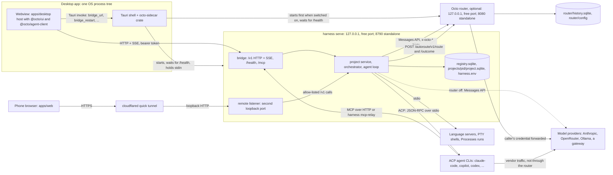

# Octo architecture

The system overview: what runs, who starts whom, how a request travels, which module does what, and the rules every part
keeps. It describes the code in the working tree. It was rebuilt on 2026-11-22 from the code and from tools run against it
(`go list`, `cargo metadata`, an import graph of the TypeScript packages, line counts); the earlier passes of 2026-11-11 and
2026-11-19 are kept where they were still accurate. Where a spec and the code disagree, the code is described and the
difference is listed in [Known contradictions](#known-contradictions). Anything not checked says **not verified**.

Companion documents:

- [`SYSTEM.md`](SYSTEM.md): the runtime view for someone operating or debugging Octo (start-up, shutdown, failure modes, the
  HTTP + SSE API by area, the data model, background work, limits, diagnostics, "where to look when").
- [`packages/ui/COMPONENTS.md`](../packages/ui/COMPONENTS.md): the UI component library, design tokens and the tool-tab anatomy.
- The [user guide](user-guide/README.md), for the person who uses Octo.

Contents: [At a glance](#at-a-glance) · [Parts](#the-parts) · [Data](#data-locations) · [Flows](#main-flows) ·
[Module map](#module-map) · [Cross-cutting rules](#cross-cutting-rules) · [Where to look](#where-to-look) ·
[Environment](#environment-variables-and-settings) · [Status](#status) · [Specs index](#specs-index) ·
[Gates](#gates-and-scripts) · [Contradictions](#known-contradictions)

## At a glance

| Process | Started by | Listens on | Talks to (protocol) | Its data |
| --- | --- | --- | --- | --- |
| Desktop shell (Tauri 2, `apps/desktop/src-tauri`) | the person | nothing | webview (Tauri `invoke`), harness and router (spawn, `GET /health`, stdin) | `harness.log`, `router.log`, `harness.pid`, `router.pid` in the app's log and data folders |
| Webview (`apps/desktop/src` + `@octo/ui`) | the shell | nothing | harness bridge (HTTP + SSE with a bearer token) | `localStorage` (layout, theme, tab memory) |
| Harness (`harness serve`, Go) | the shell; or `pnpm dev:all`; or by hand | `127.0.0.1:<free port>` in the app, `127.0.0.1:8790` by default (`--addr`) | model providers or the router (Messages API over HTTPS/HTTP), ACP agents and language servers (stdio), `cloudflared` (child process) | `{data-dir}`: registry, one SQLite per project, `harness.env`, side files ([Data](#data-locations)) |
| Router (`octo`, Rust), optional | the shell when `OCTO_ROUTER_ENABLED=1` and an upstream key are set; `pnpm dev:all -- --router`; or by hand | `127.0.0.1:<free port>` in the app, `127.0.0.1:8080` by default (`[server] bind_addr`) | upstream providers (HTTPS, the caller's key forwarded) | `history.sqlite` (+ `.key`), config fragments |
| ACP agent CLIs | the harness, lazily, per session | nothing (stdio) | the harness (ACP over stdio, MCP back over HTTP or `harness mcp-relay`), their vendor (their own traffic) | their own (not Octo's) |
| Language servers, terminal shells, Processes runs | the harness | nothing (stdio, PTY) | the harness | none; pids in `children.json` |
| Remote listener + `cloudflared` | the harness, only after the owner turns Remote access on | `127.0.0.1:<free port>` (`HARNESS_REMOTE_ADDR`) behind a `*.trycloudflare.com` URL | the phone (HTTPS through Cloudflare), the harness's API through an allow-list | `{data-dir}/remote/devices.json` |
| Phone client (`apps/web`) | the phone's browser, from the tunnel URL | nothing | the remote listener (HTTP, long poll instead of SSE) | `localStorage` key `octo.remote.device` |
| Browser-tab proxy | the harness, on demand | `127.0.0.1:0` | the site the person opens | none |

Where the desktop app keeps its data (Tauri's app data directory plus the identifier `com.ndolinschi.octo.desktop`; the path
logic is duplicated on purpose in `apps/harness/cmd/harness/doctor_datadir.go`). Only Linux was run.

| OS | Harness data | Router data | Verified |
| --- | --- | --- | --- |
| Linux | `$XDG_DATA_HOME` or `~/.local/share`, then `com.ndolinschi.octo.desktop/harness` | same base, `com.ndolinschi.octo.desktop/router` | yes (owner's run 2) |
| macOS | `~/Library/Application Support/com.ndolinschi.octo.desktop/harness` | `.../router` | not verified |
| Windows | `%APPDATA%\com.ndolinschi.octo.desktop\harness` | `...\router` | not verified (no Windows build) |

Without the desktop app the harness uses `--data-dir` / `HARNESS_DATA_DIR`, default `./data/harness`, and the router uses
`OCTO_CONFIG` (default `./config/`) and `history.toml` `database_path` (default `data/history.sqlite`).

## The parts

| Part | Path | Stack | What it is for |
| --- | --- | --- | --- |
| **harness** | `apps/harness/` | Go 1.26 (toolchain go1.26.11), own `go.mod`, 67 packages | The local project server. It holds projects, runs one orchestrator per main session and its sub-agents, keeps each project's history in its own SQLite file, and serves the UI over HTTP + SSE. Also the CLI commands `doctor`, `mcp-relay`, `run`, `sessions`, `show`, `version` |
| **router** (crate `octo`) | `apps/router/` | Rust (Axum 0.8, Tokio, sqlx/SQLite) | An optional HTTP proxy in front of the model providers. It picks a cheaper model for easy requests (the ladder and the price rule), decides who should do a delegated task (`/autoroute/v1/route`), records every call and delegation, and enforces per-project budgets. It holds no provider key: it forwards the caller's |
| **agent-client** (`@octo/agent-client`) | `packages/agent-client/` | TypeScript, no DOM, no React | The `Bridge` interface and its HTTP + SSE implementation, the pure project-state reducer, a message-port bridge for embedded hosts, language-server and terminal sessions. Types mirror the harness's JSON |
| **ui** (`@octo/ui`) | `packages/ui/` | React 19, Tailwind 4, Monaco, xterm | Everything on screen: sidebar, tab workspace, conversation, tool tabs, editor with comments and LSP, settings. Talks only through `Bridge`. Has an in-memory demo bridge (`@octo/ui/demo`) |
| **desktop** (`@octo/desktop`) | `apps/desktop/` | Vite + React host, Tauri 2 shell, crate `octo-sidecar` | Hosts the UI in a window. The shell starts, watches and stops the harness and the router as sidecars. `octo-sidecar` has no Tauri dependency, so it is tested anywhere |
| **web** (`@octo/web`) | `apps/web/` | Vite + React | The same UI for a paired phone: a pairing screen, then `OctoApp` against the tunnel; events by long poll |

Also present: `scripts/` (dev stack, installer, sidecar build, repository checks), `.github/workflows/` (three CI files),
`.cursor/rules/` and `.claude/rules/` (coding rules), `docs/` (this file, the user guide, specs, research, plans).

Dependency direction: `desktop`/`web` → `ui` → `agent-client` → (HTTP) → `harness` → (HTTP, optional) → `router` → upstream.
`packages/ui` never imports Tauri. Harness, router and desktop shell share no SQLite file and no config file.

## Data locations

Nothing below is shared between harness, router and shell.

| What | Where | Owner | Notes |
| --- | --- | --- | --- |
| Harness data dir | `--data-dir` / `HARNESS_DATA_DIR`, default `./data/harness`; in the desktop app see [At a glance](#at-a-glance) | harness | Private: directories `0700`, files `0600`. At every start `projectstore.Open` removes group/other bits from the data dir and up to three levels below it (a no-op on Windows). `HARNESS_DATA_DIR` cannot come from `harness.env` |
| `harness.env` | `{data-dir}/harness.env`, mode `0600` (a group-readable file is refused) | harness (the settings API writes it atomically); the shell reads the three `OCTO_ROUTER_*` keys | `KEY=VALUE` lines. Precedence: flags > process environment > file |
| `harness.lock`, `api-token`, `children.json` | `{data-dir}` | harness | One harness per data dir (`internal/datalock`); the generated bridge token; terminals and runs now running (stopped at the next start if the harness was killed) |
| `registry.sqlite` | `{data-dir}/registry.sqlite` | harness | The project list (`projects`). Stamped with `user_version`; a newer database is refused untouched; a registry that cannot open stops the start (`registry_unavailable`) |
| `project.sqlite` | `{data-dir}/projects/{pid}/project.sqlite` | harness | One per project: messages, agents, usage, sessions, memory, changes, approvals, queue, reviews, ... (39 tables, three of them FTS5 indexes; [SYSTEM.md](SYSTEM.md#data-model)). Schema **15** (`projectstore.SchemaVersion`). Migrations leave `project.sqlite.pre-m6` and `.pre-v15` beside it, **kept for good**. A project whose database cannot be opened is listed as unavailable |
| Project side files | `{data-dir}/projects/{pid}/shadow/` (change pre-images, 256 MiB cap), `secrets.json` (`0600`, never in SQLite), attachments, worktrees | harness | |
| ACP wire traces | `{data-dir}/traces/` | harness | Only with `HARNESS_ACP_TRACE`; 5 MB per file, 20 files, redacted |
| Plugins, remote-tool cache, price table | `{data-dir}/plugins/`, `{data-dir}/cache/`, `{data-dir}/prices.toml` | harness | All optional |
| Remote devices | `{data-dir}/remote/devices.json` (folder `0700`, file `0600`) | harness | SHA-256 of each device token, never the token |
| Legacy CLI sessions | `{data-dir}/harness.sqlite` | harness | Only `harness run / sessions / show` |
| Router config | `OCTO_CONFIG`; standalone `./config/`; in the app `<app data>/router/config/` (`server.toml` `0600`, `limits.toml`, `history.toml`, rewritten at every start; `openrouter.toml`, `autoroute.toml`, `prices.toml` are embedded in the binary when absent) | router (the shell writes it) | `[server]` and `[limits]` are required |
| Router store | `history.toml` `database_path`; standalone `data/history.sqlite`; in the app `<app data>/router/history.sqlite` (+ `.key` for the token HMAC unless `OCTO_HISTORY_TOKEN_KEY`) | router | `calls`, `decisions`, `session_outcomes`, `autoroute_calls`, `budget_spend`, `delegations`, `delegation_outcomes` (14 migrations). Soft-fail: if it cannot open, the proxy runs without history |
| Logs | Tauri app log dir: `harness.log`, `router.log` (2 MiB cap, one `.1` kept) | desktop shell | `harness doctor` and `GET /v1/diagnostics` also carry the last 200 harness log records, scrubbed |
| UI preferences | `localStorage` (prefix `octo.`, through `packages/ui/src/lib/storage.ts`) | ui | Per webview, not shared |

## Main flows

Each flow names the modules that do the work. Statements about real vendor CLIs are **not verified** unless the
[Status](#status) table says otherwise.

### 1. A turn with the built-in loop

1. The UI calls `Bridge.sendMessage` / `sendSessionMessage` (`packages/agent-client/src/client.ts`):
   `POST /v1/projects/{pid}/messages` or `.../sessions/{sid}/messages`.
2. `internal/bridge` → `internal/project` (`Service`) → `internal/orchestrator`. If the session already runs a turn, or the
   running caps are reached (`session_settings.max_running`, default 3 per project; `HARNESS_MAX_RUNNING_SESSIONS`, default 6),
   the message waits in the session's queue (`202`, at most 20, persisted in `queue`). Otherwise the turn slot is claimed and
   the message is stored.
3. The orchestrator assembles the request (`orchestrator/window.go` in memory mode `window`, else the transcript after the
   latest compaction; old tool results are replaced by stubs past 60% of the window, `agent/clear.go`).
4. The budget gate runs (`orchestrator/route.go`, `internal/budget`; [flow 7](#7-budget)). `internal/agent` (`Loop`) sends the
   request through `internal/anthropicclient`: up to three `cache_control` breakpoints, and with a detected router the
   `x-octo-*` hint headers (`internal/router`).
5. Tool calls of one answer run concurrently. The orchestrator has `spawn_agent`, `list_dir`, `read_file`, notes, memory
   tools and `request_input`; sub-agents also have `write_file`, `edit`, `bash` (`internal/tools/local`). Under "Ask first"
   (`supervised`) a write or a command waits for an approval ([flow 4](#4-an-approval)).
6. Everything is published on the project's event hub (`internal/events`, one `seq` per project) and streamed as SSE
   (`message.delta`, `tool.started`, `agent.created`, `usage`, `change.recorded`, ...). The UI folds the events with the pure
   reducer of `@octo/agent-client` (`state.ts`).
7. The turn ends: the slot is released, `turn.finished` is published, the queue advances (a failed or cancelled turn pauses
   it). When auto memory allows it, a side-model call digests the turn into its task record (`internal/memory`). Without an
   API key, Octo key or custom base URL the built-in loop is unavailable and such a turn fails at once with one message.

### 2. A turn with an ACP agent as orchestrator

1. The project's `models.orchestrator` is `acp:<agent>[/<model>]` (with no key the default is the first available,
   logged-in ACP agent).
2. The first message starts the agent process lazily (`orchestrator/acp_host.go`, `internal/acp`), a child of the harness
   with the allow-listed environment (`internal/childenv`) plus the manifest's `env`, never the harness's provider keys. A
   stored session is resumed with `session/load` when the agent offers it; else a new session gets a recap (8000
   characters at most).
3. The harness's tools reach the agent as an MCP server inside the harness (`internal/mcp`, `POST /mcp/v1/projects/{pid}`,
   loopback only, a per-session bearer token): an HTTP entry when the agent supports it, else `harness mcp-relay`
   (`internal/mcprelay`).
4. `session/prompt` goes out; `session/update` chunks become `message.delta`, thinking, plan and tool rows; `usage_update`
   becomes a usage row (`source: acp`). Permission requests and `fs/*` go through `internal/permission`: auto-approved in a
   `full` project, an approval card otherwise; file access is confined to the project folders. The agent process itself is
   not sandboxed.
5. Failures end the turn with a catalogue message (`internal/usererr`): missing command, not logged in, refused MCP
   servers, crash, refusal, empty reply. An idle session is shut down after `HARNESS_ACP_IDLE` (30 min).

### 3. Delegation to a sub-agent: the route decision, the outcome report and escalation

1. The orchestrator calls `spawn_agent` (`orchestrator/spawn.go`). With no explicit `tier` or `agent`, and a router that
   announced `route_api` on `GET /health`, the tier is `auto`; otherwise the balanced tier.
2. `orchestrator/auto.go` builds the candidates: each API tier (when the built-in loop is available) and each available
   ACP agent (`acp:<id>`; manifest `flatRate` and `strengths`), filtered by `models.auto_candidates`.
3. `internal/router` posts `{budget_key, session_id, task: {title, brief, tools, depth, parent_tier}, candidates}` to
   `POST /autoroute/v1/route` and waits at most `HARNESS_ROUTE_TIMEOUT` (2500 ms).
4. The router (`src/proxy/autoroute/route.rs` → `src/auto/delegate/`) classifies the task once (`[autoroute.delegation]
   classifier`: `jev` by default, a Decisions call with a 2 s budget; `heuristic`; `learned` is declared and falls back to the
   heuristic), ranks the able candidates (logged-in flat-rate agents first, then API tiers by price, then others) and answers
   with the choice, band and reason. It writes a `delegations` row (`src/history/delegations.rs`) and a call record; the
   classifier's cost counts against the budget key.
5. The harness records `route_choice`, `route_band`, `route_reason`, `route_request_id` on the agent row and a usage row
   with role `route`, then starts the sub-agent: an API tier through `agent.Loop`, or the chosen ACP agent.
6. When the sub-agent ends, `orchestrator/delegation.go` reports a `finished` outcome
   (`POST /autoroute/v1/route/{request_id}/outcome`, `internal/router/outcome.go`: at most 3 tries, never blocks the turn).
   Later signals are reported too: `redelegated` (similar work delegated again under the same parent), `rewound`,
   `reverted`, `escalated`. The router derives a `solved` label from the reports (`src/auto/delegate/outcome.rs`; eleven
   ordered rules, [router history](../apps/router/docs/history.md#the-solved-label)).
7. **Escalation** (setting `HARNESS_DELEGATION_ESCALATE_ON_FAILURE`, default **off**): when a router-chosen sub-agent fails
   (agent error, timeout, a non-budget failure, its own "Could not do it", or tests that failed by the router's label), the
   harness asks the router once more with `exclude` = the first choice and `min_tier` = the next stronger tier, and runs a
   fresh sub-agent with the same brief, within the budget.
8. Any routing failure falls back and never fails the turn: no router, timeout, 5xx, 422 or an unknown choice → the balanced
   tier (or the first logged-in agent when there is no key); a 402 is the budget failure. An explicit tier or agent is never
   routed. A tier whose model is `acp:<id>` starts that agent.

### 4. An approval

1. **Access** is a project field: `supervised` ("Ask first", the default for new projects, `HARNESS_DEFAULT_ACCESS`),
   `accept_edits`, or `full`.
2. In `supervised`, `write_file`, `edit`, `bash` (any depth), `web_fetch` to a new host, ACP `session/request_permission` (not
   read/search) and ACP `fs/write_text_file` create an approval (`internal/approval`, `orchestrator/approvals.go`); under
   `accept_edits` file edits pass and commands still ask. Only the agent that asked waits.
3. The UI shows a request card (`packages/ui/src/components/v7/ApprovalCard.tsx` in the transcript slot); the answer is
   `POST /v1/projects/{pid}/approvals/{id}` with `allow`, `allow_for_turn` (same kind, same agent; for a command only the same
   program and only a simple command), `allow_all_for_turn`, `allow_always` (a stored `approval_rules` row) or `deny`.
4. Cancelling the turn denies what is pending; an unanswered request is denied after `HARNESS_APPROVAL_TIMEOUT` (30 min).
   Events: `approval.requested`, `approval.resolved`, `project.attention`. Pending approvals survive a UI reload, not a
   harness restart. A paired phone may allow or deny one request at a time (`remote_decision_forbidden` otherwise).

### 5. A file edit and its revert

1. An agent writes through `write_file` / `edit` (`internal/tools/local`, confined to the project folders; a path in `.git`
   is refused), or ACP `fs/write_text_file` (`orchestrator/acp_*.go`), or a `bash` command or an agent's own tool changes
   files.
2. `internal/changes` records every change per turn: the explicit writes directly, the rest by before/after snapshots of
   the folders; pre-images go to `shadow/`, diffs to `blobs` and `changes` in `project.sqlite` (`internal/diff` counts
   lines). Event `change.recorded`; `file.changed` for the editor.
3. The Changes tab (`packages/ui/src/components/v7/ChangesView.tsx`) lists turns and files
   (`GET /v1/projects/{pid}/changes`, `.../changes/{cid}`).
4. `POST .../changes/{cid}/revert` restores the pre-image (refused when the file changed since, and never into `.git`). A
   revert of a router-chosen sub-agent's change is reported to the router as a `reverted` outcome. Diffs older than 30 days
   are pruned when the harness opens the project at start (`project.ChangeRetention`).
5. A person's own edit in the editor is `PUT /v1/projects/{pid}/files/content` with `expected_mtime` (`409 file_changed` on a
   conflict); `file.changed` with `source: user`.

### 6. Remote access pairing

1. The owner turns Remote access on (Settings, `POST /v1/remote/enable`). `internal/remoteaccess` opens a second loopback
   listener and runs `cloudflared tunnel --url http://127.0.0.1:<port>` (a quick tunnel; the URL changes every start). Off
   after every start.
2. `POST /v1/remote/pairing` issues an 8-character code (5 min, single use) and a QR link `<url>/#pair=<code>`.
3. The phone opens the link; `apps/web` (`src/pairing.ts`) takes the code from the fragment and calls `POST /pair/claim`.
   Claims are rate-limited per source and back off after wrong codes. The device is **pending** until the computer allows it
   (`POST /v1/remote/devices/{id}/confirm`, within 5 min).
4. The device then calls the allow-listed part of `/v1` (`internal/remoteaccess/rules.go`) with its own token
   (`octo_dev_...`, only its SHA-256 is stored); events arrive by long poll (`GET .../events/poll`,
   `apps/web/src/pollingEventSource.ts`) because quick tunnels do not carry SSE. The local API token never works on the
   tunnel. Detail: [`apps/harness/docs/remote-access.md`](../apps/harness/docs/remote-access.md).

### 7. Budget

1. A project has an optional `budget_usd` (`PATCH /v1/projects/{pid}`; `null` removes it).
2. Spend is one number (`internal/budget`). With a router that announced `budget_key`: the router's last reported spend for
   the project (`x-octo-spent-usd`, or `spent_after_usd` of the call record); the harness sends `x-octo-budget-key` (the
   project id) and `x-octo-budget-usd` on every request. Without a router: the sum of usage rows (reported costs plus
   `prices.toml` estimates). A flat-rate agent's figure is `subscription_equivalent_usd`, never spend.
3. Before every orchestrator request and every `spawn_agent` the gate compares spend with the budget; reached means the
   turn ends `failed` with "Project budget reached ...". The built-in loop also caps `max_tokens` so one request cannot run
   far past the budget. The router's 402 is the backstop; its `budget_spend` table survives a restart.

### 8. Memory

Every message stays verbatim in `project.sqlite`. Task records, dated facts and memory files are written only when the
project's `memory.auto_memory` allows it (default `off`; with `HARNESS_FEATURE_AUTO_MEMORY` a model's attempt raises a
`memory` approval card). Tools: `task_update`, `memory`, `memory_search`, `recall_message`. Search is three FTS5 indexes
(`search_u`, `search_t`, `search_s`). Mode `window` builds the request from capped blocks and stores a context receipt.
Code: `internal/memory`, `projectstore/{tasks,search,receipts}.go`, `orchestrator/{memory_tools,window}.go`. Detail:
[`apps/harness/docs/memory.md`](../apps/harness/docs/memory.md).

### 9. Settings, diagnostics and first start

`GET/PUT /v1/settings` (`internal/settings`) read and write `{data-dir}/harness.env` for a fixed list (provider key, tier
models, default orchestrator, router switch/key/base URL, child-env allow list, ACP trace, feature flags). Secrets are
write-only. Models, the allow list, the trace and the feature flags apply at once; keys and router settings answer
`restart_required`, and the shell restarts the sidecars through `bridge_restart`. The first-run screen is the connect screen
(UI decision 53). `harness doctor` and `GET /v1/diagnostics` (`internal/diag`) report versions, the data dir, the `PATH`
children get, each agent's command and login probe, the router state and the last 200 scrubbed log lines; see
[SYSTEM.md](SYSTEM.md#diagnostics).

## Module map

One table per part. "Tests" counts the test files beside the code; the gates that run them are under
[Gates](#gates-and-scripts). Sizes are tracked source lines on 2026-11-22.

### Router (`apps/router`, crate `octo`, 91 source files, 16,405 lines; 29 test files, 13,181 lines)

| Module | Purpose | Depends on | Tests |
| --- | --- | --- | --- |
| `main.rs`, `cli.rs`, `export.rs` | Entry: `--version`, `--help`, `export-delegations --out f.jsonl [--redact]` (training data for `ml/`), else start the proxy | `proxy`, `history` | `cli.rs` unit test; `tests/delegations.rs` |
| `config.rs` (988 lines) | TOML fragments of `OCTO_CONFIG` into `Config`; `openrouter.toml`, `autoroute.toml`, `prices.toml` embedded as defaults | `serde`, `toml` | `tests/embedded_defaults.rs`, `autoroute_defaults_regression.rs` |
| `state.rs`, `routes.rs` | `AppState` (config, HTTP client, providers, history, `Auto`); the top router with tracing | all | (through the HTTP tests) |
| `proxy/` (14 files, 2,287 lines) | Axum routes, `x-octo-key` auth, body limits, provider selection, passthrough handlers, error JSON, stdin watch; `proxy/autoroute/`: `/autoroute/v1/messages`, `chat/completions`, `status`, `calls/{id}`, `route`, `route/{id}/outcome`, compaction and retry glue | `auto`, `providers`, `history` | `proxy_post.rs`, `select_provider.rs`, `chat_provider_select.rs`, `stdin_exit.rs`, `stream_cut.rs`, `autoroute*.rs`, `route_api.rs`, `route_integration.rs` |
| `auto/` (33 files, 7,146 lines) | Routing policy without Axum types. `decide/`: the per-request ladder decision (classify, gate, sticky session tier, budget caps). `delegate/`: the route endpoint's ranking (band, policy, classifier seam, `solved` derivation). `jev/`: the Decisions classifier questions and parsing. `ladder.rs` (config warnings), `stall.rs` (error/tool stalls), `hints.rs` (harness headers), `ledger.rs` (spend per budget key), `calls.rs` (call records), `body.rs` (shaping, housekeeping), `catalog.rs` (tiers, windows), `text_tool_call.rs` | `providers` (Decisions), `prices` | `price_rule.rs`, `cost_fixes.rs`, `review_fixes.rs`, `harness_integration.rs`, `route_api.rs`, `delegations.rs` |
| `history/` (17 files, 2,865 lines) | SQLite pool and migrations (`migrations/`, 14 files), HMAC caller identity, bounded async inserts, cost precedence, call payloads, session outcomes, call records and budget spend, delegation records and outcomes, pruning | `sqlx` | `history_store.rs`, `history_payload.rs`, `history_session_cost.rs`, `session_outcomes.rs`, `call_persistence.rs`, `delegations.rs` |
| `prices/` (5 files, 1,007 lines) | `prices.toml` plus the OpenRouter catalogue refresh (every 6 h when upstream is openrouter.ai) | `reqwest` | `price_catalogue.rs` |
| `providers/` (15 files, 1,600 lines) | Upstream wire formats: OpenAI chat, OpenRouter chat and Messages, Anthropic Messages, Decisions; attribution headers; stream tee for history | `history` | `provider_wire.rs`, `openai_headers.rs`, `openrouter_headers.rs`, `openrouter_models.rs` |
| `config/` | The shipped TOML fragments (13 files, 271 lines) | | |
| `ml/` | The learned-router thesis study, stages 1 to 6 (Python, 35 files, 8,229 lines; models 23 MB, results 3.0 MB, figures 2.8 MB). Not part of the binary; nothing in `src/` loads its models | own `requirements*.txt` | `ml/tests/` (pytest; tests that need fetched data skip) |
| `scripts/` | Claude Code helpers (`claude-code-env.sh`, `claude-code-experiment.sh`, `statusline.sh`), `smoke-openrouter.sh`, `reconcile_costs.py`, `calibrate.py` | | none |
| `experiments/` | Empty (`.gitkeep`); the working directory `scripts/claude-code-env.sh` creates and fills | | |

Product docs: [`apps/router/docs/README.md`](../apps/router/docs/README.md) (architecture, proxy, autoroute, history, prices,
configuration, status).

### Harness (`apps/harness`, Go; 409 source files, 76,882 lines; 297 test files, 50,884 lines)

Generated from `go list -json ./...` (imports and test files) with a hand-written purpose per package. "Depends on" and
"Used by" list internal packages only; a `+N` means N more.

| Package | Purpose | Depends on (internal) | Used by | Files / lines | Test files |
| --- | --- | --- | --- | --- | --- |
| `cmd/harness` | The binary: `serve` (wires every package below), `doctor`, `mcp-relay`, `run` / `sessions` / `show` (legacy one-shot CLI), `version` | `acptrace`, `agent`, `anthropicclient`, `apitoken`, `bridge` +31 | - | 7 / 1037 | 14 |
| `acp` | Agent Client Protocol client: JSON-RPC over a child's stdio, session/new, load, prompt, auth, model selection | `acptrace`, `childenv` | `orchestrator`, `permission`, `providers` | 11 / 2191 | 9 |
| `acptrace` | Opt-in wire trace of ACP sessions under `{data-dir}/traces/` (redacted, 5 MB x 20 files) | - | `acp`, `cmd/harness`, `diag` | 2 / 350 | 1 |
| `activity` | The one-line "what the agent is doing now" label (Reading x, Running `cmd`) | - | `agent`, `orchestrator` | 1 / 159 | 1 |
| `agent` | The built-in Messages-API tool loop (`agent.Loop`): streaming, concurrent tools, caching breakpoints, compaction, tool-result clearing; `Runner` for the legacy CLI | `activity`, `router`, `store`, `tools` | `cmd/harness`, `orchestrator` | 7 / 1008 | 6 |
| `anthropicclient` | The Anthropic SDK client with base URL, key source and a response observer (rate-limit headers) | - | `cmd/harness` | 1 / 99 | 2 |
| `apitoken` | The bridge's bearer token: from `HARNESS_API_TOKEN` or generated into `{data-dir}/api-token` | - | `bridge`, `cmd/harness` | 1 / 119 | 1 |
| `approval` | Pending approval requests and turn grants; one waiting request blocks only its agent | `globx`, `projectstore` | `orchestrator`, `project` | 2 / 663 | 2 |
| `attachments` | Images attached to a message: sniffed type, size, hash name | - | `bridge`, `orchestrator`, `project`, `projectstore` | 1 / 131 | 1 |
| `bridge` | HTTP + SSE server: every `/v1` route, `/health`, `/mcp/...`, CORS, token check, loopback rules | `apitoken`, `attachments`, `browserproxy`, `buildinfo`, `childenv` +17 | `cmd/harness` | 35 / 4050 | 55 |
| `browserproxy` | Loopback reverse proxy for the Browser tab: header stripping, rewriting, inspector injection | - | `bridge`, `cmd/harness` | 3 / 921 | 1 |
| `budget` | A project's spend: the router's last report, else usage rows plus price estimates | `prices`, `projectstore`, `router` | `orchestrator`, `project` | 1 / 78 | - |
| `buildinfo` | The version and commit stamped at build time (`harness --version`, `/health`) | - | `bridge`, `cmd/harness` | 1 / 57 | 1 |
| `cache` | On-disk cache of remote tool manifests | - | `tools/remote` | 1 / 66 | 1 |
| `changes` | Change tracker: explicit writes plus before/after snapshots of the folders, pre-images, revert | `diff`, `gitx`, `projectstore` | `orchestrator`, `project` | 5 / 777 | 1 |
| `childenv` | Allow-list environment for every child process (bash, agents, language servers, probes) | - | `acp`, `bridge`, `cmd/harness`, `codehost` +9 | 1 / 239 | 2 |
| `codehost` | Code-host adapter for PR review (GitHub through the user's `gh`) | `childenv`, `gitx` | `cmd/harness`, `review` | 3 / 1237 | 2 |
| `commands` | A project's named commands and ad-hoc runs (Processes tab): start, stream, stop, restart | `childenv`, `events`, `proctree`, `projcfg`, `projectstore` +1 | `bridge`, `cmd/harness` | 4 / 1029 | 4 |
| `completion` | Pure part of inline completion: validation, fill-in-the-middle prompt, post-processing | - | `bridge`, `orchestrator`, `project` | 1 / 264 | 1 |
| `config` | Environment, flags and `harness.env` into `Config`; model tiers; context windows | `tools` | `cmd/harness`, `orchestrator`, `project`, `providers` +1 | 4 / 762 | 5 |
| `datalock` | One harness per data directory (OS lock on `harness.lock`) | - | `cmd/harness` | 2 / 82 | 2 |
| `diag` | The diagnostics report (`harness doctor`, `GET /v1/diagnostics`), scrubbed log ring of 200 lines | `acptrace`, `childenv`, `plugins` | `cmd/harness` | 2 / 605 | 1 |
| `diff` | Line counts added/removed between two texts (Myers, bounded) | - | `changes`, `orchestrator` | 2 / 159 | 2 |
| `events` | Per-project event hub with a monotonic `seq` | - | `cmd/harness`, `commands`, `orchestrator`, `project` +2 | 1 / 197 | 1 |
| `fakeacp` | Scripted ACP agent for tests and demos (`examples/fakeacp`) | - | `examples/fakeacp` | 12 / 2495 | - |
| `fakelsp` | Scripted language server for tests | `lsp` | - | 1 / 137 | - |
| `fakerouter` | Stand-in Octo router for tests (health, result headers, call records, route, outcomes) | - | - | 5 / 632 | - |
| `features` | Process-wide feature flags (`HARNESS_FEATURE_AUTO_MEMORY`, `HARNESS_DELEGATION_ESCALATE_ON_FAILURE`) | - | `bridge`, `cmd/harness`, `orchestrator`, `settings` | 1 / 121 | 1 |
| `files` | Confined list/read/write of files under a folder root; refuses writes into `.git` | `tools/local` | `orchestrator`, `project` | 2 / 332 | 2 |
| `gitx` | Hardened `git` runner (argv only, no hooks, no fsmonitor): refs, worktrees, branches, diffs | `childenv` | `changes`, `codehost`, `project`, `review` +2 | 4 / 1187 | 3 |
| `globx` | Doublestar glob matching (approval rules) | - | `approval`, `tools/local` | 1 / 130 | 1 |
| `inputs` | Forms agents open with `request_input`, incl. JSON-schema forms | `projectstore`, `secrets` | `bridge`, `orchestrator`, `project` | 7 / 1519 | 3 |
| `instructions` | Reads AGENTS.md / CLAUDE.md of the project folders for the built-in loop | `tools/local` | `orchestrator`, `project` | 1 / 321 | 1 |
| `limits` | Latest rate-limit headers per provider and model (memory only) | - | `bridge`, `cmd/harness` | 1 / 141 | 1 |
| `lsp` | Language-server processes and the stdio relay (frames, never interprets LSP) | `childenv` | `bridge`, `cmd/harness`, `fakelsp` | 6 / 762 | 5 |
| `mcp` | Small MCP server (Streamable HTTP) that gives an ACP orchestrator the harness's tools | - | `bridge`, `orchestrator` | 2 / 317 | 1 |
| `mcprelay` | `harness mcp-relay`: stdio-to-HTTP bridge for agents that only speak stdio MCP | - | `cmd/harness` | 1 / 183 | 1 |
| `memory` | Orchestrator memory: task records, memory files, search shaping, digest merge, redaction | `projectstore` | `orchestrator`, `project` | 9 / 2069 | 5 |
| `mockllm` | Scripted Anthropic-compatible Messages server (`examples/mockllm`) | - | `examples/mockllm` | 13 / 1511 | 4 |
| `notemd` | Markdown form of a note (front matter + body) and the description index | - | `orchestrator`, `project`, `projectstore` | 1 / 500 | 1 |
| `orchestrator` | Turns per main session, sub-agents, `spawn_agent` incl. `tier: auto`, outcomes and escalation, ACP host and orchestrator, approvals glue, queue, compaction, memory window, side question, modes, recovery | `acp`, `activity`, `agent`, `approval`, `attachments` +23 | `bridge`, `cmd/harness`, `project` | 59 / 14503 | 66 |
| `permission` | The one place that answers an ACP agent's permission request | `acp` | `orchestrator` | 1 / 87 | 1 |
| `prices` | Optional `prices.toml` of the harness (never the router's) | - | `budget`, `cmd/harness`, `orchestrator`, `project` | 1 / 194 | 1 |
| `proctree` | Stops a child with everything it started; `children.json` ledger for leftovers | - | `cmd/harness`, `commands`, `terminal` | 3 / 272 | 1 |
| `projcfg` | Shapes of per-project settings kept outside the project row (commands, review config) | - | `commands`, `project`, `review` | 2 / 301 | 2 |
| `project` | Service layer between bridge and orchestrator/store: validation, defaults, files, notes, sessions, branches, workspaces, usage, imports | `approval`, `attachments`, `budget`, `changes`, `completion` +19 | `bridge`, `cmd/harness` | 27 / 5345 | 1 |
| `projectstore` | SQLite: `registry.sqlite` and one `project.sqlite` per project, migrations (schema 15), backups | `attachments`, `notemd`, `usererr` | `approval`, `bridge`, `budget`, `changes` +7 | 44 / 9247 | 23 |
| `providers` | "What can run a model now": built-in loop, router, every ACP agent, with states and models; Ollama and loopback probes | `acp`, `config`, `plugins`, `usererr` | `bridge`, `cmd/harness`, `project` | 7 / 1842 | 4 |
| `remoteaccess` | Remote access: `cloudflared` quick tunnel, second listener, pairing, device tokens, allow-list, long-poll | `childenv`, `events`, `usererr` | `cmd/harness` | 14 / 2412 | 11 |
| `review` | Pull-request review (RV1): sources, worktrees, viewed marks, findings, comments, submit | `codehost`, `events`, `gitx`, `projcfg`, `projectstore` +1 | `bridge`, `cmd/harness` | 13 / 3769 | 8 |
| `review/reviewtest` | Fixtures for review tests (throw-away repo, fake `gh`) | `gitx` | - | 1 / 643 | - |
| `router` | Harness side of the router: detection, hint headers, result headers, call records, spend, route call, outcome reports | - | `agent`, `bridge`, `budget`, `cmd/harness` +2 | 6 / 877 | 4 |
| `secrets` | Per-project secret store (`secrets.json`, 0600) and its redactor | - | `inputs`, `orchestrator`, `project` | 2 / 372 | 1 |
| `sessionimport` | Imports other tools' sessions (`~/.claude/projects`, `~/.codex/sessions`, ...) | - | `project` | 5 / 1133 | 1 |
| `settings` | Backend of the settings screen: the fixed list, `harness.env` writes, apply-now hooks | `childenv`, `config`, `features` | `bridge`, `cmd/harness` | 2 / 663 | 2 |
| `store` | Legacy CLI session store (`harness.sqlite`) | - | `agent`, `cmd/harness` | 1 / 149 | 1 |
| `terminal` | PTY shells per project (Terminal tab) | `childenv`, `proctree` | `bridge`, `cmd/harness` | 5 / 833 | 2 |
| `tools` | Tool registry, result caps, `ToolUseID` | - | `agent`, `cmd/harness`, `config`, `orchestrator` +3 | 3 / 218 | 2 |
| `tools/local` | `bash`, `read_file`, `write_file`, `edit`, `list_dir`, `search_files` over labelled, confined roots | `childenv`, `gitx`, `globx`, `tools` | `cmd/harness`, `files`, `instructions`, `orchestrator` +1 | 7 / 1041 | 4 |
| `tools/remote` | Remote HTTP tool discovery and invocation (`--remote`) | `cache`, `tools` | `cmd/harness` | 1 / 135 | 1 |
| `tools/webfetch` | `web_fetch`: one GET, no private addresses unless allowed | `tools` | `orchestrator` | 1 / 387 | 1 |
| `usererr` | The error catalogue: message, hint, command, action, details for everything said to a person | - | `bridge`, `cmd/harness`, `commands`, `orchestrator` +5 | 12 / 1399 | 3 |
| `examples/fakeacp` | `main` around `internal/fakeacp` | `fakeacp` | - | 1 / 11 | - |
| `examples/mockllm` | `main` around `internal/mockllm` | `mockllm` | - | 1 / 45 | - |
| `examples/remotetool` | Minimal remote tool server (manual demo of `--remote`) | - | - | 1 / 51 | - |
| `plugins` | Plugin manifests (language servers, ACP agents, tool servers), login and version probes | `childenv` | `bridge`, `cmd/harness`, `diag`, `orchestrator` +2 | 12 / 2024 | 11 |
| `plugins-examples/subscription-agents` | Embeds the built-in `subscription-agents` manifest (11 ACP agents) | - | `cmd/harness` | 1 / 14 | - |

Other directories: `examples/` (three `main` packages), `plugins-examples/` (manifests: `subscription-agents` is embedded in
the binary; `acp-agents`, `fake-acp`, `go-tools`, `typescript-tools` are examples, loaded only when copied into a plugins
directory), `scripts/` (seven e2e and live scripts, [Gates](#gates-and-scripts)). Product docs:
[`apps/harness/docs/README.md`](../apps/harness/docs/README.md); package detail:
[`apps/harness/docs/architecture.md`](../apps/harness/docs/architecture.md).

### agent-client (`packages/agent-client`, 21 source files, 6,229 lines; 29 test files, 4,416 lines)

| Module | Purpose | Depends on | Tests |
| --- | --- | --- | --- |
| `types.ts` (1,774 lines) | Wire types of every route and event; no imports | – | (through the others) |
| `client.ts` | The `Bridge` interface and `createHttpBridge`: fetch, `EventSource`, reconnect watchdog, error mapping | `types`, `commands`, `review`, `remoteAccess`, `lspSession`, `terminalSession`, `rare` (lazy) | `client*.test.ts` |
| `rare.ts`, `rareNames.ts` | The less-used `Bridge` methods in a lazy chunk; `rareNames` is the list `createHttpBridge` forwards | `client` types | yes |
| `state.ts` | The pure, total reducer over bridge events: `applyEvent`, `withAgents`, `withMessages`, per-session slices, `scopeState` | `types` | `state*.test.ts` |
| `sessionBridge.ts` | A `Bridge` addressed to one main session | `client` | yes |
| `review.ts`, `commands.ts`, `remoteAccess.ts`, `fileBytes.ts` | Pull-request review, project commands, the `/v1/remote` control routes, base64 file reads | `types` | yes |
| `lspChannel.ts`, `lspSession.ts`, `terminalSession.ts` | Language-server and terminal sessions over POST + SSE | `client` | yes |
| `messageProtocol.ts`, `messageClient.ts`, `messageServer.ts`, `messageBridge.ts` | The same `Bridge` over a `MessagePort`, with a method allow-list | `client` | yes |
| `bridge.ts`, `readDeadline.ts`, `index.ts` | Bridge URL and token from the environment; read deadlines; the public API | – | yes |

Rules: [`packages/agent-client/AGENTS.md`](../packages/agent-client/AGENTS.md).

### UI (`packages/ui`, 723 source files, about 85,000 lines)

| Folder | Purpose | May import | Files / lines (source) | Test files |
| --- | --- | --- | --- | --- |
| `src/app/` | `OctoApp` (the public component), `AppShell`, `ProjectWorkspace`, the phone layout, project switching, warm-up | everything below | 13 / 1,250 | 0 |
| `src/state/` | One React provider per concern (app, nav, requests, activity, project, session, workspace, file view, code, comments), the dock layout (`state/workspace/layout.ts`, pure) | `lib`, `lsp`, agent-client | 47 / 5,225 | 12 |
| `src/lib/` | Pure helpers and small hooks: formats, models, routes, storage, tab flags, `readyLazy`, `warm`, review, memory, schema forms, ... | agent-client types | 212 / 15,999 | 129 |
| `src/lsp/` | Language-server client; `hub.ts` stays in the entry, the rest loads with Monaco | `lib` | 6 / 877 | 4 |
| `src/components/primitives/` | The component library (decision 90): 65 files | `lib` | 65 / 5,141 | 6 |
| `src/components/shared/` | Pieces several features use that read app state (Markdown, model picker, request card, schema form, ...) | `lib`, `state`, `primitives` | 27 / 3,597 | 2 |
| `src/components/<feature>/` | 21 feature folders (chat, files, review, v7, settings, memory, sessions, browser, terminal, processes, ...) | `lib`, `lsp`, `state`, `primitives`, `shared`, itself | 294 / 40,023 | 25 |
| `src/components/dock/` | Tab groups, strips, drag, `TabView` (the one place features meet) | features and below | 19 / 2,721 | 2 |
| `src/demo/` | In-memory demo `Bridge` and seeded projects (`@octo/ui/demo`, loaded with `import()` for `?demo=`) | `lib`, `lsp`, agent-client | 40 / 10,437 | 2 |
| `src/styles.css` | Design tokens, base rules, Monaco overrides | – | 1 / 2,746 | – |
| `scripts/` | 23 Playwright and audit scripts (not in CI) | – | 23 / 8,070 | – |

Layering, providers and the lazy boundary: [`packages/ui/ARCHITECTURE.md`](../packages/ui/ARCHITECTURE.md). Components,
tokens and the tool-tab anatomy: [`packages/ui/COMPONENTS.md`](../packages/ui/COMPONENTS.md).

### Desktop (`apps/desktop`)

| Module | Purpose | Depends on | Tests |
| --- | --- | --- | --- |
| `src/` (Vite host, 23 files, 1,799 lines) | `App` → `bridgeChoice` (Tauri, demo or URL) → `HostedApp` / `BridgeShell` → `OctoApp`; host capabilities (folder picker, window chrome, traffic lights), host status and notices | `@octo/ui`, `@octo/agent-client`, `@tauri-apps/api` (lazy) | 9 `*.test.ts` (`pnpm --filter @octo/desktop test`) |
| `src-tauri/src/` (glue, 160 lines) | Five Tauri commands (`bridge_url`, `bridge_restart`, `bridge_log_tail`, `bridge_notices`, `chrome_debug`) and the exit hook that stops the sidecars | `octo-sidecar`, `tauri` | none; compiled in CI only |
| `src-tauri/sidecar/` (crate `octo-sidecar`, 11 files, 3,370 lines) | `port`, `shellenv` (login-shell PATH and allow-listed variables), `process` (process group, SIGTERM, 3 s, SIGKILL, pid files), `logfile` (2 MiB cap), `health`, `settings` (`OCTO_ROUTER_*` of `harness.env`), `router` (config fragments, client key), `web` (bundled phone client), `bridge` (the start sequence, API token per run) | std, no Tauri | `cargo test -p octo-sidecar` (router tests need `python3`) |
| `scripts/traffic-lights.mjs` | Playwright check of the macOS title-bar geometry on `?demo=1&titlebar=mac` | | manual |

### Web (`apps/web`, 9 source files, 650 lines)

`src/App.tsx` (pairing screen, then `OctoApp` with `shell="web"`), `pairing.ts`, `device.ts`, `guardedFetch.ts`,
`pollingEventSource.ts` (events by long poll). Tests: 3 files (`pnpm --filter @octo/web test`). `scripts/phone-flow.sh` and
`.mjs` drive a running harness through pairing (manual). [`apps/web/README.md`](../apps/web/README.md).

### Repository level

| Path | Purpose |
| --- | --- |
| `scripts/dev.sh`, `lib-ports.sh`, `test-dev-sh.sh` | `pnpm dev:all`: harness (+ mock model, + router) and the UI dev server on free ports; its own end-to-end test |
| `scripts/build-sidecar.sh`, `install.sh`, `install-go-toolchain.sh` | Build the harness and router sidecars and the phone client; build and install the app; install the pinned Go |
| `scripts/check-bundle-size.mjs`, `check-cycles.mjs`, `workflows-pinned.test.mjs`, `eslint/` | The entry-bundle budget, the import-cycle check, pinned GitHub actions, the ESLint rules `layer-imports` and `no-native-controls` |
| `.github/workflows/ci.yml` | Router: `cargo fmt --check`, clippy, `cargo test -p octo` |
| `.github/workflows/harness.yml` | Go: gofmt, vet, test, build; job `e2e`: three e2e scripts and `pnpm test:dev-sh` (also `--router --mock`) |
| `.github/workflows/desktop.yml` | Frontend: lint, format, all package tests, `test:scripts`, builds, bundle budget; shell: `cargo check`, fmt, clippy, `cargo test -p octo-sidecar` |
| `docs/` | This file, [SYSTEM.md](SYSTEM.md), the user guide, `superpowers/specs/` (design contracts with "As built" notes) |

## Cross-cutting rules

**Error catalogue.** Everything the harness says to a person is a `usererr.Error` (`internal/usererr`): a one-sentence
`message`, a `hint` (the next step), an optional `command` to copy, an `action` code the UI turns into a button, and
`details`. HTTP error bodies carry the same fields. Catalogue: [`apps/harness/docs/errors.md`](../apps/harness/docs/errors.md).
The UI shows them through `components/shared/ErrorNotice.tsx`.

**Approvals and scopes.** Three access levels (`supervised` = "Ask first", `accept_edits`, `full`); five answers (`allow`,
`allow_for_turn`, `allow_all_for_turn`, `allow_always`, `deny`); a compound command is never remembered; only the asking
agent waits; unanswered requests are denied after 30 min. [Flow 4](#4-an-approval) and
[`apps/harness/docs/v7.md`](../apps/harness/docs/v7.md).

**Secrets.** Provider keys live in `harness.env` (written by the settings API, write-only to the UI) or the process
environment. Child processes get an allow-listed environment (`internal/childenv`): names with KEY, TOKEN, SECRET,
PASSWORD, CREDENTIAL and `*_BASE_URL` are dropped unless named in `HARNESS_CHILD_ENV_ALLOW` or a manifest's `env`. Form
secrets go to `secrets.json` (0600) and reach a child only as `secret:<name>`. Everything stored, traced or logged passes
a redactor (`internal/secrets`, `internal/acptrace`, `internal/diag`). The router stores only an HMAC of the caller's key.

**Security hardening.**

| Measure | Where | Verified |
| --- | --- | --- |
| Bearer token on every `/v1` route (`HARNESS_API_TOKEN`, else generated per start); `/health`, CORS preflight and MCP outside it; SSE also takes `?token=` | `internal/apitoken`, `internal/bridge/auth.go`; the shell makes a new 256-bit token per run | Go and sidecar tests; e2e scripts |
| CORS answers only the UI's origins (`tauri://localhost`, `http://tauri.localhost`, `localhost:1420`, `127.0.0.1:1420`, plus `HARNESS_UI_ORIGINS`); settings and the folder dialog refuse non-loopback peers and foreign origins | `internal/bridge` | Go tests |
| CSP of the Tauri webview; CSP header on the phone client's HTML; remote Markdown images load only after "Load image" | `apps/desktop/src-tauri/tauri.conf.json`, `internal/remoteaccess` | `tauriCsp.test.ts`, `TestWebBuildCSPIsTheHeader`; **not verified** in the Tauri runtime or WebKit |
| No write into `.git` (any case, also through symlinks and worktree `.git` files) by the file API, `write_file`, `edit`, ACP `fs/write_text_file`, revert, rewind | `tools/local/confine.go` (`ErrGitPath`) | Go tests |
| Hardened `git`: argv only, `core.hooksPath` = null device, `core.fsmonitor=false` | `internal/gitx` | Go tests with real temporary repositories |
| Private file modes: data dir `0700`, files `0600`, tightened at every start | `internal/projectstore`, sidecar `logfile` | Go and Rust tests; Windows not verified |
| Remote access: a separate listener, device tokens (hash only), deny-by-default allow-list, no `?token=`, no MCP, one decision at a time | `internal/remoteaccess` | Go tests, a fake `cloudflared`; a real tunnel **not verified** |
| Router: non-loopback bind refused without `allow_remote` and `client_auth_key`; `x-octo-key` on every route but `/health` | `apps/router/src/proxy/auth.rs` | `cargo test -p octo` |

Not stopped: a shell command or an ACP agent running as the same OS user can read what that user can read.

**Persistence boundaries.** The harness, the router and the desktop shell never share a store or a config file. The shell
reads three keys of `harness.env` and writes the router's config fragments; the harness never reads the router's database
(it reads call records over HTTP); the router never reads the harness's. The UI keeps only view preferences in
`localStorage`.

## Where to look

| Feature | Package / directory | Spec | Verification script (all scripted, no real CLI) |
| --- | --- | --- | --- |
| Project server, bridge API, SSE | `apps/harness/internal/{bridge,project,projectstore,events}` | `2026-11-10-project-harness-design.md` | `go test ./...`; `apps/harness/scripts/e2e-acp-orchestrator.sh` drives it with curl |
| Orchestrator, sub-agents, tiers | `internal/{orchestrator,agent,anthropicclient}` | `2026-11-10-project-harness-design.md` | `apps/harness/scripts/e2e-router.sh` (three sub-agents on one budget key) |
| Orchestrator on an ACP agent, MCP | `internal/{acp,permission,mcp,mcprelay}`, `internal/orchestrator/acp_*.go`; `apps/harness/docs/acp-orchestrator.md` | `2026-11-10-subscription-agents-design.md` (S2) | `apps/harness/scripts/e2e-acp-orchestrator.sh` |
| Plugins, agent manifests, login probes | `internal/plugins`, `apps/harness/plugins-examples/` | `2026-11-10-workspace-plugins-acp-design.md`, `2026-11-10-subscription-agents-design.md` | `apps/harness/scripts/test-subscriptions.sh` (live, needs the CLIs and accounts) |
| Child process environment | `internal/childenv` | `2026-11-10-subscription-agents-design.md` | `go test ./internal/childenv` |
| Language servers | `internal/{lsp,fakelsp}`; UI `packages/ui/src/lsp` | `2026-11-10-workspace-plugins-acp-design.md` | `go test` (real `gopls` test when installed) |
| Files and code pane | `internal/files`, `packages/ui/src/components/files` | `2026-11-10-code-pane-design.md` | `go test`; UI scripts |
| Usage, cost, limits, prices | `internal/{prices,limits}`, usage rows in `projectstore` | `2026-11-10-usage-design.md`, `research/2026-11-10-cost-audit.md` | `go test` |
| Router integration (hints, headers, budget, compaction) | harness `internal/{router,budget,fakerouter}`; router `src/auto/{hints,ledger,calls}.rs`, `src/proxy/autoroute/` | `2026-11-11-router-harness-integration.md` | `apps/harness/scripts/e2e-router.sh`; `cargo test -p octo` (`tests/harness_integration.rs`, `tests/call_persistence.rs`) |
| Delegation routing (`tier: auto`), outcomes, escalation | harness `internal/orchestrator/{auto,spawn,delegation}.go`, `internal/router/{route,outcome}.go`; router `src/auto/delegate/`, `src/history/delegations.rs` | same, section I2; `2026-11-13-learned-router-design.md` (revision 3) | `e2e-router.sh`; `tests/route_api.rs`, `tests/delegations.rs` |
| Price rule, ladder, autoroute | `apps/router/src/auto/`, `apps/router/config/autoroute.toml`, `prices.toml` | same; `apps/router/docs/autoroute.md` | `tests/price_rule.rs`, `tests/cost_fixes.rs` |
| Changes, approvals, queue, forms, secrets (v7) | `internal/{changes,diff,approval,inputs,secrets}`, `orchestrator/{approvals,queue,secrets}.go`; `apps/harness/docs/v7.md` | `2026-11-10-v7-changes-queue-approvals.md` | `apps/harness/scripts/e2e-v7.sh` |
| Project and parallel sessions, worktrees, branches | `projectstore/{project_sessions,workspaces}.go`, `orchestrator/sessions.go`, `project/{sessions,workspaces,branches}.go`; `apps/harness/docs/sessions.md` | `2026-11-12-project-sessions-design.md`, `2026-11-14-parallel-sessions-design.md` | `go test`; `e2e-sessions.sh`, `e2e-parity.sh` (not in CI) |
| Memory | `internal/memory`, `projectstore/{tasks,search,receipts}.go`, `orchestrator/{memory_tools,window}.go`; `apps/harness/docs/memory.md` | `2026-11-11-orchestrator-memory-design.md` | `go test`; `e2e-v7.sh` |
| Settings and `harness.env` | `internal/{settings,config,features}`; `apps/harness/docs/settings.md` | `2026-11-11-packaging-design.md` (P1, P7) | `go test ./cmd/harness ./internal/settings` |
| Diagnostics, wire trace, schema versions | `internal/{diag,acptrace}`, `cmd/harness/doctor.go`, `projectstore/migrate.go` | `2026-11-11-packaging-design.md` (R1) | `go test ./cmd/harness ./internal/diag ./internal/projectstore` |
| Remote access and the phone client | `internal/remoteaccess`, `cmd/harness/remote.go`, `apps/web`; `apps/harness/docs/remote-access.md` | `2026-11-14-remote-access-mobile-design.md` | `go test ./internal/remoteaccess`; `e2e-remote.sh` (not in CI) |
| Pull-request review | `internal/{review,codehost,gitx}`; UI `components/review`; `apps/harness/docs/review.md` | `2026-11-11-pr-review-design.md` | `go test` with a fake `gh` |
| Sidecars, ports, PATH, stop order | `apps/desktop/src-tauri/sidecar/`, `apps/desktop/src-tauri/src/lib.rs` | `2026-11-11-packaging-design.md` (P5, P8, P8b) | `cd apps/desktop/src-tauri && cargo test -p octo-sidecar` |
| Dev stack and installer | `scripts/{dev,build-sidecar,install}.sh` | `2026-11-11-packaging-design.md` (P3, P6) | `pnpm test:dev-sh` |
| Client, reducer, message bridge | `packages/agent-client/src` | `2026-11-10-project-harness-design.md` and the specs that extend it | `pnpm --filter @octo/agent-client test` |
| UI (layers, tabs, chat, usage, demo) | `packages/ui/src`, `packages/ui/ARCHITECTURE.md`, `packages/ui/COMPONENTS.md` | `2026-11-10-project-harness-ui.md` | `pnpm --filter @octo/ui test`, `packages/ui/scripts/*.mjs` |
| Router proxy and history | `apps/router/src`, `apps/router/docs/` | (product docs) | `cargo test -p octo` |
| Inline completion | `internal/completion`, `POST /v1/projects/{id}/complete`; editor provider in `packages/ui/src/components/files/editor/completion` | `2026-11-11-inline-completion-design.md` | `e2e-v7.sh` case, `go test ./internal/completion` |
| Learned router study | `apps/router/ml` | `2026-11-13-learned-router-design.md` | `make test` in `apps/router/ml` (not in CI) |
| Bots | not built | `2026-11-11-bots-design.md` | none |

## Environment variables and settings

Rebuilt on 2026-11-19 and checked again on 2026-11-22 from the code: `os.Getenv` / `os.LookupEnv` and the setting ids in `apps/harness`, `env::var` in
`apps/router` and `apps/desktop/src-tauri`, `import.meta.env` and `process.env` in the TypeScript packages, and the
variables the scripts in `scripts/` and `apps/*/scripts/` read. A name no code reads is not listed. "Settings" =
editable through `GET/PUT /v1/settings` (stored in `harness.env`; `apps/harness/docs/settings.md`). Process environment
beats the file; flags beat both. Test-only variables (`OCTO_FAKEACP_*`, `OCTO_FAKELSP_CHILD`, `OCTO_TEST_VAR`,
`OCTO_STUB_APP_DIR`) are left out.

**Desktop shell (`octo-sidecar`)** forwards, from the user's login shell to the harness, `PATH` and these names when the shell has them: `LANG`, `LC_*`, `XDG_CONFIG_HOME`, `XDG_DATA_HOME`, `XDG_STATE_HOME`, `XDG_CACHE_HOME`, `SSH_AUTH_SOCK`, `NVM_DIR`, `BUN_INSTALL`, `PNPM_HOME`, `VOLTA_HOME`, `HTTP_PROXY`/`HTTPS_PROXY`/`NO_PROXY` (both cases), `SSL_CERT_FILE`, `NODE_EXTRA_CA_CERTS`, `TMPDIR`, `SHELL`, `USER`, `LOGNAME`, `TERM`. Never a name containing KEY, TOKEN, SECRET, PASSWORD, PASSWD or CREDENTIAL; never a name set in `harness.env`. Not verified on macOS. `harness doctor` lists the names child processes get (`shell_env_set`).

### Harness (`apps/harness`)

| Name | Default | Read in | What it does |
| --- | --- | --- | --- |
| `ANTHROPIC_API_KEY` (setting; applies at once through the settings API) | empty | `internal/config` | Bearer / key the Messages client sends. Empty with no Octo key and no custom base URL: the built-in loop is unavailable (ACP agents still work) |
| `ANTHROPIC_BASE_URL` (flag `--base-url`) | the Anthropic API host | `internal/config` | A router must be given as `.../autoroute`; hints and result headers exist only there. A loopback URL is probed for reachability (`apps/harness/docs/providers.md`) |
| `HARNESS_OCTO_KEY` (flag `--octo-key`) | empty | `internal/config` | Sent as `x-octo-key` |
| `HARNESS_DATA_DIR` (flag `--data-dir`) | `./data/harness` | `internal/config`, `cmd/harness/doctor_datadir.go` | The data directory. Not settable from `harness.env`. `harness doctor` prefers the desktop app's directory when it exists and neither is given |
| `--addr` (flag only) | `127.0.0.1:8790` | `cmd/harness/serve.go` | Listen address of `harness serve` |
| `HARNESS_API_TOKEN` | generated per start into `{data-dir}/api-token` (`0600`) | `internal/apitoken` | Bearer token required on `/v1/**` (16+ printable ASCII characters); env only, never passed to children. The Tauri shell, `scripts/dev.sh` and the e2e scripts set it |
| `HARNESS_NO_API_TOKEN` (flag `--no-api-token`) | off | `internal/apitoken`, `internal/config` | `1` turns the token check off (tests and scripts only; logs a warning) |
| `HARNESS_UI_ORIGINS` | none | `cmd/harness/serve.go`, `internal/bridge` | Extra browser origins of the UI, comma-separated, beside `tauri://localhost`, `http://tauri.localhost`, `http://localhost:1420`, `http://127.0.0.1:1420` (`bridge.DefaultUIOrigins`). Only these get CORS answers and reach the settings routes. `scripts/dev.sh` sets it to the dev server's port |
| `HARNESS_EXIT_ON_STDIN_CLOSE` (flag `--exit-on-stdin-close`) | off | `cmd/harness/serve.go` | Exit on EOF of stdin. The shell sets `1` |
| `HARNESS_MODEL_ORCHESTRATOR`, `_FAST`, `_BALANCED`, `_DEEP` (settings, apply at once) | `BuiltinModels` in `internal/config/config.go` | `internal/config`, `internal/settings` | A model id, or `acp:<agent>[/<model>]` |
| `HARNESS_MODEL_COMPLETION` (setting, at once) | empty = `qwen2.5-coder:1.5b` (`DefaultOllamaSmallModel`) | `internal/config` | The Ollama model tag of the small inline-completion tier |
| `HARNESS_OLLAMA_BASE_URL` (setting, at once) | `http://127.0.0.1:11434` | `internal/config` | The Ollama server of that tier; its reachability is probed (`apps/harness/docs/providers.md`) |
| `HARNESS_MAX_TURNS` (flag `--max-turns`) | `25` | `internal/config` | Loop iterations per agent |
| `HARNESS_STREAM` | `true` | `internal/config` | Stream model answers |
| `HARNESS_PROMPT_CACHING` (flag `--prompt-caching`) | `true` | `internal/config` | Turn off for a gateway that rejects `cache_control` |
| `HARNESS_MAX_TOOL_RESULT_BYTES`, `HARNESS_MAX_REPORT_BYTES`, `HARNESS_READ_FILE_LINES` | 48 KiB, 32 KiB, 2000 | `internal/config`, `internal/tools` | What goes back into model context |
| `HARNESS_CONTEXT_WINDOWS` | built-in table | `internal/config` | `model=tokens,...` |
| `HARNESS_PLUGINS_DIR` (flag `--plugins-dir`, repeatable) | none | `internal/config`, `cmd/harness/serve.go` | Extra plugin directories |
| `HARNESS_NO_BUILTIN_PLUGINS` (flag `--no-builtin-plugins`) | `false` | `internal/config` | **Every harness started by a test or script sets `1`** |
| `HARNESS_MAX_RUNNING_SESSIONS` | `6` | `internal/config`, `internal/orchestrator` | Sessions that may run a turn at once across all projects (1-32); a project's own cap is `session_settings.max_running` (default 3) |
| `HARNESS_ACP_IDLE` | `30m` | `internal/config` | Idle ACP orchestrator session shutdown |
| `HARNESS_ROUTE_TIMEOUT` | `2500ms` | `internal/config` | The route call of `tier: auto` |
| `HARNESS_DEFAULT_ACCESS` | `supervised` | `cmd/harness/serve.go` (`v7Env`) | Access of projects created without one: `supervised` ("Ask first"), `accept_edits`, `full` |
| `HARNESS_APPROVAL_TIMEOUT` | `30m` | `cmd/harness/serve.go` | An unanswered approval is denied after this; `0` or negative: wait for ever |
| `HARNESS_FEATURE_AUTO_MEMORY` (setting, at once) | `true` | `internal/features` | Feature flag behind automatic memory writes and the "Enable auto memory?" prompt (`GET /v1/config` `features.auto_memory`) |
| `HARNESS_DELEGATION_ESCALATE_ON_FAILURE` (setting, at once) | off | `internal/features`, `internal/orchestrator/delegation.go` | Policy `delegation.escalate_on_failure` (on = `once`): retry a failed router-chosen sub-agent once on the next stronger candidate (`apps/harness/docs/architecture.md`, "Delegation outcomes and escalation") |
| `[autoroute.delegation] classifier`, `model_path` (router `config/autoroute.toml`) | `jev`, `""` | `apps/router/src/auto/delegate/classifier.rs` | Who decides a delegation's band: `jev`, `heuristic` (no model call), `learned` (declared; falls back to the heuristic with the reason recorded) |
| `HARNESS_ACP_TRACE` (setting, at once) | off | `cmd/harness`, `internal/acptrace` | Wire trace under `{data-dir}/traces/` for sessions that start afterwards |
| `HARNESS_MODEL_DISCOVERY` | on | `cmd/harness/serve.go`, `internal/bridge/providers.go` | `0` turns off the discovery of agents' models (`apps/harness/docs/providers.md`) |
| `HARNESS_CHILD_ENV_ALLOW` (setting, at once) | empty | `internal/childenv` | Extra names or `PREFIX_*` passed to every child process. Without it children get only the allow-list of `internal/childenv`; names containing KEY, TOKEN, SECRET, PASSWORD, CREDENTIAL and `*_BASE_URL` are dropped unless named here or passed by a manifest's `env` |
| `HARNESS_IMPORT_HOME` | the user's home directory | `internal/sessionimport` | Where "Import sessions" looks for other tools' session stores (`~/.claude/projects`, `~/.codex/sessions`, ...); for tests and unusual homes |
| `HARNESS_REMOTE_CLOUDFLARED`, `HARNESS_REMOTE_ADDR`, `HARNESS_REMOTE_WEB_DIR` (flag `--remote-web-dir`), `HARNESS_REMOTE_WEB_PROXY`, `HARNESS_REMOTE_ALLOW`, `HARNESS_REMOTE_DEVICE_IDLE_DAYS`, `HARNESS_REMOTE_IDLE_OFF_HOURS` | `cloudflared` on PATH, `127.0.0.1:0`, none, none, `send,answer,stop`, `30`, `8` | `internal/remoteaccess` | Remote access. Not settings; see `apps/harness/docs/remote-access.md` |
| `OCTO_CODEX_HOME`, `OCTO_OMP_DIR` | none | `plugins-examples/subscription-agents/plugin.json`, `internal/orchestrator/skills.go` | Become `CODEX_HOME` and `PI_CODING_AGENT_DIR` for those agents |
| `OCTO_ROUTER_ENABLED`, `OCTO_ROUTER_UPSTREAM_KEY`, `OCTO_ROUTER_BASE_URL` | off, empty, empty | stored by the harness (settings, restart); **read by the desktop shell** | Never passed to child processes |
| `OCTO_MCP_TOKEN`, `OCTO_PICK_START` | internal | `internal/orchestrator`, `internal/bridge/pickfolder.go` | Set by the harness for its own children (the MCP relay; the Windows folder dialog). Not for users |

Read only to find a display, a shell or a home: `DISPLAY`, `WAYLAND_DISPLAY` (folder dialog), `SHELL`, `COMSPEC` (terminal), `XDG_DATA_HOME`, `APPDATA` (`doctor`).

**Agent manifests** (`plugins-examples/subscription-agents/plugin.json`): the harness forwards `COPILOT_GITHUB_TOKEN`,
`XAI_API_KEY`, `CURSOR_API_KEY`, `WINDSURF_API_KEY`, `FACTORY_API_KEY` from its own environment to the matching agent
only. A vendor key forwarded this way can switch an agent from the subscription to per-token billing.

### Router (`apps/router`)

| Name | Default | Read in | What it does |
| --- | --- | --- | --- |
| `OCTO_CONFIG` | `./config/` | `src/config.rs` | A config directory of TOML fragments, or one legacy `config.toml`. The only way the shell configures it |
| `OCTO_HISTORY_TOKEN_KEY` | `history.token_key`, else an auto-generated `.key` beside the database | `src/history/mod.rs` | HMAC key for caller identity |
| `OCTO_EXIT_ON_STDIN_CLOSE` | off | `src/proxy/stdin_watch.rs` | The shell sets `1` |
| `OCTO_PRICES_REFRESH` | unset | `src/prices/mod.rs` | `off` or `catalogue`; beats `[prices] refresh` in `prices.toml`. Unset: prices are refreshed from the OpenRouter catalogue only when the upstream URLs point at openrouter.ai (every 6 h, cache `prices-catalogue.json` beside the history database); `apps/router/docs/prices.md` |
| `RUST_LOG` | `info` | `src/main.rs` (`tracing`) | Log filter |
| `config/*.toml` | shipped files in `apps/router/config/` | router | Bind address, upstream URLs, ladder, `never_pay_more_for_less` (default true), budgets, `[autoroute.route]`, prices, history. Not environment variables |

The helper scripts in `apps/router/scripts/` (`claude-code-env.sh`, `claude-code-experiment.sh`, `statusline.sh`) read `OCTO_BIND`, `OCTO_ROOT`, `OCTO_EXPERIMENTS_DIR`, `OCTO_URL`, `OCTO_SESSION`, `OCTO_CLIENT_AUTH_KEY`, `OCTO_CC_REQUIRE_LOCAL`, `OCTO_CC_SKIP_PERMISSIONS`; see `apps/router/README.md`.

### Desktop shell and UI host

| Name | Default | Read in | What it does |
| --- | --- | --- | --- |
| `OCTO_BRIDGE_URL` | unset | `apps/desktop/src-tauri/src/lib.rs`, `sidecar/src/bridge.rs` | `http(s)://host:port`: start nothing, use that harness |
| `OCTO_BRIDGE_TOKEN` | none | same | The API token of the harness at `OCTO_BRIDGE_URL` |
| `OCTO_HARNESS_BIN`, `OCTO_ROUTER_BIN` | the `harness` / `octo` file next to the executable | same | For experiments |
| `OCTO_DEBUG_CHROME` | unset | `src-tauri/src/lib.rs` (`chrome_debug`); `apps/desktop/src/windowChrome.ts`, `useWindowChrome.ts` | Any value but empty or `0`: draw the traffic-light alignment guide and log the configured position (`octo chrome: trafficLightPosition ...` on stderr and the console). The owner's macOS check, `apps/desktop/README.md` |
| `VITE_HARNESS_BRIDGE_URL` | `http://127.0.0.1:8790` | `apps/desktop/src/bridgeChoice.ts`, `packages/agent-client/src/bridge.ts` (fallback name `HARNESS_BRIDGE_URL`), build time | Bridge the browser UI connects to |
| `VITE_HARNESS_API_TOKEN` | none | same | The token a browser dev UI sends (`scripts/dev.sh` sets it); do not set it for a production build, Vite would bake it in |
| `OCTO_DEV_UI_PORT` | `1420` | `apps/desktop/vite.config.ts`, `scripts/dev.sh` | Dev server port. `tauri dev` always uses 1420 |
| `OCTO_WEB_PORT` | `1430` | `apps/web/vite.config.ts` | Dev server port of the web client |
| `TAURI_DEV_HOST` | unset | `apps/desktop/vite.config.ts` | Tauri mobile dev |
| `PLAYWRIGHT_CHROMIUM_EXECUTABLE_PATH`, `NODE_PATH` | unset | `packages/ui/scripts/browser.mjs` | The browser scripts: which Chromium to launch; where to find Playwright |

### Scripts

| Name | Default | Read in | What it does |
| --- | --- | --- | --- |
| `OCTO_DEV_PORT_BASE` | unset | `scripts/dev.sh`, `scripts/test-dev-sh.sh` | `N`: the four defaults move to N (bridge), N+1 (mock), N+2 (router), N+3 (UI); they stay defaults, so a busy one moves on |
| `OCTO_DEV_BRIDGE_PORT`, `OCTO_DEV_MOCK_PORT`, `OCTO_DEV_ROUTER_PORT` | `8790`, `8791`, `8792` | `scripts/dev.sh` | A busy default moves to the next free port; an explicit busy port is an error naming the process |
| `OCTO_DEV_ROUTER_DIR` | `~/.local/share/octo-dev/router` | `scripts/dev.sh` | Router history for `--router` |
| `OCTO_ROUTER_UPSTREAM_KEY`, `OPENROUTER_API_KEY` | none | `scripts/dev.sh --router` | Upstream key when not `--mock` |
| `OCTO_TEST_PORT_BASE` | unset | `scripts/test-dev-sh.sh` | `N`: the test uses N..N+3, which must be free |
| `GO_VERSION` | `1.26.11` | `scripts/install-go-toolchain.sh` | The Go release it installs |
| `OCTO_NO_ROUTER` | `0` | `scripts/build-sidecar.sh`, `scripts/install.sh` | `1`: placeholder instead of a router build |
| `OCTO_NO_WEB` | `0` | `scripts/build-sidecar.sh` | `1`: skip building the phone client (same as `--no-web`) |
| `E2E_MOCK_PORT`, `E2E_HARNESS_PORT`, `E2E_ROUTER_PORT`, `E2E_DIRECT_PORT`, `E2E_ESCALATE_PORT`, `E2E_PORT_STDIO`, `E2E_PORT_HTTP`, `E2E_PORT_NOKEY`, `E2E_PORT_AGY`, `E2E_WAIT_SECS` | 88xx (each script's header lists them); waits 60 s (v7: 120) | `apps/harness/scripts/e2e-acp-orchestrator.sh`, `e2e-router.sh`, `e2e-v7.sh` | Ports and the bound of every wait. A busy default moves on; a busy port you set is an error. `e2e-parity.sh`, `e2e-remote.sh` and `e2e-sessions.sh` still use fixed ports (8840-8843, 18842) |
| `OCTO_TEST_<ID>` | unset | `go test -tags subscription` (`apps/harness/scripts/test-subscriptions.sh`) | Opt in to a live agent run |
| `BRIDGE`, `PHONE`, `LOCAL_TOKEN`, `PROJECT_DIR` | none | `apps/web/scripts/phone-flow.mjs` | The phone-flow check against a running harness |

## Status

Taken from the "As built" and "Not verified" notes of the specs, the live checklist and the owner's two live runs of
2026-11-11 (run 1, and run 2 at `a375955`), checked against the code on 2026-11-12 and, for the 2026-11-13 to 2026-11-19
work, on 2026-11-19. "Verified here" is the build environment: scripted agents, the mock model, the fake router, a real
router with a mock upstream, a fake `gh`, demo data, Chromium (Playwright) on Linux. **Everything from the 2026-11-18/19
polish, performance, security and robustness pass was verified here and nowhere else**: not on macOS, not in WebKit, not in
the Tauri runtime (the shell is not compiled in this environment), not with a real agent CLI or a real Ollama. "Owner" is
the owner's Linux runs. "status not recorded" where no note says. Test counts are not kept in this file (they go stale):
run the suites (commands under [Gates](#gates-and-scripts)).

| Area | State | Verified here | Not verified |
| --- | --- | --- | --- |
| Harness project server, bridge, orchestrator loop, sub-agents, files, plugins, LSP relay | Built | Go gates; `gopls` test when installed | Built-in loop with a real key (the owner's billed calls went through the router) |
| Usage, cost, limits | Built; run 1 defects found by the owner | Go gates | Fixes of run 1 wait for checklist 1.1; subscription limits (not read by design) |
| Router: ladder, price rule, hints, headers, route endpoint, call records, persisted spend, stdin exit | Built; verified live (run 2) | `cargo test -p octo` | Low-tier price against a billed call; compaction on a real upstream |
| Harness router integration (I1, I2): hints, one spend number, budget gate, `tier: auto` | Built; verified live (runs 1 and 2) | `e2e-router.sh` | Equal spend after the last call (checklist 1.2); compaction with `ceiling` or `fixed` on a real router |
| Delegation records, outcome reports, the `solved` label, `octo export-delegations`, escalation on failure (2026-11-20; setting off by default) | Built | `cargo test -p octo` (`tests/delegations.rs`); Go tests; `e2e-router.sh` cases 7 and 8 against the real router | A real model or agent; the label's noise rate (unknown) |
| Learned-router study (`apps/router/ml`, stages 1 to 6) | Done as a study; nothing of it runs in the router (`learned` falls back to the heuristic) | `make test` in `apps/router/ml` (not in CI) | A model runtime in the router (not built, by decision) |
| Router decision quality | Verified live (run 1): classifier answered in 49–93 ms | | Bands beyond that run |
| ACP orchestrator (S2), MCP server, relay | Built; verified live with Claude Code (runs 1 and 2) | `e2e-acp-orchestrator.sh` | Copilot and Grok logged in; each CLI's handling of `mcpServers`, `session/load`, tool titles |
| ACP agent manifests (11) | Written from vendor docs and the ACP registry | Claude Code (owner); Copilot and Grok logged out (owner, run 2) | codex, cursor, opencode, antigravity, devin, droid, omp, pi: no run recorded; run 1's silent Copilot turn not reproduced |
| Live activity (thinking, plan, tool rows, quiet notice) | Built | Scripted agent: timing; secrets never leave the harness | Whether real agents send chunks at all (the wire trace shows it) |
| Settings API (`harness.env`), no-key start | Built | Go gates; both e2e scripts | Harness and shell writing `harness.env` at the same moment |
| Providers endpoint (`GET /v1/providers`, `422`, `409`) | Built | Go tests with fake probe commands | Real CLI probes; "connected means selectable" and provider preferences (not built) |
| R1 harness: doctor, diagnostics, wire trace, schema versions | Built | Go gates; migration from an older schema; newer database refused | Any real CLI (checklist 1.3, 1.4) |
| v7 harness: changes, approvals, queue, forms, secrets | Built | Go gates; `e2e-v7.sh` | An ACP agent asking for permission in a supervised project (checklist 2.9) |
| Memory M1 (task records, facts, memory files, search, digest) | Built; partly verified live (run 2: some word forms) | Go gates | Whether models search when they should |
| Memory M2 (window context, receipts) | Built, opt-in; first version measured 15% dearer than `full` (run 2) | 300 scripted exchanges; receipts | The stepped window on a real caching provider |
| Memory M3 (UI view) | Built | Playwright on demo data | A real harness; embeddings (not built) |
| Inline completion (harness endpoint and UI) | Built | `e2e-v7.sh` case; Playwright on demo data | Latency and suggestion quality with a real model (checklist 2.11) |
| Pull-request review: RV1 harness, RV2 UI | Built; RV3 (AI pass) designed, not built | Fake `gh`; Playwright on demo data | Real `gh` and GitHub (checklist 2.13); very large pull requests |
| Bridge API token | Built | Go and sidecar tests; e2e scripts | Tauri shell not compiled here; browser `EventSource` with `?token=` |
| Desktop sidecars: ports, PATH, health, stop order, stdin exit, router sidecar | Built; verified live (run 2: sidecars exit with the app) | `cargo test -p octo-sidecar`; `pnpm test:dev-sh`, incl. `--router --mock` | The Tauri glue compiled in CI only; the installed app on macOS |
| Installer (`scripts/install.sh`) | Verified live on Linux (run 2) | Prerequisite output with a stub `PATH` (P8b) | macOS |
| Desktop title bar (decision 54); macOS traffic-light alignment (2026-11-19: `trafficLightPosition` `{24, 22}`, measured on the owner's screenshots) | Built | Desktop unit tests; `apps/desktop/scripts/traffic-lights.mjs` on the dev server (`?demo=1&titlebar=mac`, drawn from the same constants) | **The real macOS window** (traffic lights, drag, zoom, full screen; `OCTO_DEBUG_CHROME=1` draws the guide); macOS 15 and older (lights 20 apart); the Rust is not compiled here |
| UI: workspace, tabs, files, comments, LSP, usage, palette, demo | Built (up to v6.3 part 1) | Frontend gates; Playwright on demo data; screenshots | Touch, screen readers, forced colours; WebKit |
| UI: shell pass, settings page, providers, connect screen (decisions 51–60) | Built | Playwright on demo data; UI unit tests | A live harness's `/v1/providers`; WebKit |
| UI: usability pass (2026-11-12) | Built | Playwright on demo data; unit tests | WebKit; light theme for the new controls |
| UI: v7 (changes, queue, approvals, forms) | Built (mounted in `cedc10c`) | status not recorded | Live use in a supervised project (checklist 2.9) |
| UI part 2 (decisions 24, 26–28, 30, 31, 37–40) | Partly built; per decision not recorded | status not recorded | The rest |
| UI decisions 64–78 | Built in batches 1 to 4 (frame, status bar, settings scopes, review workspace, provider list, skeletons); per decision "As built" notes in the UI spec | Playwright scripts on demo data | WebKit; a live harness |
| UI decisions 79–94 (widths, no coloured frames, view tabs, tab width, field rows, file opening, usage per model, `/context`, Providers list, component library, review rounds 1 and 2, no boxed shortcuts, Memory redesign) | Built (batch 5 closes part of rounds 1 and 2; which findings remain open: status not recorded) | UI unit tests; `width-stability`, `flicker`, `file-open-stability`, `frame-colours`, `scroll-on-send`, `spacing-audit` on demo data | WebKit and macOS; the open findings |
| UI: Sessions tab, sidebar session rows, "Open session" from delegation rows (`specs/2026-11-12-project-sessions-design.md`) | Built | Unit tests (`lib/sessions`, reducer); Playwright tour group `sessions` on demo data | A real agent's sessions: resume with `session/load`, messaging a finished agent |
| Harness project sessions (schema 13) and error catalogue `internal/usererr` (structured `message`, `hint`, `command`, `action`, `details`) | Built | Go gates (catalogue and sweep tests) | Real agents' failures; an older UI against the new bodies |
| Memory M4 (sessions as exchanges), M5 (notes with descriptions), M6 (a task exists only when a turn did work; `project.sqlite.pre-m6`; the schema 14 migration) | Built | Go gates | A real project's migration on the owner's data |
| Slash commands and `/clear`, `remember`, images, side question on the project's agent, itemised context | Built | Go gates; Playwright on demo data | Real agents (does each accept images; which commands each advertises) |
| Component library (decision 90) | Primitives built; 15 `octo/no-native-controls` warnings left on 2026-11-22 (49 in `research/2026-11-12-ui-component-audit.md`); 198 ESLint warnings in `packages/ui` in all, 31 of them `no-deprecated` | `pnpm lint` (0 errors) | The remaining batches B3–B10 |
| Entry bundle | 160.39 kB gzip, budget 161.00 (2026-11-19; the budget has been raised by hand in `scripts/check-bundle-size.mjs` as features landed, the history is in that file's header) | `pnpm --filter @octo/desktop build && node scripts/check-bundle-size.mjs`; CI runs it | A cold start over a slow disk |
| Browser tab and Design Mode (`browserproxy` + `@octo/ui`, `apps/harness/docs/browser.md`) | Built | `go test -race ./internal/browserproxy/...`, `remoteaccess` rules test, `@octo/agent-client` and `@octo/ui` unit tests, `pnpm lint`, `check-bundle-size.mjs`, Chromium Playwright E2E + `spacing-audit` / `frame-colours` across dark/light + desktop/phone on demo data | Full `apps/harness` `go build` here (proxy 403 on `modernc.org/sqlite@v1.62.0`); live `harness serve` against real external sites / Vite HMR in Tauri/WebKit |
| Parity backlog | B1–B7, B11–B13 built in batches 1 to 4 (slash commands, `/clear`, images, side question, always-allow, modes, plans, rewind, steer); B8–B10 not built | Go gates; Playwright on demo data | B8–B10; every item against a real agent |
| UI polish and performance pass, 2026-11-18/19 (decisions 98 and 99 and the "As built" sections of the UI spec from "work-surface polish" on): dock tool tabs share one anatomy (a 40 px bar with no title, one hairline), resizable sidebar (200-480) and file-tree column, compact folders (decision 98: `chain` on `GET /files`, Settings → Editor), "Add to chat" in the editor and tree menus, "Ask first" as the one name of the permission level, Processes say who started a process, instant first opens (`readyLazy`, warm-up), motion tokens, long conversations (send lands at the end, background tabs keep their place, cheaper scroll and drag), changing project without a blink (decision 99, `project-switch.mjs`) | Built | Playwright Chromium on demo data and, for the file tree, the branch chip and the Markdown images, against a real `harness serve` on the mock model; `spacing-audit`, `frame-colours`, `flicker`, `layout-shift`, `project-switch`, `scroll-*`, `file-open-stability`; UI unit tests | WebKit, macOS, the Tauri window, a real agent, a phone by eye; 4x CPU scroll is **not shown to meet its target** (43-45 frames over 50 ms of 60, before 49-51) |
| Branch chip and picker (decision 100, was a second "98"): `GET /v1/projects/{pid}/branches`, `POST .../branches/switch`, switch only when tracked files are clean and no session works in the checkout, else "Start in a worktree from <branch>"; `POST .../sessions/{sid}/worktree` | Built | Go tests with real temporary repositories; real `harness serve` + Chromium (switch, create, both refusals, move to a worktree) | Windows paths, submodules, a repository with thousands of branches, a real agent working in a worktree; no route applies a worktree's work back to the main checkout |
| Approval scopes (`allow`, `allow_for_turn`, `allow_all_for_turn`, `allow_always`, `deny`), the simple-command rule (a compound command is never remembered), a group of waiting requests answered at once | Built | Go tests; `e2e-v7.sh`; UI tests | An ACP agent asking for permission in a supervised project (checklist 2.9) |
| Provider reachability (`not_running` for Ollama and for a loopback base URL; `POST /v1/providers/{id}/recheck`) | Built | Go tests (fake probe, real HTTP probe against a closed port) | A real Ollama |
| Robustness: unavailable projects (`status: "unavailable"`, `project_unavailable`, `folder_missing`), a lock on the data directory (`data_dir_in_use`), `children.json` clean-up of terminals and runs left by a killed harness, `harness --version`, versions of the harness, router, desktop, UI and shell aligned to 0.2.0 (on 2026-11-22 every `package.json` says 0.2.0, `@octo/web` and `@octo/agent-client` included) | Built | Go and Rust tests; the clean-up on Linux | The macOS process clean-up (compiled for macOS, never run there) |
| Security pass, 2026-11-19: a CSP for the Tauri webview (`tauri.conf.json`), remote Markdown images load only after "Load image", writes into `.git` refused by the file API, hardened `git` (no hooks, no fsmonitor), a remote device may only allow or deny one request at a time (`remote_decision_forbidden`), private file modes (`0700` / `0600`), Cloudflare's signed apt repository in the Linux install line | Built | Go tests (`TestWebBuildCSPIsTheHeader`, the allow-list test), UI and desktop tests (`tauriCsp.test.ts`), the production build in Chromium with the policy as a header: 0 violations, 0 off-machine requests | The CSP in the Tauri runtime and in WebKit; "Load image" against a real remote host; a real tunnel and phone |
| CI additions (2026-11-18/19): the `e2e` job of `harness.yml` (three e2e scripts and `pnpm test:dev-sh`, with and without `--router --mock`), the web client's test and build in `desktop.yml`, `pnpm test:scripts` (actions pinned to commit SHAs), `check-cycles`, clippy of the shell | Built | The same commands run here | `go test -race` is not in CI (it was too slow on a loaded runner; run it locally before touching concurrency code) |
| Live checklist 4 (owner's manual checklist, not in the public tree) | Written; the owner's run is pending | | Every item |
| Bots | Draft; not built | | Owner questions 1–2 |
| Subscription routing through the router (S3b) | Not built; not recommended | | Owner decision |
| I3 savings view | Not built | | |
| Packaging for release: signed builds, auto-update, Windows | Out of scope for R1 | | |

## Specs index

Every file in `docs/superpowers/specs/`, with the status written in the file, shortened.

### Specs (`docs/superpowers/specs/`)

| File | What it is | Status in the file |
| --- | --- | --- |
| `2026-11-09-desktop-ui-design.md` | Tauri desktop shell and shared UI, future web host | Approved for Phase 1; built |
| `2026-11-10-project-harness-design.md` | Projects, orchestrator, sub-agents, bridge API contract | Approved; built |
| `2026-11-10-project-harness-ui.md` | UI design, decisions 1–100, tokens, workspace | No status line; "As built" sections up to the performance pass of 2026-11-19. Decisions 79–94 follow the numbering of the file (85 sits after 89). Numbering fixed 2026-11-19: 98 compact folders, 99 changing project without a blink, 100 the branch picker (it and the compact folders were both "98"). Code comments about the branch picker still say "decision 98" |
| `2026-11-10-code-pane-design.md` | Own app with a built-in Monaco code pane, file API | Approved; built |
| `2026-11-10-workspace-plugins-acp-design.md` | Workspace tabs, code comments, plugins (LSP), ACP sub-agents | Approved; built |
| `2026-11-10-usage-design.md` | Tokens, cost and limits (Usage panel) | Phase A approved and built; subscriptions option B1; open: real ACP traffic, default prices |
| `2026-11-10-subscription-agents-design.md` | Copilot, Grok, Codex and eleven agents over ACP; orchestrator on a subscription; routing | S1 and S2 built; live activity and providers built; S3a built as the route endpoint; S3b not built (owner decision) |
| `2026-11-10-v7-changes-queue-approvals.md` | Changes per turn, queue, approvals, forms and secrets | Harness built (its "As built — v7" section); UI mounted in `cedc10c` |
| `2026-11-10-vscode-agents-window-design.md` | Octo as a VS Code Agents window | Shelved; kept for its findings |
| `2026-11-11-router-harness-integration.md` | Auto-routing: hints, ledger, budget, route endpoint, price rule | I1 and I2 built on both sides, with later fixes; I3 not built |
| `2026-11-11-packaging-design.md` | No-key start, `harness.env`, sidecars, settings API, installer, R1 | P1–P8b and R1 (harness) built; the first-run screen is built as the connect screen (decision 53) |
| `2026-11-11-orchestrator-memory-design.md` | Task records, facts, memory files, search, bounded context | M1, M2 and M3 built; embeddings not built |
| `2026-11-11-inline-completion-design.md` | Ghost-text completion with its own model | Built on both sides; not verified with a real model |
| `2026-11-11-pr-review-design.md` | Pull-request review | RV1 (harness) and RV2 (UI) built; RV3 (AI pass) not built |
| `2026-11-11-bots-design.md` | Standing autonomous agents with permissions | Draft for the owner; not built |
| `2026-11-12-parity-backlog.md` | Features to add after the OpenCode and Cursor comparison (B1–B13) | B1–B7 and B11–B13 built; B8–B10 not built |
| `2026-11-12-project-sessions-design.md` | Main sessions that can be continued, agent sessions made accessible, the Sessions tab | Harness (schema 13) and UI built; not verified with a real agent |
| `2026-11-14-parallel-sessions-design.md` | Parallel sessions in a project: every main session addressable and running at once, worktrees, coordination tools between sessions, memory modes, the sidebar tree and its three views | Phases 1 (harness) and 2 (client and UI) built; of phase 3 only "move a session into a new worktree" and the branch picker are built (no apply-back); coordination tools and memory modes (phases 4–5) not built |
| `2026-11-14-remote-access-mobile-design.md` | Remote access for a phone: Cloudflare quick tunnel run by the harness, second listener with an allow-list, pairing and device tokens, long-poll events, the `apps/web` client, Settings → Remote access | Phase 1 built and verified with a fake `cloudflared`; a real tunnel, phone and WebKit not verified |
| `2026-11-13-learned-router-design.md` | The learned router for the owner's thesis: data, features, evaluation; revisions 2 and 3 after the experiments | Revision 3: the data path at the delegation boundary is built (records, outcomes, label, export, escalation); a model in the router is not |
| `2026-11-15-dynamic-forms-mentions-design.md` | Forms built from a JSON schema (one renderer; agent tool, tool servers, a block inside a reply), one mention system in the composer and in messages (files, projects, sessions, agents, notes; Markdown in a request), and requests to another project's agent (`ask_project`, `/ask`) | Draft in the file. Part A (forms from a JSON schema) is built: `internal/inputs/schema*.go`, `shared/SchemaForm`, UI decision 97. The mention system and `ask_project`: status not recorded |

## Gates and scripts

| Area | Gate (from the repo root unless stated) |
| --- | --- |
| Router | `cargo fmt --check`, `cargo clippy -p octo --all-targets -- -D warnings`, `cargo test -p octo` |
| Harness | `cd apps/harness && gofmt -l . && go vet ./... && go test ./...` (CI runs `gofmt`, `go vet`, `go test`, `go build`); `go test -race -timeout 30m ./...` locally before touching concurrency code, not in CI |
| agent-client | `pnpm --filter @octo/agent-client lint`, `... test`, `... format:check` |
| ui | `pnpm --filter @octo/ui lint`, `... test`, `... format:check`; `node packages/ui/scripts/spacing-audit.mjs --url http://localhost:1420` against a dev server must print `total=0` |
| desktop | `pnpm --filter @octo/desktop lint`, `... test`, `... build`; `node scripts/check-bundle-size.mjs` after the build |
| web | `pnpm --filter @octo/web test`, `... build` (CI runs both) |
| whole frontend | `pnpm lint` (tsc, eslint, `scripts/check-cycles.mjs`), `pnpm format:check`, `pnpm test:scripts` (also `scripts/workflows-pinned.test.mjs`: every action in `.github/workflows` is pinned to a commit SHA with its tag in a comment; `dtolnay/rust-toolchain` then names its `toolchain` explicitly) |
| Browser scripts (not in CI; need a dev server and Playwright) | `node packages/ui/scripts/<name>.mjs --url http://localhost:1420` for `spacing-audit`, `flicker`, `layout-shift`, `project-switch` (changing project), `scroll-on-send`, `file-open-stability`, `frame-colours`, ...; `node apps/desktop/scripts/traffic-lights.mjs` (the macOS title bar geometry, on `?demo=1&titlebar=mac`) |
| Shell | `cd apps/desktop/src-tauri && cargo test -p octo-sidecar`; `cargo check` needs the sidecar binaries and WebKitGTK |
| End to end (`e2e` job of harness.yml) | `bash apps/harness/scripts/e2e-acp-orchestrator.sh`, `e2e-router.sh` (needs `cargo build -p octo` first), `e2e-v7.sh`; `pnpm test:dev-sh` |
| Not in CI (manual, scripted) | `bash apps/harness/scripts/e2e-parity.sh`, `e2e-remote.sh`, `e2e-sessions.sh` (fixed ports); `apps/web/scripts/phone-flow.sh`; `make test` in `apps/router/ml` |
| Live (needs accounts) | `bash apps/harness/scripts/test-subscriptions.sh [agent ...]` (or `all`) |

Every harness started by a test or script sets `HARNESS_NO_BUILTIN_PLUGINS=1` so it never probes or starts a real
agent CLI.

## Known contradictions

Differences between a spec or doc and the code, found while checking this file on 2026-11-12, 2026-11-19 and 2026-11-22. The
code is described above.
Items fixed since 2026-11-11 were removed (the v7 header, the missing live checklist, the router status file).

1. `specs/2026-11-11-orchestrator-memory-design.md`, "As built — M1", says "M2 and M3 are not built". The sections "As
   built — M2" and "As built — M3" below it say they are, and the code has both. The M1 sentence is stale.
2. `specs/2026-11-11-packaging-design.md`, "As built — R1", says `projectstore.SchemaVersion` is **3** "now". The code has
   `SchemaVersion = 15` in `apps/harness/internal/projectstore/migrate.go`; the spec's "now" is stale.
3. `specs/2026-11-11-router-harness-integration.md`, section I2, says the route call times out after 300 ms. The code
   (`DefaultRouteTimeout` in `apps/harness/internal/config/config.go`) and the spec's own "As built" note say 2500 ms.
4. `apps/harness/README.md` says nobody has run Copilot or Grok, nor Codex. `apps/harness/scripts/test-subscriptions.sh`
   says copilot, grok and codex were run by a person. The owner's run 2 records logged-out Copilot and Grok failures and no
   logged-in run; no record of a Codex run exists. The status table above is the current statement.
5. (Fixed 2026-11-19: this file and the handover said `HARNESS_DEFAULT_ACCESS` defaults to `full`; `v7Env` in
   `apps/harness/cmd/harness/serve.go` defaults to `supervised`, as `apps/harness/docs/v7.md` says.)
6. (2026-11-19) `apps/harness/docs/sessions.md` said parallel sessions had "no worktrees"; the code has `POST /v1/projects/{pid}/sessions/{sid}/worktree`
   and `GET /workspaces` (`internal/project/workspaces.go`). Fixed there. The parallel-sessions spec has no "As built" for it.
7. (Fixed by 2026-11-22: `apps/web/package.json` and `packages/agent-client/package.json` were 0.1.0; every package is 0.2.0 now.)
8. (2026-11-19) `apps/harness/docs/providers.md` says only `claude-code`, `grok` and `copilot` are verified in the built-in manifest;
   the owner's run 2 ran only Claude Code for real (Copilot and Grok logged out). The status table above is the current statement.
9. (2026-11-19) Comments in the code (the branch picker and chip in `packages/ui`, `internal/project/branches.go`,
   `internal/usererr/catalogue_branches.go`, `internal/bridge/workspaces.go`, the client's branch methods) call the branch picker
   "decision 98"; the UI spec numbers it 100 (98 is compact folders). Code was not changed in this documentation pass.
10. (2026-11-19) `pnpm format:check` covers TypeScript, CSS and JSON only. Markdown is not checked or formatted by prettier, and
    existing pages have long table lines.
11. (2026-11-22) `packages/ui/AGENTS.md` says "the bundle budget in `scripts/check-bundle-size.mjs` is never raised"; the
    script's header records the budget being raised by hand several times, now to 161.00 kB.
    The practice is "raise it with a reason"; the AGENTS.md sentence is stale. Corrected there.
12. (2026-11-22) `apps/router/AGENTS.md` says "Do not add `#[cfg(test)]` modules in `src/`"; `src/cli.rs`,
    `src/auto/action.rs` and `src/proxy/error.rs` have them. Code was not changed.
13. (2026-11-22) `apps/desktop/AGENTS.md` said `src-tauri/src/lib.rs` has four commands; it registers five (`chrome_debug`
    as well). Corrected there.
