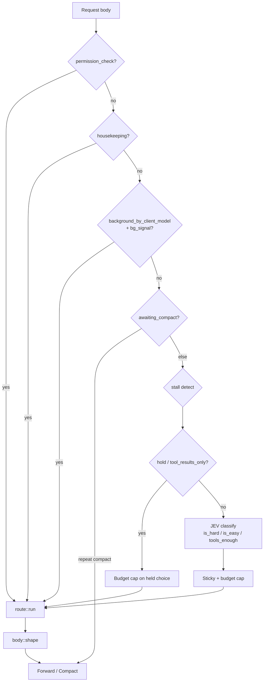
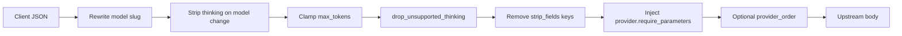
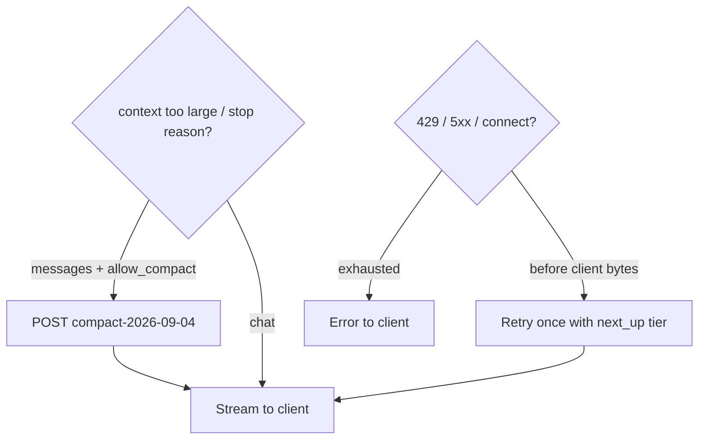

# Autoroute

Autoroute is the session-aware model ladder for Claude Code → OpenRouter. It lives behind dedicated paths so passthrough behavior stays unchanged.

## Endpoints

| Method | Path | Notes |
| --- | --- | --- |
| `POST` | `/autoroute/v1/messages` | Primary Claude Code path; compaction + retry + text-tool-call hook |
| `POST` | `/autoroute/v1/chat/completions` | Same decide/shape; **no** Messages compact API; no text-tool-call hook |
| `GET` | `/autoroute/status` | JSON for statusline (`?session=` optional) |

Ladder slugs and policy: `config/autoroute.toml` (default Mistral: ministral-8b → mistral-small-3.1 → `mistralai/devstral-2512`).

## Decide pipeline

Order inside `auto::decide` (simplified):

### Triggers (examples)

| Trigger / reason | Meaning |
| --- | --- |
| `permission_check` | Keep sticky model; skip JEV |
| `housekeeping` / `housekeeping_trimmed` | Force low; optional message trim |
| `background_model` | Same as housekeeping when opt-in flag on |
| `stall:error_streak` / `stall:tool_*` | Escalate one band for `escalate_turns` |
| `text_tool_call` | Next-turn escalate after detector fires |
| `none` | Empty question passthrough (still shaped) |
| JEV band names | Complexity from Decisions scores |

## Body shaping (`shape`)

Applied on every Forward (including “passthrough” unset tier):

Shipped strip list (Anthropic-only; proven against `mistralai/devstral-2512` `supported_parameters`):

- `output_config`
- `safeguards`
- `context_management`

`require_parameters` modes: `always` | `tools_only` | `never` (invalid values fail config load). Empty `strip_fields` disables stripping — do not leave `require_parameters=always` with an empty list unless you accept OpenRouter 404s.

Protected keys (`tools`, `tool_choice`, `system`, `messages`, `max_tokens`, `stop_sequences`, `metadata`) are never stripped even if listed.

## Sticky, stall, budget

| Mechanism | Behavior |
| --- | --- |
| Sticky band | Session remembers low/mid/high; down-tier needs `down_confirm` consecutive lower classifications |
| Stall | Looks at last `stall_window` non-HK assistant turns; escalates and holds `escalate_turns` |
| Session budget | When `session_budget_usd > 0`, `cap_for_budget` clamps tier by spend; **default is 0 (off)** |
| high_allow | Client preferred model on High only if allowlisted (empty = always use configured high slug) |

Caveats (budget holes, shared `#subagent` key): [status.md](./status.md).

## Compaction and retry (messages)

- Messages autoroute: real OpenRouter compaction; one tier-up retry before the client sees failure.
- Chat autoroute: `allow_compact=false` for overflow decide; if a Compact turn still appears, `chat_compact` strips compaction and forwards as normal chat.

## Session identity

`session_key` is derived only from the request body: `metadata.user_id` (JSON string) → `session_id`, then optional `#subagent` when the body looks like a Claude Code Agent (`body::session_key`). No Anthropic session headers are read. Concurrent **subagents** currently share `{uuid}#subagent` — one sticky/stall/budget for all Agents. Per-subagent keys (`#sub:{hash}`) are planned, not shipped ([plans/](./plans/2026-11-06-orchestration-plan.md)).

## Observe signals (history only unless flags on)

| Signal | Source | Routing effect by default |
| --- | --- | --- |
| `client_model` | Preferred model in body | None |
| `client_has_thinking` | Thinking blocks present | None |
| `client_tool_names` | Tool name CSV | None |
| `bg_signal` | Model matches `background_model_patterns` | None unless `background_by_client_model` |
| `hk_text_signal` | Housekeeping text patterns | Housekeeping path when text matches |

## Server tools

`web_search` / `web_fetch` / `code_execution`:

| `server_tool_mode` | Behavior |
| --- | --- |
| `passthrough` (default) | Forward unchanged |
| `online_suffix` | Rewrite model with `:online` |
| `reject` | 400 before upstream |

## Statusline

`GET /autoroute/status?session=…` returns spend / model JSON for `scripts/statusline.sh`.
