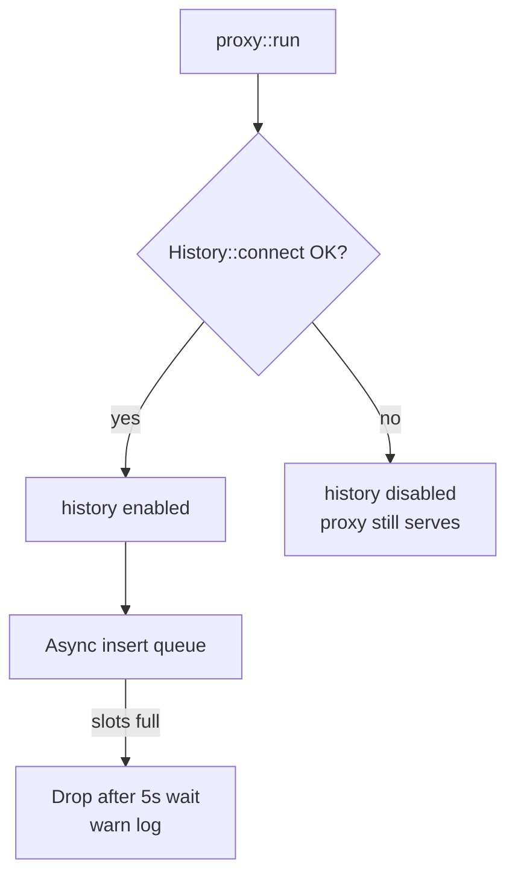
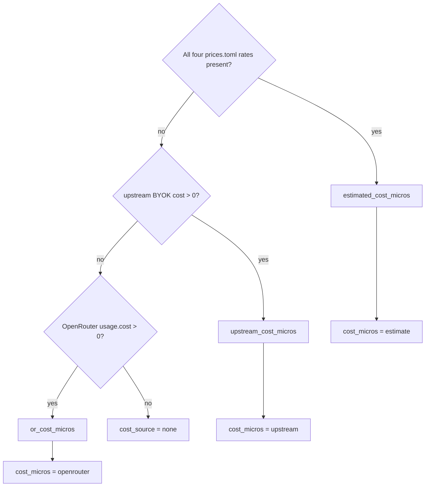

# History and cost

Octo records a **side copy** of proxied calls in SQLite. Live streaming is unchanged: inserts run asynchronously and must not block the client.

## Connect behavior



- Path: `config/history.toml` → `database_path` (default `data/history.sqlite`).
- Migrations under `migrations/`; compile-time `query!` uses committed `.sqlx/` (`SQLX_OFFLINE`).
- Concurrency: 32 insert slots; wait up to 5s; then **drop** the row (no spill-to-disk).
- Shutdown: graceful drain of in-flight inserts.

## Identity

Caller secrets (`Authorization` / `x-api-key`) are stored as **HMAC-SHA256** hashes. Token key from `OCTO_HISTORY_TOKEN_KEY`, `history.token_key`, or an auto-generated `.key` beside the DB (restrictive Unix permissions).

Raw tokens are never written to the database or tracing.

## Tables (conceptual)

### `calls`

Core metrics: kind, provider, model, status, latency, bytes, tokens, `cost_micros`.

Routing: `session_id`, `tier_before` / `tier_after`, `trigger`, `rerouting` / `rerouting_reason`.

Cost detail: `or_cost_micros`, `upstream_cost_micros`, `estimated_cost_micros`, `cost_source`, `is_byok`, `upstream_provider`, cache tokens, `generation_id`, `trimmed_from_tokens`.

Observe: `client_model`, `client_has_thinking`, `client_tool_names`, `bg_signal`, `hk_text_signal`.

Payloads: `request_payload` / `response_payload` (JSON envelopes). With `store_payloads = false`, text payload columns are omitted; metrics and observe columns remain.

### `decisions`

JEV / Decisions rows: scores (`is_hard`, `is_easy`, `tools_enough`), complexity, choice rule, payloads, cost columns. No orchestration score columns yet.

### `session_outcomes`

Upserted from last-user `tool_result` blocks that look like cargo / pytest / unittest summaries, keyed by observe `session_id` (including `#subagent` when present).

## Cost precedence



Money is stored as **integer micro-dollars** (`CostMicros`). Failed / no-usage rows stay honest zeros with `cost_source = "none"`.

Ladder slugs in shipped `prices.toml` may use `0.0` placeholders — estimates are then zero until you fill console rates.

## Caveats

| Issue | Effect |
| --- | --- |
| Soft-fail open | Proxy up, no history |
| Burst drop | Missing rows under load; warn may omit `session_id` |
| Stream fail after headers | Client may see 200; history may record 502 |
| `generation_id` | Body `msg_*` stored; OpenRouter `gen-*` response headers not persisted |
| Compact accounting | Compaction rows often lack `session_id` and may skip session spend add |

Inspect latest rows:

```bash
sqlite3 data/history.sqlite \
  "SELECT id, kind, provider, model, status, trigger FROM calls ORDER BY id DESC LIMIT 5;"
```

Reconcile vs a provider CSV: `python3 scripts/reconcile_costs.py data/history.sqlite --provider-csv invoice.csv`.
