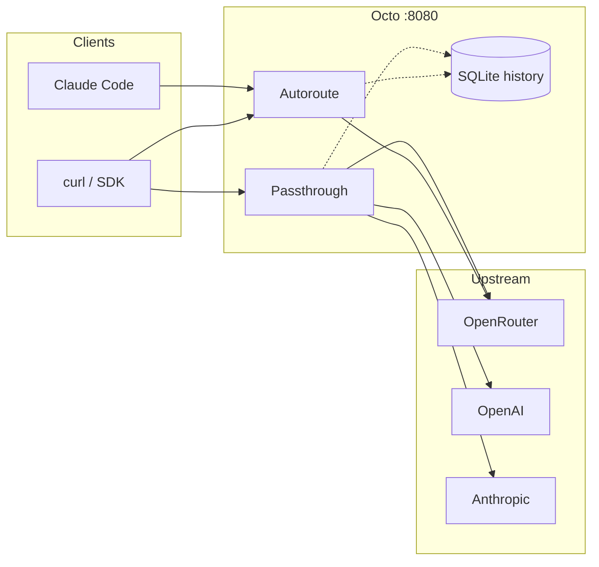

# Overview

**Octo** is a local Rust HTTP proxy (Axum + Tokio) that sits between Claude Code / OpenAI-compatible clients and upstream LLM APIs (OpenAI, Anthropic, OpenRouter).

It does two jobs:

1. **Passthrough proxy** — forward chat, Anthropic Messages, and OpenRouter Decisions with streaming, path aliases, and provider selection.
2. **Autoroute** — on `/autoroute/*`, pick a model from a configured ladder (low → mid → high), reshape the body for OpenRouter, and record routing reasons in SQLite.



## Why it exists

Claude Code speaks Anthropic Messages and often sends Anthropic-only fields (`output_config`, `safeguards`, `context_management`, thinking blocks). OpenRouter Mistral / Devstral models reject those under `provider.require_parameters`, returning **404 Filter by Parameters**. Autoroute strips/hygiene-shapes the body, chooses cheaper models when the turn is easy, escalates on stall, and keeps FinOps-oriented history.

## Quick capability map

| Capability | Status | Doc |
| --- | --- | --- |
| OpenAI chat proxy | Working | [proxy.md](./proxy.md) |
| OpenRouter chat / messages / decisions | Working | [proxy.md](./proxy.md) |
| Anthropic Messages (direct) | Working | [proxy.md](./proxy.md) |
| Loopback + optional `x-octo-key` | Working | [proxy.md](./proxy.md) |
| Autoroute ladder + JEV + sticky + stall | Working | [autoroute.md](./autoroute.md) |
| Strip fields + `require_parameters` | Working (tuned) | [autoroute.md](./autoroute.md) |
| SQLite history + cost micros | Working (soft-fail) | [history.md](./history.md) |
| Session outcomes (cargo/pytest/unittest) | Working | [history.md](./history.md) |
| Session spend budget | Partial (off by default; holes) | [status.md](./status.md) |
| Per-subagent sticky / orchestration | Not shipped | [status.md](./status.md) |
| Rewrite text-as-tool-call same turn | Not shipped | [status.md](./status.md) |

## How to run

```bash
git submodule update --init --recursive
cargo run   # from repo root; loads ./config/
```

Default bind: `127.0.0.1:8080`. Clients supply upstream API keys per request. See [configuration.md](./configuration.md) and the root [README.md](../README.md) for curl samples.

## Mental model

| Mode | Path prefix | Model choice | Body reshape |
| --- | --- | --- | --- |
| Passthrough | `/v1/*`, `/openai/*`, `/openrouter/*`, `/claude/*`, … | Client's `model` | Selector fields stripped only |
| Autoroute | `/autoroute/v1/messages`, `/autoroute/v1/chat/completions` | Ladder + decide | Full `shape()` hygiene |

Autoroute never changes passthrough semantics. Enable it by pointing Claude Code (or equivalent) at the `/autoroute` URLs.
