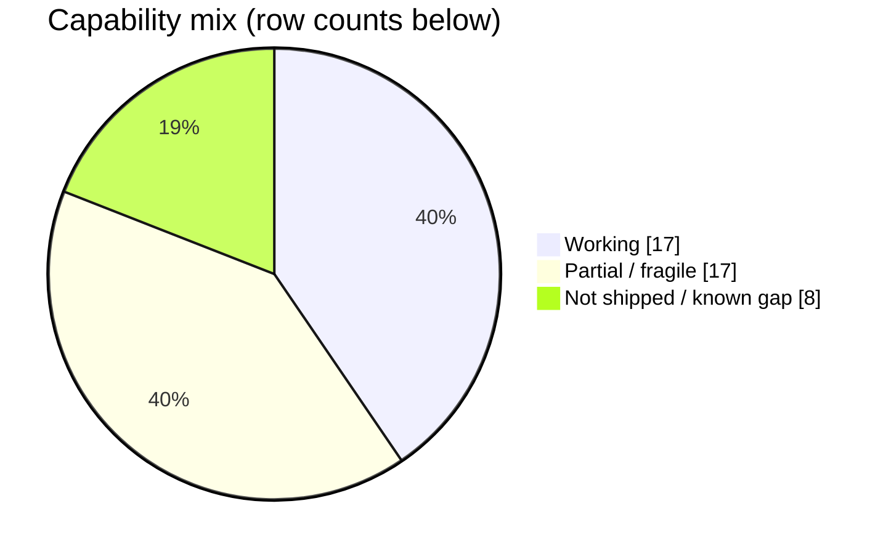
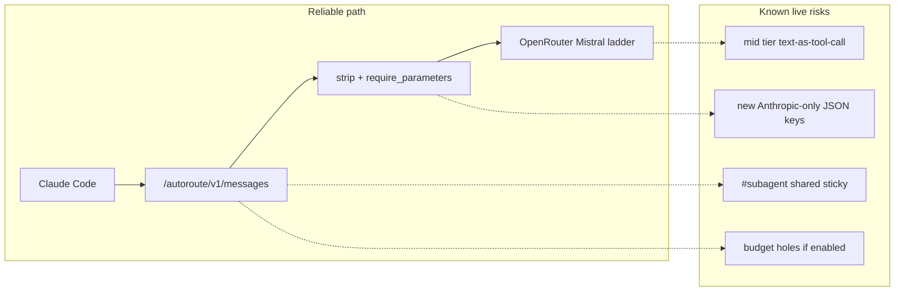

# Status — what works, what does not

Honest capability matrix for the codebase on `main` as of the architecture-docs merge (`27d89d0` lineage). Evidence comes from integration tests under `tests/`, live verification notes, and code inspection. Prefer this page over optimistic README wording when deciding what to rely on.

## Summary

| Bucket | Count | Meaning |
| --- | --- | --- |
| Working | 17 | Test-backed; safe for default Claude Code → OpenRouter use |
| Partial | 17 | Works with caveats, off-by-default flags, or accounting holes |
| Missing | 8 | Planned or documented; not in code |

---

## Working

| Area | What you can rely on | Evidence |
| --- | --- | --- |
| Health | `GET /health` → 200 | `route_integration` |
| Chat proxy | OpenAI + OpenRouter path/body/backend select, streaming | `chat_provider_select`, `proxy_post`, header tests |
| Messages proxy | Direct Anthropic + OpenRouter Messages | `route_integration`, llm defaults |
| Decisions proxy | OpenRouter Decisions forward + history | `history_store` |
| Client auth | Loopback default; remote needs key; `x-octo-key` | `proxy_post`, `auth.rs` |
| Autoroute ladder | low/mid/high from config; sticky + stall escalate/release | `tests/autoroute.rs` |
| JEV classify | `is_hard` / `is_easy` / `tools_enough`; scores in `decisions` | `autoroute` JEV tests; verification C1 |
| Housekeeping | Force low, no decisions row, optional trim | housekeeping fixtures |
| Permission check | Hold model, skip JEV | permission_check tests |
| Body hygiene | `strip_fields` + `require_parameters`; thinking strip; max_tokens clamp | shape fixtures `call_528` / `call_530` |
| Tools kept | Client `tools[]` not filtered by JEV | forwards_all_tools tests |
| Messages compact | OpenRouter compact API when overflow | `compact.rs` + decide route |
| Messages retry | One tier-up on 429 / 5xx / connect-timeout before client bytes | `autoroute_retry` |
| History core | Async insert, HMAC tokens, cost micros, payloads | `history_*` tests |
| Observe columns | client_model / thinking / tools / bg / hk | `autoroute_observe` |
| Session outcomes | cargo / pytest / unittest tool_result parse | `session_outcomes` |
| Statusline | `/autoroute/status` + script | `status.rs`, `scripts/statusline.sh` |

---

## Partial / fragile

| Item | Default / behavior | Risk | Tracking |
| --- | --- | --- | --- |
| Soft-fail history | DB fail → proxy continues without DB | Silent loss of FinOps | `proxy/mod.rs` |
| Insert backpressure | 32 slots, 5s, then **drop** | Missing rows under burst; warn often lacks `session_id` | verification F3 |
| Stream vs history status | Client 200 possible while history 502 | Confusing recon | AGENTS.md |
| `session_budget_usd` | **0 (disabled)** | Cap unused until configured | `autoroute.toml` |
| Budget holes | Fill-upgrade / retry skip re-cap; compact skips session cost | Overspend vs intended cap | verification E4 |
| `background_by_client_model` | **false** | `bg_signal` observe-only | defaults regression |
| `server_tool_mode` | **passthrough** | Server tools hit models that may not support them | `autoroute_server_tools` |
| Chat autoroute compact | No Messages compact API | Chat overflow ≠ messages compact | `allow_compact: !chat` |
| Shared `#subagent` key | All Agents share sticky/budget | Concurrent subagents corrupt state | research A1/A5 |
| Text-as-tool-call | Detect + **next-turn** escalate | Mid-tier can emit Agent JSON as text this turn | [debug/text-tool-call](./debug/2026-11-06-text-tool-call.md) |
| Catalog miss window | Defaults to **8192** | Extra compact / fill pressure | verification E2 |
| Empty model seed | Cost sync can seed `""` | Theoretical empty upstream model | verification E3 |
| `generation_id` | Stores body `msg_*` | Missing OpenRouter `gen-*` header | verification F1 |
| `prices.toml` zeros | Ladder rates may be `0.0` | Estimate cost stays zero | `prices.toml` |
| `provider_order` empty | OpenRouter chooses endpoint | Mid via Cloudflare vs Mistral variance | ratelim / text-tool docs |
| Filter-by-Parameters | Strip list tuned for known keys | New Anthropic-only fields → 404 again | [experiments/ratelim](./experiments/2026-11-06-ratelim.md) |
| tool_results_only hold | Implemented | Dedicated true-case test still thin | verification C3 |

---

## Not shipped / does not work yet

| Gap | Intent | Status |
| --- | --- | --- |
| `#sub:{hash}` session keys + `parent_session_id` | Isolate subagent sticky/budget | Plan P0 only |
| `needs_orchestration` JEV score | Shadow multi-part task detection | Plan P1 only |
| `orchestrate` config + Agent nudge | Encourage delegation on high | Plan P2 only |
| Per-subagent default-low routing | Cheap explore Agents | Plan P3 only |
| Eval harness H1–H5 | Quality vs always-high | Plan P4 only |
| Same-turn rewrite of text → `tool_use` | Fix mid-tier Agent text emissions | Explicitly not implemented |
| History spill-to-disk | Survive insert bursts | Not implemented (drop only) |
| Persist `x-generation-id` | FinOps join to OpenRouter console | Not implemented |

Full plan: [plans/2026-11-06-orchestration-plan.md](./plans/2026-11-06-orchestration-plan.md).

---

## Recommended production posture (today)

1. Bind loopback; set `client_auth_key` if exposing beyond localhost.
2. Point Claude Code at **`/autoroute`** (not raw `/v1/messages`) when using the Mistral ladder.
3. Keep shipped `strip_fields` + `require_parameters = "always"` unless you have a proven narrower set.
4. Leave `session_budget_usd = 0` unless you accept fill/retry/compact accounting holes.
5. Leave `background_by_client_model = false` until you want Haiku-pattern routing.
6. Expect concurrent Claude Code Agents to share sticky state (`#subagent`).
7. Treat mid-tier text-as-tool-call as a known failure mode; escalate helps the *next* turn only.
8. Do not depend on orchestration nudge / per-subagent routing — not in the binary.

---

## How this page is maintained

Update when:

- A PARTIAL becomes test-closed and default-safe → move to **Working**
- A plan item lands on `main` → move out of **Not shipped**
- A live incident finds a new Anthropic-only key or provider quirk → add under **Partial**

Dated evidence folders under `docs/verification`, `docs/experiments`, and `docs/debug` remain the audit trail; this matrix is the executive view.
