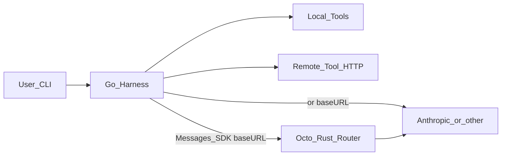

# Go Harness (agent client) — design

**Date:** 2026-11-08  
**Status:** approved — implementing via plan `docs/superpowers/plans/2026-11-08-go-harness.md`  
**Scope:** thin MVP in monorepo `harness/` (Go); Octo Rust router unchanged

## Intent and why

Octo is an HTTP **router/proxy** (Rust). Clients today are external (e.g. Claude Code). We need our own **agent harness**: a Go process that owns the agent loop, tools, sessions, and local state, and talks to any Anthropic-compatible Messages endpoint — typically Octo (`/v1/messages` or `/autoroute/...`), or direct Anthropic, or another router the user points at.

Harness is a **piece of our product**, not a requirement of the router. The router stays independent and keeps accepting other clients. Harness is the future primary client (Claude Code–class), not an IDE (IDE is later).

Greenfield: no external Go etalon. Wire Anthropic conventions via the **official Anthropic Go SDK**.

## Goals

- **Go module** under [`harness/`](../../../harness/) in this monorepo (`go.mod` own module path).
- **Agent loop** over Anthropic Messages: user turn → model → `tool_use` → execute → `tool_result` → until end turn.
- **Official SDK:** `github.com/anthropics/anthropic-sdk-go/v2` (Messages + tools). Configurable base URL and API key (pass-through client auth like Claude Code → Octo).
- **Two tool classes:**
  - **Local (direct):** implemented in-process (MVP set below).
  - **Remote:** defined and invoked over a small HTTP JSON protocol; harness merges their schemas into the model `tools[]` and dispatches `tool_use` to the remote.
- **Modular isolation:** packages talk only through exported interfaces; no shared mutable globals across domains; harness DB/cache/config **never** touch Octo Rust history SQLite or `config/*.toml`.
- **Own persistence:** SQLite for sessions/messages/tool traces; optional file cache dir — paths under harness-owned data root.
- **CLI entrypoint** to run one agent session (stdin/args prompt) against a chosen upstream.
- **Smoke path:** harness → local Octo (or mock) → at least one local tool round-trip in tests (fake HTTP upstream OK).

## Non-goals (this slice)

- IDE, UI, statusline, VS Code / Cursor integration.
- Claude Code feature parity (permissions UX, MCP marketplace, subagents as CC ships them, hooks, Skill packs).
- Changing Octo Rust: no new proxy routes required for MVP; harness uses existing Messages/autoroute paths.
- Sharing DB, cache, migrations, or config loader with Rust.
- OpenAI chat/completions agent loop (Anthropic Messages only).
- Production multi-tenant hosting of the harness itself.

## Anti-goals

- Embedding Go inside the Rust binary or calling Rust via FFI for the agent loop.
- Fabricating `tool_use` on the router; tools execute only in harness (or remote tool servers harness calls).
- Logging raw API keys or unbounded prompt bodies.

## Constraints

- Language: Go **1.25+** (required by anthropic-sdk-go/v2).
- Wire format: Anthropic Messages conventions only (`tools`, `tool_use`, `tool_result`, content blocks).
- Upstream auth: client supplies key (`ANTHROPIC_API_KEY` / config); when base URL is Octo, same Bearer/`x-api-key` behavior Octo already expects for Messages.
- Octo loopback default `http://127.0.0.1:8080`; autoroute example base `http://127.0.0.1:8080/autoroute` (SDK appends `/v1/messages` per Anthropic client conventions — builder must verify path joining against SDK `WithBaseURL`).
- Ponytail: smallest complete MVP; no extra frameworks.
- Tests live next to Go packages or under `harness/…_test.go` (Go convention); do not add Rust tests for harness.

## Approaches considered

| Approach | Tradeoff | Decision |
|----------|----------|----------|
| Separate Git repo for harness | Cleaner isolation; dual clone/CI | Deferred — product wants one tree for now |
| **Monorepo `harness/` Go module** | Shared clone; separate `go.mod`, data, CI job | **Chosen** |
| Full Claude Code parity in v1 | Huge surface, slow to ship | **Rejected** for this slice |
| **Thin MVP:** loop + local tools + remote interface + one remote adapter | Ships usable client; room to grow | **Chosen** |
| Reuse Octo SQLite/history | Couples products; violates “nothing shared” | **Rejected** |

## Architecture



### Package layout (proposed)

Module path: `github.com/ndolinschi/Octo/harness` (matches GitHub remote).

| Package | Responsibility |
| --- | --- |
| `cmd/harness` | CLI: flags/env, start one session, exit codes |
| `internal/config` | Load harness-only TOML/env (`HARASS` avoided); data dir, base URL, model, key, remote tool endpoints |
| `internal/store` | SQLite: sessions, messages, tool runs; migrations owned here |
| `internal/cache` | Optional disk cache (e.g. remote tool schema TTL); separate from store |
| `internal/anthropicclient` | Wrap SDK client: base URL, key, timeouts |
| `internal/agent` | Agent loop: append messages, register tools, dispatch tool_use, stop on end_turn / max turns |
| `internal/tools` | `Tool` interface + registry (name → handler); builds Anthropic `tools[]` |
| `internal/tools/local` | Direct tools: `bash`, `read_file`, `write_file`, `list_dir` (workspace-rooted) |
| `internal/tools/remote` | Discover schemas from remote; HTTP invoke; map errors to `tool_result` is_error |
| `internal/session` | Session id, resume from store (minimal) |

Public API surface for later IDE: keep `internal/` until a second consumer needs `pkg/`. **Builder call:** start fully under `internal/` + `cmd/`.

### Isolation rules

- `local` must not import `remote` or `store`.
- `remote` must not import `local`.
- `agent` depends on `tools` registry interface only, not concrete local/remote packages (wire in `cmd` or a small `internal/app`).
- `store` / `cache` / `config` must not import `agent` or SDK.
- No package may open Octo’s `data/history.sqlite` or read `config/*.toml` from the Rust tree.

### Upstream modes (config)

| Mode | `base_url` example | Notes |
| --- | --- | --- |
| Octo passthrough | `http://127.0.0.1:8080` | Uses Octo `[llm.messages]` / path selection |
| Octo autoroute | `http://127.0.0.1:8080/autoroute` | Ladder / sticky / etc. |
| Direct Anthropic | `https://api.anthropic.com` (or SDK default) | No Octo |
| Custom router | any Anthropic-compatible Messages base | User’s router |

Model string is client-chosen; when using autoroute, Octo may rewrite model per ladder (existing router behavior).

### Local tools (MVP)

| Name | Behavior |
| --- | --- |
| `bash` | Run command in configured workspace; capture stdout/stderr/exit; timeout |
| `read_file` | Read file under workspace root (path confinement) |
| `write_file` | Write/create file under workspace root |
| `list_dir` | List directory under workspace root |

Path confinement: reject `..` escapes outside workspace. **Builder call:** no interactive TTY; no PTY.

### Remote tools (MVP)

- Config lists one or more remote bases, e.g. `http://127.0.0.1:9100`.
- **Discover:** `GET {base}/tools` → JSON array of Anthropic-shaped tool defs (`name`, `description`, `input_schema`).
- **Invoke:** `POST {base}/tools/{name}` with JSON body = tool input; response body = string/JSON result; non-2xx → `tool_result` with `is_error=true`.
- Harness merges remote defs into the same registry as local tools (name collision: local wins; log warn).
- Ship a **tiny example remote** under `harness/examples/remotetool` (one echo tool) for integration tests — not a product server.

### Persistence

- Default data dir: `./data/harness/` (or `HARASS_DATA_DIR` / `OCTO_HARNESS_DATA_DIR` — **builder call:** prefer `HARNESS_DATA_DIR`).
- SQLite file: `{data_dir}/harness.sqlite`.
- Tables (minimal): `sessions`, `messages` (role + JSON content), `tool_runs` (optional for debug).
- Cache dir: `{data_dir}/cache/` for remote schema snapshots.

### CLI (MVP)

```text
harness run --prompt "..." [--workspace DIR] [--base-url URL] [--model MODEL]
```

Env fallbacks: `ANTHROPIC_API_KEY`, `ANTHROPIC_BASE_URL`, `HARNESS_DATA_DIR`.

### Observability

- Structured logs (slog): turn index, tool name, latency, upstream status — no secrets, truncate large tool payloads in logs.

### Testing

- Unit: path confinement; registry merge (local vs remote); agent loop with **fake** Messages HTTP (httptest).
- Integration (optional behind tag): live Octo + key — not required for merge if httptest covers loop.

### CI / repo hygiene

- Root README or `harness/README.md`: how to build/run.
- CI: add a Go job (`go test ./...` in `harness/`) without coupling to `cargo test`.
- `.gitignore`: harness build artifacts / local `data/harness/`.

## Left to the builder

- Exact SDK option for base URL path joining (`/v1/messages` vs autoroute prefix).
- SQLite driver (`modernc.org/sqlite` vs `mattn`) — prefer pure Go if CI has no CGO.
- Max turns / max tokens defaults.
- Whether first CLI uses streaming or non-streaming Messages (non-streaming OK for MVP).
- TOML library choice for harness config.

## Approval

Human partner approves this design before implementation and before `writing-plans`. After approval: implementation plan under `docs/superpowers/plans/`, then code only in `harness/` (+ docs/CI), not Rust proxy behavior.
