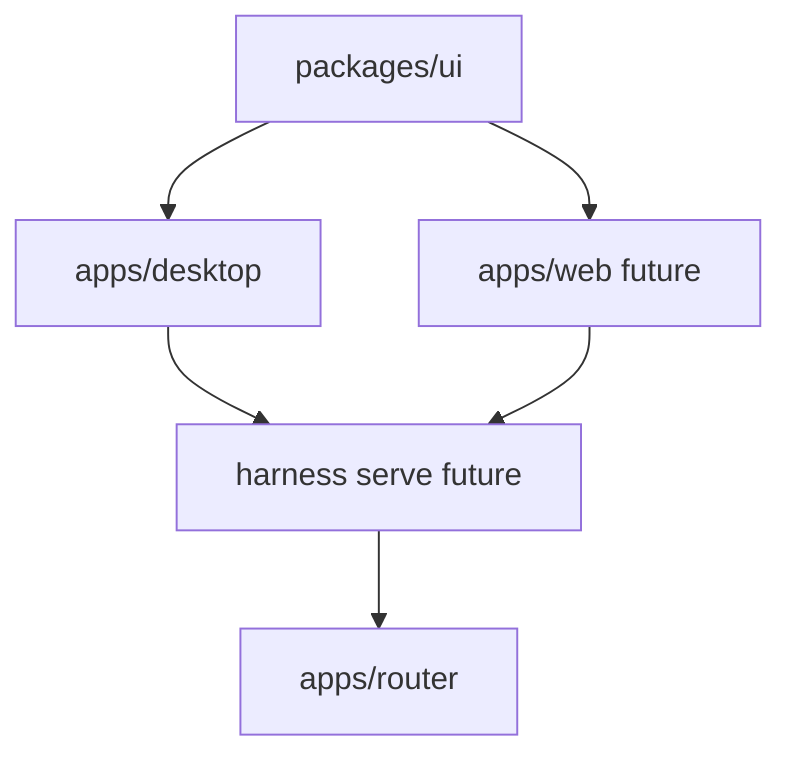

# Desktop + shared UI — design

**Date:** 2026-11-09  
**Status:** approved for Phase 1 (scaffold)  
**Approach:** A — shared UI + future harness HTTP bridge

## Intent

Ship a **Tauri desktop shell** and a **shared frontend** so the same UI can later power a **web** deploy on Claude-hosted infrastructure. **Desktop** runs tools on the local machine (via harness local registry). **Web** runs tools only on the remote environment (harness remote tool HTTP). One Go agent loop in harness; UI never dispatches tools directly.

## Goals

- Monorepo layout: `packages/ui`, `packages/agent-client`, `apps/desktop`, stub `apps/web`.
- UI free of Tauri imports (shell-agnostic).
- Explicit `AgentBridge` URL (`HARNESS_BRIDGE_URL` / `VITE_HARNESS_BRIDGE_URL`) for Phase 2 wiring.

## Non-goals (Phase 1)

- Harness `serve` HTTP API, live chat, streaming.
- Router admin or autoroute UI.
- Shared SQLite/config with router or harness.

## Anti-goals

- Duplicate agent loop in TypeScript.
- Desktop UI calling `bash` or filesystem APIs without harness tool policy.
- Embedding Go inside the webview.

## Approaches considered

| Id | Summary | Why not / pick |
| --- | --- | --- |
| **A** | Shared UI + harness HTTP bridge | **Chosen** — single agent loop, web vs desktop = bridge config |
| **B** | Local tools as HTTP remotetool only | Awkward double-hop, extra loopback surface |
| **C** | TS agent loop in browser | Diverges from CLI/harness hooks roadmap |

## Architecture (target)

## Tool boundary

| Port | Desktop | Web |
| --- | --- | --- |
| `AgentBridge` | loopback harness serve | HTTPS on env |
| `ToolSurface` | local + optional remote | remote bases only |

Defined in `packages/agent-client` (`resolveBridgeUrl`, types). Phase 1: URL placeholder only.

## Constraints

- Cargo workspace remains `apps/router` only; Tauri crate stays under `apps/desktop/src-tauri`.
- pnpm workspace at repo root; do not merge into Cargo workspace.
- React 19 + Vite 8 + Tauri 2 (as scaffolded).

## Phase 1 deliverable

Scaffold: pnpm workspace, placeholder `OctoApp` screen, Tauri shell consuming `@octo/ui`, CI `pnpm build` + `cargo check`, docs and Cursor rules.

## Phase 2 (follow-up PR)

See plan `2026-11-09-harness-bridge-phase2.md` (not in the public tree).
