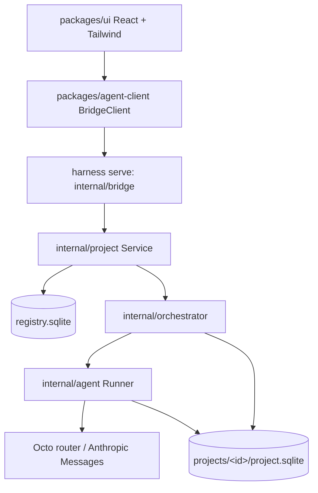

# Project-based harness + new UI — design

**Date:** 2026-11-10
**Status:** approved (decisions made by the orchestrating agent on the owner's behalf; owner reviews the finished work)
**Supersedes:** Phase 2 stub [`../plans/2026-11-09-harness-bridge-phase2.md`](../plans/2026-11-09-harness-bridge-phase2.md) (session-based bridge)

## Intent

Move the harness from one-shot **sessions** to long-lived **projects**. A project is a
workspace the user manages from **one continuous conversation** with a project
**orchestrator**. The orchestrator keeps its own context small by delegating work to
**sub-agents** (nested N layers), choosing a model tier per task difficulty. Everything a
project knows lives in that project's own database. The UI is a premium chat app:
projects in a left sidebar, the orchestrator chat in the centre, and read-only drill-down
into any sub-agent's conversation.

## Goals

- `harness serve`: loopback HTTP + SSE API for projects, agents, messages, notes.
- Project isolation: one SQLite file per project; nothing shared between projects.
- A project attaches to one or more folders; tools are confined to those folders.
- Orchestrator delegates through a `spawn_agent` tool; sub-agents may delegate again up
  to a configurable depth; sibling delegations run in parallel.
- Model tiers (`fast` / `balanced` / `deep`) mapped to model ids per project.
- Project notes ("intent, decisions, facts") persisted and injected into the
  orchestrator's system prompt on every turn.
- React + Tailwind UI in `packages/ui`, hosted by `apps/desktop`, talking only to the bridge.
- Sub-agent transcripts are viewable but never controllable from the UI.

## Non-goals (this change)

- Multiple chat threads per project (one orchestrator thread by design).
- Automatic context compaction of the orchestrator thread (delegation + notes keep it
  lean; compaction is the next follow-up).
- Auth, multi-user, remote hosting, Tauri sidecar auto-spawn of `harness serve`.
- Router changes. The harness already talks to Octo over Anthropic Messages; tier →
  model mapping is plain model ids, so no router work is required.
- Permission prompts / approvals for tool calls.

## Anti-goals

- An agent loop in TypeScript, or the UI touching the filesystem or shell.
- Sub-agent output streamed raw into the orchestrator's context.
- Any cross-project table, cache, or note.

## Approaches considered

| Id | Summary | Verdict |
| --- | --- | --- |
| **A** | One shared DB with a `project_id` column everywhere | Rejected — isolation is by convention only; a missed `WHERE` leaks data |
| **B** | **DB file per project + tiny registry index** | **Chosen** — isolation is physical; delete/export a project = one directory |
| **C** | Project DB stored inside the attached folder (`.octo/`) | Rejected — a project may have several folders or none; pollutes repos |

| Id | Delegation model | Verdict |
| --- | --- | --- |
| **1** | **`spawn_agent` tool, synchronous child run, result returned as tool_result** | **Chosen** — fits the existing tool loop; parent sees only the child's final report |
| **2** | Async task queue + polling tools | Rejected for now — more moving parts, no user-visible benefit at this size |

## Architecture



### Storage

```text
{data-dir}/
  registry.sqlite                 # projects(id, name, created_at) — index only
  projects/{project_id}/
    project.sqlite                # everything else for that project
```

`project.sqlite` tables:

| Table | Columns |
| --- | --- |
| `project` | single row: `name`, `description`, `instructions`, `models_json`, `max_depth`, `created_at`, `updated_at` |
| `folders` | `id`, `label` (unique), `path` (absolute), `created_at` |
| `agents` | `id`, `parent_id` (NULL = orchestrator), `depth`, `role`, `title`, `task`, `model`, `tier`, `status`, `result`, `error`, `spawn_tool_use_id`, `input_tokens`, `output_tokens`, `created_at`, `started_at`, `finished_at` |
| `messages` | `id` (autoincrement), `agent_id`, `role`, `content_json` (SDK `MessageParam.content`), `created_at` |
| `notes` | `id`, `title`, `content`, `author` (`user` \| `orchestrator`), `created_at`, `updated_at` |

The legacy `harness.sqlite` session store and the `run` / `sessions` / `show` CLI stay
untouched.

### Agents

- Each project has exactly one **orchestrator** agent row (`parent_id` NULL, `depth` 0,
  `role` `orchestrator`), created with the project. Its message list is the project chat.
- `status`: `idle` (orchestrator between turns) · `running` · `completed` · `failed` · `cancelled`.
- A user message starts one **turn**: the tool loop runs until the orchestrator answers
  without tool calls. Only one turn per project at a time (`409` otherwise).
- Server restart: any agent left `running` is marked `failed` ("interrupted"); the
  orchestrator returns to `idle`.

### Tools by agent kind

| Tool | Orchestrator | Sub-agent |
| --- | --- | --- |
| `spawn_agent` | yes | yes while `depth < max_depth` |
| `list_dir`, `read_file` | yes (orientation only) | yes |
| `write_file`, `bash` | no | yes |
| `save_note`, `delete_note` | yes | no |
| remote tools (`--remote`) | no | yes |

`spawn_agent` input: `{ "role": string, "title": string, "task": string, "tier": "fast"|"balanced"|"deep" }`.
The child starts with a fresh context: system prompt (project brief, folders, its role)
plus `task` as the first user message. The tool result is the child's final text (capped
by `tools.CapString`), or an error result if the child failed. Several `spawn_agent`
calls in one assistant message run concurrently.

File tools take an optional `folder` (label). With one folder it may be omitted; with
several it defaults to the first. Paths stay confined to the chosen folder. A project
with no folders gets no file/shell tools.

### Model tiers

Per project `models`: `{ orchestrator, fast, balanced, deep }`. Defaults (overridable by
`HARNESS_MODEL_ORCHESTRATOR|FAST|BALANCED|DEEP`): `claude-sonnet-5-5`, `claude-haiku-5-5`,
`claude-sonnet-5-5`, `claude-opus-5-5`. The orchestrator defaults to the balanced model (it delegates and
its never-compacted thread is the longest-lived, so it is the costliest place for the deep model); projects
created earlier keep the `models` stored in `models_json`. When pointing at Octo autoroute, set all four to
whatever ids the router config expects.

### Notes (project memory)

Notes are short titled records. All notes are rendered into the orchestrator system
prompt each turn. The orchestrator writes them with `save_note` (upsert by title); the
user can read, add, edit and delete them in the UI.

## Bridge API

Base: `http://127.0.0.1:8790`. JSON bodies, `snake_case` fields, RFC 3339 timestamps.
Errors: `{ "error": { "code": string, "message": string } }` with 400 / 404 / 409 / 500.
CORS: allow any `http://localhost:*`, `http://127.0.0.1:*`, `tauri://localhost`,
`http://tauri.localhost` origin.

| Method | Path | Body → Response |
| --- | --- | --- |
| GET | `/health` | → `{ "ok": true, "version": string }` |
| GET | `/v1/config` | → `{ "default_models": Models, "default_max_depth": number }` |
| GET | `/v1/projects` | → `{ "projects": ProjectSummary[] }` (newest activity first) |
| POST | `/v1/projects` | `ProjectInput` → `201 Project` |
| GET | `/v1/projects/{pid}` | → `Project` |
| PATCH | `/v1/projects/{pid}` | partial `ProjectInput` → `Project` (`folders`, when present, replaces the set) |
| DELETE | `/v1/projects/{pid}` | → `204` (409 while running) |
| GET | `/v1/projects/{pid}/agents` | → `{ "agents": Agent[] }` (flat, creation order) |
| GET | `/v1/projects/{pid}/agents/{aid}` | → `Agent` |
| GET | `/v1/projects/{pid}/agents/{aid}/messages` | → `{ "messages": Message[] }` |
| POST | `/v1/projects/{pid}/messages` | `{ "text": string }` → `202 { "message": Message }` (409 `turn_in_progress`) |
| POST | `/v1/projects/{pid}/cancel` | → `202` (no-op when idle) |
| GET | `/v1/projects/{pid}/notes` | → `{ "notes": Note[] }` |
| POST | `/v1/projects/{pid}/notes` | `{ "title", "content" }` → `201 Note` |
| PATCH | `/v1/projects/{pid}/notes/{nid}` | `{ "title"?, "content"? }` → `Note` |
| DELETE | `/v1/projects/{pid}/notes/{nid}` | → `204` |
| GET | `/v1/projects/{pid}/events` | SSE stream of `BridgeEvent` |

There is deliberately **no** endpoint that posts a message to a sub-agent.

### Types

```ts
type Tier = "fast" | "balanced" | "deep";
type AgentStatus = "idle" | "running" | "completed" | "failed" | "cancelled";
type Models = { orchestrator: string; fast: string; balanced: string; deep: string };
type Folder = { id: string; label: string; path: string };

type ProjectInput = {
  name: string;                 // required on create
  description?: string;
  instructions?: string;        // custom instructions for the orchestrator
  folders?: { path: string; label?: string }[];   // label defaults to basename, deduped
  models?: Partial<Models>;
  max_depth?: number;           // 1..8, default 3
};

type ProjectSummary = {
  id: string; name: string; description: string;
  status: "idle" | "running";   // orchestrator turn in progress?
  folder_count: number; agent_count: number;
  created_at: string; updated_at: string;        // updated_at = last activity
};

type Project = ProjectSummary & {
  instructions: string; folders: Folder[]; models: Models; max_depth: number;
  orchestrator_agent_id: string;
};

type Agent = {
  id: string; project_id: string; parent_id: string | null; depth: number;
  role: string;                 // "orchestrator" or the specialist role, e.g. "Code explorer"
  title: string;                // short task title
  task: string;                 // full delegated prompt ("" for orchestrator)
  model: string; tier: Tier | null;               // null for orchestrator
  status: AgentStatus;
  result: string | null; error: string | null;
  spawn_tool_use_id: string | null;               // tool_use id in the parent's message
  input_tokens: number; output_tokens: number;
  created_at: string; started_at: string | null; finished_at: string | null;
};

type ContentBlock =
  | { type: "text"; text: string }
  | { type: "tool_use"; id: string; name: string; input: unknown }
  | { type: "tool_result"; tool_use_id: string; content: string; is_error: boolean };

type Message = {
  id: number; agent_id: string; role: "user" | "assistant";
  content: ContentBlock[];      // normalized by the bridge from stored SDK JSON
  created_at: string;
};

type Note = { id: string; title: string; content: string;
              author: "user" | "orchestrator"; created_at: string; updated_at: string };
```

### Events (SSE)

Each SSE frame: `id: <seq>`, `event: <type>`, `data: <json>`. `seq` is a per-project
monotonically increasing integer (in-memory; resets on server restart). A client that
reconnects should refetch agents/messages rather than rely on replay. A `: ping` comment
is sent every 15 s.

```ts
type BridgeEvent =
  | { type: "agent.created";   seq: number; agent: Agent }
  | { type: "agent.updated";   seq: number; agent: Agent }         // status, tokens, result
  | { type: "message.created"; seq: number; message: Message }     // persisted message
  | { type: "message.delta";   seq: number; agent_id: string; text: string }  // streaming assistant text
  | { type: "tool.started";    seq: number; agent_id: string; tool_use_id: string; name: string }
  | { type: "tool.finished";   seq: number; agent_id: string; tool_use_id: string; is_error: boolean }
  | { type: "note.changed";    seq: number; note: Note | null; note_id: string }  // null = deleted
  | { type: "project.updated"; seq: number; project: Project }
  | { type: "turn.finished";   seq: number; status: "completed" | "failed" | "cancelled"; error: string | null };
```

`message.delta` text belongs to the assistant message currently being generated by
`agent_id`; the following `message.created` for that agent replaces the streamed buffer.

## UI

See the UI design section added by the design pass:
[`2026-11-10-project-harness-ui.md`](./2026-11-10-project-harness-ui.md).

Structure in short: project sidebar · orchestrator chat with inline delegation cards ·
read-only agent transcript view with breadcrumb through the agent tree · project
settings (folders, instructions, models, notes).

## Testing

- Go: unit tests per package; an integration test drives `bridge` over `httptest`
  against a scripted fake Messages server (create project → send message → sub-agents
  → nested sub-agent → events → transcript).
- `examples/mockllm`: standalone scripted Anthropic-compatible server so the whole stack
  runs without an API key (used for demos and UI screenshots).
- TS: `agent-client` unit tests (client request shapes, SSE parsing, event reducer).
- UI: type-check + build; Playwright smoke run against `harness serve` + `mockllm`.

## As built — relative data-dir SQLite URI (2026-11-17)

- **Normalized SQLite paths in `projectstore` (`apps/harness/internal/projectstore/store.go`, `store_test.go`).**
  - `Open` and `openSQLite` now resolve `dataDir` and database file paths with `filepath.Abs` (and slash-normalized absolute URI path via `filepath.ToSlash`) before building `url.URL{Scheme: "file", ...}`. Previously, passing the default relative `--data-dir` (`./data/harness`) produced a relative `file:` URI whose first segment was parsed by SQLite as an invalid URI authority (`SQL logic error: invalid uri authority: data`).
  - Added `TestOpenRelativeDataDir` in `apps/harness/internal/projectstore/store_test.go`.

**Verified.** `gofmt -l .` in `apps/harness` (clean).
**Not verified.** `go vet ./...`, `go test ./...`, and live `go run ./cmd/harness serve` in this VM (cannot fetch uncached `modernc.org/sqlite@v1.62.0` zip because `proxy.golang.org` redirects to `storage.googleapis.com`, which is blocked with HTTP 403 in the sandbox).

## As built — an unavailable project does not stop the harness (2026-11-19)

A project whose `project.sqlite` cannot be opened or read (random bytes, truncated, `user_version` above this build's,
unreadable) no longer stops `harness serve`: restart recovery skips it (one `ERROR project unavailable` log line with the
path), every other project starts. `GET /v1/projects` lists it with `status: "unavailable"` and `error`
(`{message, hint, details}`; `details` names the file and any `.pre-*` backup beside it), its name from the registry.
`GET /v1/projects/{pid}`, sending a message and every other route of it answer 409 with that case (`project_unavailable`, or
`newer_schema` for a newer schema). Nothing is deleted, moved or rewritten; `DELETE /v1/projects/{pid}` still removes
Octo's copy when the person asks. The state lasts until the next start (restore the file, restart). A damaged
`registry.sqlite` still stops the harness, now with the catalogue sentence, its hint and the file
(`registry_unavailable`), and without the spurious `prune attachments … database is closed` line. UI: the sidebar row shows
the project as needing the user with the message as its tooltip, and opening it shows the structured notice (with Retry
and Delete project). Verified: `TestServeStartsWithUnavailableProjects`, `TestServeStopsOnDamagedRegistry` (real data
folders, real `serve`) and the reviewer's reproduction; the UI was type-checked, not driven in a browser.

## As built — a missing project folder (2026-11-19)

`projectstore.Folder.Missing()` stats the folder (exists, is a folder, can be opened). A project whose folder is gone carries
`error` (the `folder_missing` case: which folder, its path in `details`) in `GET /v1/projects` and `GET /v1/projects/{pid}`
while its status stays as it is, so it can still be opened and its settings fixed; the sidebar row shows it as needing the
user with the message. Sending a message, starting a terminal, starting a Processes run and the file routes of that folder
answer 409 `folder_missing` instead of `internal` / `start_failed: fork/exec …`. The deleted-project screen
(`ProjectGone`, data-project-gone) stays for a 404 only. Verified: `TestServeMissingProjectFolder` (real serve, the folder
renamed away) and the reviewer's reproduction; the UI hunk was type-checked only.
