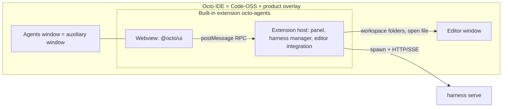

# Octo on VS Code — Agents window design

**Date:** 2026-11-10
**Status:** shelved — the owner chose an own app with an embedded editor instead ([`2026-11-10-code-pane-design.md`](./2026-11-10-code-pane-design.md)). Kept for its findings; the extension and fork recipe were not completed.
**Builds on:** [`2026-11-10-project-harness-design.md`](./2026-11-10-project-harness-design.md) (harness + bridge API), [`2026-11-10-project-harness-ui.md`](./2026-11-10-project-harness-ui.md) (UI)

## Intent

The desktop product becomes a **VS Code-based IDE**. The editor stays a full code editor.
Octo adds its own **Agents window** — a separate OS window with the project-based agent
UI — and VS Code's built-in chat / Agents window is switched off. Unlike a
folder-bound agent pane, the Agents window is **global**: it lists Octo projects, each
of which may span several folders, independent of what the editor window has open.

Hard constraint from the owner: **do not modify VS Code core source.**

## Findings (VS Code 1.145.2 source, verified locally)

- VS Code ships its own Agents window (`src/vs/sessions`, `code --agents`, command
  `workbench.action.openAgentsWindow`). Its actions are gated on chat setup not being
  hidden and on `config.chat.agent.enabled`
  (`OPEN_AGENTS_WINDOW_PRECONDITION`, `contrib/chat/common/constants.ts`).
- `chat.disableAIFeatures` "disables and hides built-in AI features… including chat".
- Extensions may override setting defaults through `contributes.configurationDefaults`,
  and `product.json` supports `builtInExtensions`, branding keys, and
  `extensionEnabledApiProposals` — so a fork can be **configuration + a built-in
  extension**, with zero source patches.
- Any editor tab, including a webview panel, can be moved to a floating auxiliary
  window (`workbench.action.moveEditorToNewWindow`).

## Approaches considered

| Id | Summary | Verdict |
| --- | --- | --- |
| **A** | Patch `src/vs/sessions` to render Octo instead of Copilot sessions | Rejected — violates "do not touch core"; permanent merge burden |
| **B** | **Built-in extension: webview panel hosted in an auxiliary window, plus a patch-free fork recipe** | **Chosen** — works in stock VS Code today and in the fork unchanged |
| **C** | Separate Electron/Tauri app next to VS Code | Rejected — not integrated; cannot open files/workspaces in the editor |

## Architecture



| Path | Role |
| --- | --- |
| `apps/vscode/` | Extension `octo-agents` (extension host + webview bundle of `@octo/ui`) |
| `apps/ide/` | Fork recipe: pinned VS Code tag, `product.json` overlay, bundles the extension as built-in. **No patches under `src/`.** |
| `packages/agent-client` | Adds a transport-agnostic message bridge (webview side) and its host-side server |
| `packages/ui` | Gains an optional `host` capability object; stays shell-agnostic |
| `apps/desktop` | Remains the browser dev host for the UI (`?demo=1`); the Tauri shell is superseded by the IDE |

### Agents window

- Command `octo.openAgentsWindow` ("Octo: Open Agents Window", `Ctrl/Cmd+Shift+A`).
  Creates one `WebviewPanel` (`retainContextWhenHidden`), then moves it to an auxiliary
  window. Singleton: a second invocation focuses the existing window.
- `octo.agentsWindow.openOnStartup` (default `true`) opens it after startup.
- A status-bar item "Agents" in the editor window opens/focuses it.
- A `WebviewPanelSerializer` restores the panel after a window reload.
- Setting `octo.agentsWindow.location`: `window` (default) | `editor` (stay as an editor
  tab — also the fallback where auxiliary windows are unavailable, e.g. web).

### Transport (webview ⇄ extension host ⇄ harness)

The webview never talks to the network (`connect-src 'none'`). `@octo/agent-client`
provides `createMessageClient(port)` → `{ bridge, callHost(action, args), onTheme(cb) }` where
`bridge` implements the existing `Bridge` interface over a message port, and
`serveBridge(port, bridge, { onHost })` for the host side, which forwards to a normal
`createHttpBridge`. `MessagePortLike = { postMessage(msg), onMessage(cb) → dispose }`. Wire format (JSON):

```ts
// webview → host
{ kind: "call"; id: number; method: BridgeMethod; args: unknown[] }
{ kind: "subscribe"; sub: number; projectId: string }
{ kind: "unsubscribe"; sub: number }
{ kind: "host"; id: number; action: HostAction; args: unknown[] }
// host → webview
{ kind: "result"; id: number; ok: true; value: unknown }
{ kind: "result"; id: number; ok: false; error: { status: number; code: string; message: string } }
{ kind: "event"; sub: number; event: BridgeEvent }
{ kind: "open"; sub: number }            // (re)connected — client refetches
{ kind: "error"; sub: number; message: string }
{ kind: "theme"; theme: "dark" | "light" }
```

`BridgeMethod` is every `Bridge` method except `subscribe`. Errors round-trip as
`BridgeError`.

### Harness lifecycle

On activation the extension resolves a bridge: (1) `octo.bridge.url` if set and
healthy; otherwise (2) spawn `harness serve` from `octo.harness.path`, the bundled
`bin/harness` (fork builds), or `harness` on `PATH`, on a free loopback port with
`--data-dir` under the extension's global storage, `--base-url` from
`octo.llm.baseUrl`, API key from `SecretStorage` (`Octo: Set API Key`) or the
environment. The child is killed on deactivate. If nothing can be started the UI shows
its existing offline state with the reason.

### Editor integration (projects, not a folder)

The UI receives a `host` object when embedded:

```ts
type HostCapabilities = {
  openFile?(path: string, folderLabel?: string): void;   // open in the editor window
  openProjectInEditor?(projectId: string): void;         // project folders → workspace folders
  pickFolder?(): Promise<string | null>;                 // native folder dialog for the project form
  theme?: "dark" | "light";                              // follow the IDE theme; hides the UI's own toggle
};
```

- **Open in editor** (top bar): replaces the editor window's workspace folders with the
  project's folders (multi-root). The Agents window itself is not tied to any folder.
- File paths in tool rows are links; they open in an editor group of the main window,
  never inside the Agents window.
- The project form's folder rows get a "Browse…" button using the native dialog.

### Disabling VS Code's own AI surfaces

Through `contributes.configurationDefaults` of the built-in extension (`product.json`
has no settings-defaults key, so the extension is the only patch-free place):
`chat.disableAIFeatures: true` (master switch — it sets the "chat setup hidden" context
that gates the chat view, status entry, title-bar menu and the Open Agents Window
actions), `chat.agent.enabled: false`, `chat.titleBar.openInAgentsWindow.enabled: false`,
`chat.agentsControl.enabled: "hidden"`, `chat.unifiedAgentsBar.enabled: false`,
`chat.commandCenter.enabled: false`, `chat.viewSessions.enabled: false`,
`workbench.secondarySideBar.defaultVisibility: "hidden"`. The manifest also declares
`capabilities.agentsWindow.supported: false`. No built-in code is removed or patched.

Limits found in source (1.145.2):

- Extension defaults apply only to window/resource/machine-overridable settings;
  application-scoped keys (e.g. `chat.agentsWindowBanner.enabled`) cannot be defaulted.
- `product.json` must keep `defaultChatAgent`: without it the entitlement service
  returns early and `chat.disableAIFeatures` stops hiding anything.
- Main-process entry points are not covered by settings: the `--agents` CLI flag,
  `<protocol>://agents/…` links and the Windows jump-list task can still open the
  first-party window. Closing those needs a core patch, which is out of scope.

### What the first-party Agents window teaches us

VS Code's own Agents window is a **separate BrowserWindow with its own workbench entry
point** bound to a fixed empty workspace; sessions own the folders and the window
mirrors the active session's folders. Extensions cannot open, target or extend it, and
`createWebviewPanel` cannot request an auxiliary window, its size or its chrome. So an
extension-hosted window is an **auxiliary window** of an editor window: it closes with
that window, opens at 1024×768 or its last saved bounds, and gets a clean frame only
through `workbench.action.enableCompactAuxiliaryWindow` (setting
`octo.agentsWindow.compact`, default on). A true top-level Agents window that outlives
editor windows would require core changes; that is the known trade-off of the
no-patch constraint. Ideas borrowed: one window for many folders, a single "open
intent" hand-off to the editor, folders mirrored from the active project.

### Fork recipe (`apps/ide`)

`build.sh`: shallow-clone `microsoft/vscode` at the pinned tag → deep-merge
`product.overlay.json` into `product.json` (name "Octo", `applicationName` `octo`,
data folders, Open VSX gallery, no Copilot `defaultChatAgent` wiring) → build
`apps/vscode` and copy it to `extensions/octo-agents` with the harness binary in
`bin/` → `npm ci` → compile → launch script. The script fails if `git status` shows any
change under `src/`.

## Acceptance criteria

1. **No core changes.** The fork recipe applies no patch to VS Code `src/`; the build
   script asserts a clean `src/` tree.
2. **Separate window.** In real VS Code (stable 1.145.x under Xvfb),
   `octo.openAgentsWindow` yields a second OS window containing the Octo UI;
   re-invoking does not create a duplicate. Screenshot evidence.
3. **Works end to end.** With the extension-spawned harness pointed at the mock model
   server, creating a project and sending a message in the Agents window produces the
   delegation tree and a final answer; a sub-agent transcript opens read-only.
4. **Editor stays a code editor.** "Open in editor" makes the editor window's workspace
   folders equal the project's folders; a file link opens that file in the editor
   window; normal editing is unaffected.
5. **Built-in AI off.** With the extension installed, the effective defaults listed
   above are applied (asserted in an integration test), and VS Code's chat UI/Agents
   window entry points are not shown.
6. **Same look.** The Agents window renders the same `@octo/ui` as the reviewed
   browser build, following the IDE's dark/light theme.
7. **Quality gates.** Extension type-checks and bundles; unit tests cover the message
   bridge and harness manager; an `@vscode/test-electron` integration suite passes;
   all existing checks (Go, agent-client, UI lint, desktop build) still pass.
8. **Fork build (best effort in this environment).** The recipe is run; a launched
   Code-OSS "Octo" build with the built-in extension is the target. If the build cannot
   complete here, the failure point is reported precisely.

## Non-goals

- Replacing or restyling the VS Code workbench itself; installers, signing, auto-update.
- Removing the bundled Copilot extension from source (it is disabled by configuration).
- Remote/web (`vscode.dev`, Remote-SSH) support beyond the `editor` location fallback.
